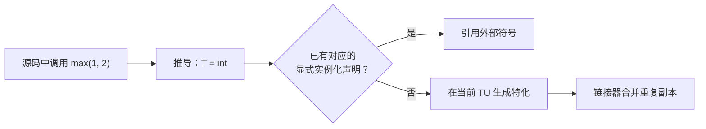

# 01 · 模板基础

> **一句话**：模板不是函数，是一份生成函数的图纸；编译器在你调用它的地方，照着图纸造出一个具体函数——这个过程叫实例化。

## 从一条编译错误开始

先看一段看起来毫无问题的代码：

```cpp
#include <iostream>

template <typename T>
T max(T a, T b) { return a > b ? a : b; }

int main() {
    auto m = max(1, 2.5);
    std::cout << m << '\n';
}
```

Clang 给出的前两行是：

```text
error: no matching function for call to 'max'
note: candidate template ignored: deduced conflicting types for parameter 'T' ('int' vs. 'double')
```

GCC 的措辞略有不同，note 里写的是 `deduced conflicting types for parameter 'T' ('int' and 'double')`，意思完全一样。

很多人看到 `no matching function` 就开始检查函数名是不是打错了。有用的信息在第二行：编译器要给 `T` 找一个类型，第一个实参要求 `T = int`，第二个实参要求 `T = double`，两个要求打架，推导失败。这跟函数名无关，也跟 `>` 运算符无关。

这条错误暴露了模板最核心的机制：**模板定义里只有一个 `T`，调用时必须为它选出一个具体类型。** 接下来的内容都围绕这个类型怎么被选出来、代码怎么被造出来。

## 模板是图纸，不是函数

写下 `template <typename T> T max(T a, T b)` 的时候，你没有定义任何函数。你定义的是一份模板（template）：一段带有“待填参数”的代码形状。编译器看到它时不会生成机器码，只会把它记下来。

代码生成发生在你调用 `max(1, 2)` 的那一刻：编译器把 `T` 代入 `int`，得到

```cpp
int max(int a, int b) { return a > b ? a : b; }
```

这份具体产物叫特化（specialization）——注意这里的“特化”是广义的“一次具体化”，和第 02 篇讲的“显式特化”不是一回事。从模板到具体函数的过程叫实例化（instantiation）。

这个区别有个直接的后果：

```cpp
template <typename T>
void never_called(T) { static_assert(sizeof(T) == 0, "should not happen"); }
```

只要没人调用 `never_called`，这段代码永远不会被实例化，`static_assert` 也就永远不会触发。模板里的错误是惰性的：写出模板不会报错，用到的那一刻才报错。这既是模板灵活的来源，也让错误信息跑到了调用栈深处。

类模板同理：

```cpp
template <typename T>
class Box {
public:
    explicit Box(T v) : value_(std::move(v)) {}
    T& get() { return value_; }
private:
    T value_;
};

Box<int> a{42};
Box<std::string> b{"hello"};
```

`Box` 本身不是一个类型，`Box<int>` 和 `Box<std::string>` 才是两个互不相关的类型。它们的成员函数各自独立实例化：如果 `Box<std::string>` 从没调用过 `get()`，那么 `get()` 就不会为它生成代码。

一个常被问到的小问题：`template <typename T>` 和 `template <class T>` 有区别吗？没有。在模板参数列表里这两个关键字完全等价，`class` 在这里不表示“必须是类类型”。标准库两种写法都有，选一种在项目里统一即可。本书统一用 `typename`，因为它不会让人误以为只能传类。

## 实例化：图纸什么时候变成代码

实例化分三种，理解它们的区别能省下很多链接错误。

隐式实例化（implicit instantiation）是最常见的一种：你用了 `max<int>`，编译器就替你在当前翻译单元里生成一份。同一个特化在多个 `.cpp` 里被用到，每个 `.cpp` 都会生成一份，最后由链接器合并（这依赖“模糊链接”，vague linkage）。这也是为什么模板代码多了以后，目标文件会明显变大。

显式实例化定义（explicit instantiation definition）是你主动下令“就在这里生成”：

```cpp
// max.cpp
#include "max.hpp"
template int max<int>(int, int);       // 显式实例化定义
```

显式实例化声明（explicit instantiation declaration，C++11）是它的搭档，写在头文件里：

```cpp
// max.hpp
extern template int max<int>(int, int);   // 别的 TU 不要自己生成
```

`extern template` 的意思是“这个特化已经在某个地方生成好了，你们别重复劳动”。它是纯优化手段：省编译时间、减小目标文件。代价是必须有人提供那份显式实例化定义，否则链接时会出现 `undefined reference`。



第三种是显式特化（explicit specialization），也就是“我要给某个类型换一套实现”。它长得像模板，但已经不是模板了：

```cpp
template <>
const char* max<const char*>(const char* a, const char* b) {
    return std::strcmp(a, b) > 0 ? a : b;   // 按字典序比较，而不是比指针地址
}
```

这个写法有几个坑（声明顺序、和重载的关系），第 02 篇整章讲。这里只需要记住：**特化是“我已经有一份现成实现”，实例化是“照图纸生成一份”。**

## 推导：编译器怎么猜 T

模板实参推导（template argument deduction）的规则可以用一句话概括：**拿形参的类型去匹配实参的类型，反解出模板参数。** 匹配是逐参数独立进行的，每个参数都得给出同一个 `T`。

推导阶段不做类型转换。`max(1, 2.5)` 里，`1` 是 `int`，`2.5` 是 `double`，编译器不会“贴心”地把 `int` 提升成 `double` 再推导，而是直接判定冲突。少数例外（数组退化成指针、函数退化成函数指针、顶层 `const` 被丢弃）不影响这个结论。

所以要让它工作，有四条路：

```cpp
// 1. 显式指定模板实参：此时不再推导，允许常规隐式转换
max<double>(1, 2.5);          // 返回 double

// 2. 两个类型参数 + 公共类型
template <class T, class U>
std::common_type_t<T, U> max2(T a, U b) { return a > b ? a : b; }
max2(1, 2.5);                 // T=int, U=double，返回 double

// 3. 调用方自己转换（最直白，也最容易被忽略）
max(static_cast<double>(1), 2.5);

// 4. 干脆别混用类型
max(1, 2);
```

第 1 条有个陷阱：`max<int>(1, 2.5)` 能编译，但 `2.5` 会被截断成 `2`，返回 `2` 而不是 `2.5`。Clang 默认会给一条 `-Wliteral-conversion` 警告（实测输出 `implicit conversion from 'double' to 'int' changes value from 2.5 to 2`），但并非所有编译器都会提醒，所以别指望警告来救你。第 2 条更安全，代价是返回类型为值，不是引用。`std::max` 返回 `const T&` 是为了避免拷贝，而跨类型比较时你没法返回一个统一类型的引用。

::: warning 返回引用的代价
写 `template <class T> const T& max(const T& a, const T& b)` 时，如果传入的是临时对象，返回的引用可能指向已经销毁的对象。`std::max(a, b)` 本身没问题，但 `const auto& r = std::max(f(), g());` 就是悬垂引用。这是接口设计问题，不是模板问题，但它经常和模板一起出现。
:::

## 定义为什么必须放在头文件里

C++ 的编译模型是“每个 `.cpp` 独立编译，链接器最后拼起来”。模板的实例化发生在使用点，而使用点所在的翻译单元必须能看到完整定义，否则编译器没法生成代码。

于是下面这种“教科书式”的拆分注定失败：

```cpp
// max.hpp
template <typename T>
T max(T a, T b);            // 只有声明

// max.cpp
#include "max.hpp"
template <typename T>
T max(T a, T b) { return a > b ? a : b; }
template int max<int>(int, int);   // 如果没有这一行

// main.cpp
#include "max.hpp"
int main() { auto m = max(1, 2); }  // 只有声明，无法实例化
```

链接时的报错是：

```text
undefined reference to `int max<int>(int, int)'
```

注意它说的是具体特化找不到，而不是“模板找不到”。编译器在 `main.cpp` 里看到了声明，知道有这么个东西，于是留下一个外部符号；但没人生成 `max<int>` 的定义，链接器就傻了。

所以惯例是把模板的声明和定义都放在头文件里（通常叫 `.hpp` 或 `.h`，并在末尾 `#include` 一个 `.ipp`/`.tpp` 实现文件，纯粹为了排版好看）。代价是：任何包含这个头文件的翻译单元都会重新解析模板定义，编译时间随包含次数线性增长。

如果某个特化被大量使用，又不想让每个 `.cpp` 都实例化一遍，就用上一节的组合拳：

```cpp
// max.hpp
extern template int max<int>(int, int);

// max.cpp
template int max<int>(int, int);
```

这就是所谓“显式实例化 + extern template”模式，在大型项目里很常见。它也是把模板实现藏进 `.cpp` 的唯一正当办法，但只对你列出来的那些特化有效：`max<long>` 还是得走头文件。

## 两阶段查找与两个消歧关键字

模板里的名字查找分两个阶段。这个设计经常让新手困惑，不过直觉很简单。

第一阶段在解析模板定义时进行：所有**不依赖模板参数**的名字，当场查清楚，绑定到当时可见的实体。第二阶段在实例化时进行：**依赖模板参数**的名字，此时才查找——而且只补充“关联命名空间里的名字”（即 ADL）。

这解释了一个常见现象：

```cpp
void helper(int);                 // (1)

template <typename T>
void call(T t) { helper(t); }     // 这里的 helper 在第一阶段绑定到 (1)

void helper(double);              // (2) 声明得太晚

call(1.5);                        // 调用 (1)，因为 (1) 接受 int，1.5 被截断
```

`helper(t)` 里的 `t` 类型依赖 `T`，但函数名 `helper` 的普通查找发生在第一阶段。第二阶段只增加 ADL 找到的候选。(2) 在全局命名空间里，而 `double` 没有关联命名空间，所以它根本没进候选集。这个行为经常被误认为编译器 bug。

::: info 编译器差异
两阶段查找是标准要求，但 MSVC 在很长一段时间里执行得很宽松（默认的 `/permissive` 模式会延迟查找）。从 VS2017 的 `/permissive-` 开始才严格起来。如果你在 MSVC 上能编译、在 GCC/Clang 上不能，先怀疑这类差异，而不是标准本身自相矛盾。
:::

依赖名还带来两个语法上的麻烦：

第一处是当你在模板里写 `T::something` 时，编译器默认认为 `something` 是一个值（静态成员），除非你用 `typename` 明确说它是类型：

```cpp
template <typename T>
void print_first(const T& c) {
    typename T::value_type first = *c.begin();   // 没有 typename 会报错
    std::cout << first;
}
```

GCC 的报错是 `need 'typename' before 'T::value_type' because 'T' is a dependent scope`，Clang 是 `missing 'typename' prior to dependent type name`。原因很朴素：`T` 还没确定，编译器没法知道 `T::value_type` 是类型还是静态成员，只能要求你标注。

第二处是成员模板的名字后面跟 `<` 时，编译器可能把 `<` 当成小于号，要用 `template` 消解：

```cpp
template <typename T>
void call_get(T& t) {
    auto v = t.template get<0>();   // 没有 template 会被解析成 (t.get < 0) > ()
}
```

C++20 起，在某些上下文里可以省略这个 `template` 关键字（P0634），但为了可读性和兼容旧编译器，写出来更稳妥。

## 模板还能长成什么样

三种常见变体，读标准库代码时天天遇到。

**成员模板**（member template）：类里的成员函数自己再带一套模板参数。

```cpp
template <typename T>
class Stack {
public:
    template <typename U>
    void push(U&& value) { data_.push_back(std::forward<U>(value)); }

    T pop() { T v = std::move(data_.back()); data_.pop_back(); return v; }

private:
    std::vector<T> data_;
};
```

`push` 里的 `U&&` 是转发引用（forwarding reference），因为 `U` 是推导出来的。第 05 篇会详细讲这个机制；这里只要知道它和 `Stack` 的 `T` 无关。

**默认模板实参**（default template argument）：类模板从 C++11 起，函数模板同样支持。

```cpp
template <typename T, typename Compare = std::less<T>>
class PriorityQueue {
    // ...
};
```

这让 `PriorityQueue<int>` 和 `PriorityQueue<int, MyCmp>` 都能用。标准库大量使用这个技巧，比如 `std::vector<T, Allocator = std::allocator<T>>`。

**非类型模板参数**（non-type template parameter，NTTP）：模板参数可以是一个值，而不是类型。

```cpp
template <int N>
struct FixedBuffer {
    std::array<std::byte, N> bytes{};
};

FixedBuffer<64> buf;               // N = 64
static_assert(sizeof(buf) == 64);
```

`N` 必须是编译期常量。C++20 放宽了限制：允许浮点数、允许满足“结构化类型”要求的类类型，也允许 `template <auto N>` 让编译器自己推导类型。

```cpp
template <auto N>   // C++20
struct Tag { static constexpr auto value = N; };

Tag<42> a;      // N 是 int
Tag<4.5> b;     // C++20 允许浮点 NTTP
```

非类型参数最常见的用途是固定尺寸的缓冲区、编译期常量配置、以及把字符串字面量作为参数（C++20 的结构化类型支持）。

## 代价：代码膨胀与编译时间

模板的“零成本抽象”是真的，但成本被挪到了别的地方，主要是两处。

**代码膨胀**（code bloat）：每个不同的 `T` 都生成一份独立的机器码。`std::vector<int>`、`std::vector<double>`、`std::vector<MyType>` 是三份完全独立的实现，哪怕它们的逻辑一模一样。这在嵌入式或者 i-cache 敏感的场景里是实打实的开销。

**编译时间**：模板定义必须在每个使用点重新解析和实例化。一个重模板头文件被几百个 `.cpp` 包含，编译时间会以肉眼可见的速度上涨。这也是为什么标准库头文件（`<algorithm>`、`<regex>`）编译起来那么慢。

所以“什么时候该用模板”不是品味问题，而是取舍问题：

| 场景 | 建议 |
| --- | --- |
| 热路径、需要内联、类型在编译期已知 | 模板 |
| 需要运行时多态、异构容器、插件边界 | 虚函数 |
| 需要存“任意可调用对象”、回调注册表 | `std::function` |
| 想避免头文件重编译、追求稳定 ABI | 虚函数或 `std::function` |

一个具体的对照：

```cpp
// 模板：每个 T 一份代码，调用可内联，无间接跳转
template <typename F>
void repeat(int n, F f) { for (int i = 0; i < n; ++i) f(i); }

// std::function：一份代码，一次间接调用，可能堆分配
void repeat(int n, const std::function<void(int)>& f) {
    for (int i = 0; i < n; ++i) f(i);
}
```

在小回调、热循环里，模板版本通常更快；在“注册一堆生命周期很长的回调”这种场景里，`std::function` 的类型擦除反而更合适：它不会让每个调用点都变成一个新的特化。

::: tip 一条实用经验
如果一个函数体只有三五行、参数类型是“任意可调用对象”或“任意容器”，模板通常是首选。如果这个接口要跨 DLL 边界、要存进 `std::vector<std::function<...>>`、或者要被几十种类型调用且每种都生成一大坨代码，那就该考虑类型擦除。
:::

## 怎么读一份模板报错

模板报错动辄几十上百行，但它有固定结构。按这个顺序读，通常几分钟内能定位：

1. **找 `error:` 那一行**，它告诉你哪个调用失败了。
2. **找紧跟其后的第一条 `note: candidate template ignored:`**，那里写着“为什么这个候选被排除”。推导冲突、约束不满足、某个参数无法转换，都在这一行。
3. **找最后一个 `required from here`**，那才是你自己的代码。中间那一堆是标准库内部的实例化链条，可以跳过。

举一个两层嵌套的例子：

```text
error: no matching function for call to 'max'
note: candidate template ignored: deduced conflicting types for parameter 'T' ('int' vs. 'double')
```

再看一个更隐蔽的：

```cpp
template <typename T>
void show(const T& v) { std::cout << v.size(); }

show(42);
```

```text
error: member reference base type 'int' is not a structure or union
note: in instantiation of function template specialization 'show<int>' requested here
```

这里 `error` 指向的是函数体内部（`v.size()`），`note` 才指向你的调用 `show(42)`。这种情况说明模板已经成功实例化，只是实例化出来的代码本身不合法。它和“推导失败”是两类问题，修法也不同：前者要给 `T` 加约束（第 04、06 篇），后者要改调用方式。

## 人话总结

<div class="human-note">
<strong>如果只记住一件事：</strong>模板是一份图纸，编译器在你的调用点按图纸施工。施工需要三样东西：能推导出具体类型、能看到完整图纸（定义在头文件里）、图纸上的每个依赖名都标注清楚（<code>typename</code> / <code>template</code>）。缺哪样，报错就会出现在哪一步。
</div>

## 常见误解

**误解一：模板就是“类型作为参数的函数”。**

不完全是。模板是代码生成规则，它可以被参数化成类型、值、甚至模板本身（模板模板参数）。把它当成函数会带来一个错误预期：以为“传进去的类型在运行时还起作用”。实际上类型在编译期就消失了，运行时没有任何“类型参数”存在。

**误解二：`template <class T>` 只能传类类型。**

`class` 和 `typename` 在这个位置完全等价，`template <class T> T id(T x)` 传 `int` 完全合法。C++ 早期用 `class` 是因为当时 `typename` 还没被引入，属于历史遗留。

**误解三：模板函数不写 `inline` 会重复定义。**

模板的实例化产物有“模糊链接”属性，链接器会自动合并重复副本，不需要你写 `inline`。会重复定义的是显式特化（`template <> ...`），它就是一个普通函数，多个 `.cpp` 里各写一份就会报 `multiple definition`——通常要放到头文件并标 `inline`。

**误解四：模板报错那么长，说明模板不可用。**

长报错是“实例化链条”的副产品，不是复杂度的证明。学会看第一条 note 之后，模板报错的信息量比很多运行时错误更高：它直接告诉你哪个类型不满足哪个条件。

## 本章小结

- 模板是生成代码的图纸，实例化才产生具体的函数/类；写出模板不等于生成代码。
- `typename` 与 `class` 在模板参数列表中完全等价。
- 推导是逐参数匹配、不做类型转换的；`max(1, 2.5)` 失败是因为 `T` 冲突，不是语法问题。
- 模板定义要放在使用点可见的地方，通常就是头文件；`extern template` 是减少重复实例化的优化，不是必需品。
- 名字在哪个阶段可见由两阶段查找决定；依赖名要用 `typename` / `template` 消歧。
- 模板的代价是代码膨胀和编译时间，不是运行时开销；该用虚函数或 `std::function` 的地方不要硬上模板。

## 练习

1. 写一个 `sum` 模板，接受两个同类型参数并返回它们的和。然后回答：`sum(1, 2.5)` 会怎样失败？用三种不同方式让它通过编译，并说明各自的返回值类型。
2. 下面这段代码为什么链接失败？给出两种修法，并说明它们在编译时间上的区别。
   ```cpp
   // math.hpp
   template <typename T> T square(T x);
   // math.cpp
   #include "math.hpp"
   template <typename T> T square(T x) { return x * x; }
   // main.cpp
   #include "math.hpp"
   int main() { return square(3); }
   ```
3. 把下面的代码改成能编译的版本，并解释 `typename` 加在哪里、为什么：
   ```cpp
   template <typename Container>
   void dump(const Container& c) {
       for (Container::const_iterator it = c.begin(); it != c.end(); ++it)
           std::cout << *it << ' ';
   }
   ```
4. 打开 Compiler Explorer，对比 `repeat(1000, [](int){})` 的模板版本和 `std::function` 版本的汇编。找出多出来的那次间接调用，并估算它在每轮循环里的成本。

---

下一篇：[02 · 特化与偏特化](/cpp-tmp/02-specialization)
