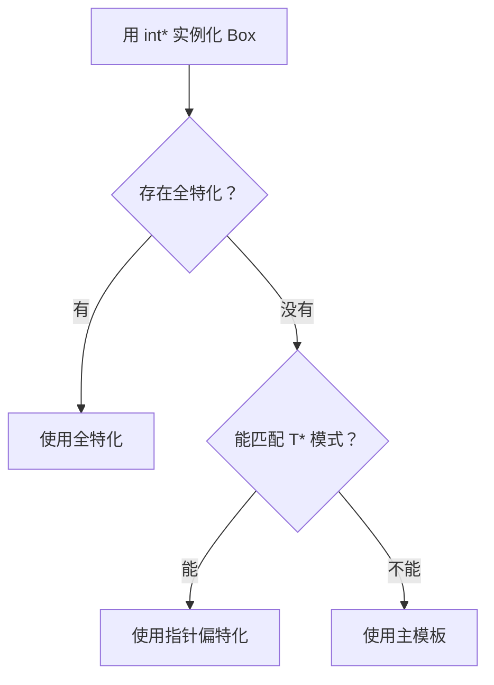

# 02 · 特化与偏特化

> **一句话**：特化是给某一种类型（或某一类形状的类型）单独写一份实现，其余类型继续走主模板；它改变的是“走哪条路”，不改变“有没有这条路”。

## 从“我明明特化了，为什么没生效”开始

下面这段代码，很多人第一次写都会踩：

```cpp
#include <iostream>

template <typename T>
void trace(const T& v) { std::cout << "[generic] " << v << '\n'; }

template <>
void trace<const char*>(const char* const& s) { std::cout << "[specialized] " << s << '\n'; }

void trace(const char* s) { std::cout << "[overload] " << s << '\n'; }

int main() {
    const char* msg = "hello";
    trace(msg);          // 输出：[overload] hello
}
```

写代码的人预期是 `[specialized]`，因为“特化比主模板更具体”。实际输出是 `[overload]`。

原因在于重载决议的顺序：编译器先在候选函数里选一个，普通函数（非模板）优先于模板。只有选中的是主模板时，它才会去看“这个类型有没有对应的特化”。也就是说，**特化不参与函数重载的比较**，它是在主模板被选中之后才生效的一层替换。

如果把 `void trace(const char*)` 那一行删掉，输出就变成 `[specialized]`。这说明特化本身没问题，只是它排不到前面。

这条规则引出本章最实用的一条工程建议：**函数模板需要定制行为时，用重载，不要用特化。** 类模板没有这个问题，因为类模板没有“重载决议”，只有“选哪个特化”。

## 类模板的全特化

全特化（explicit specialization）是把所有模板参数都写死，得到一个普通类：

```cpp
template <typename T>
class Box {
public:
    explicit Box(T v) : value_(std::move(v)) {}
    T& get() { return value_; }
private:
    T value_;
};

template <>
class Box<bool> {
public:
    explicit Box(bool v) : value_(v) {}
    bool get() const { return value_; }
    unsigned char packed() const { return value_ ? 1 : 0; }   // 额外接口
private:
    bool value_;
};
```

`Box<bool>` 和 `Box<int>` 是两个毫不相干的类型。它可以有完全不同的成员、布局、甚至不同的构造函数签名。这一点既强大又危险。调用方看到 `Box<T>` 就假设“有 `get()` 返回 `T&`”，到 `Box<bool>` 这里变成了 `bool`（不是引用），泛型代码就会编译失败。

::: warning 全特化不是模板
`template <> class Box<bool>` 定义的是一个普通类。这意味着它的成员函数如果在头文件里定义，需要标 `inline`，否则多个翻译单元包含这个头文件时会报 `multiple definition`。主模板的成员函数不受此限，因为它们是模板，有模糊链接。
:::

全特化必须在使用之前可见。如果某个 `.cpp` 先用 `Box<bool>` 触发了隐式实例化，之后才看到特化声明，标准说这是“格式错误但不需要诊断”（ill-formed, no diagnostic required，简称 IFNDR）。编译器可能什么都不说，也可能给你一个莫名其妙的重复定义错误。实践中的做法很简单：把特化写在主模板后面，紧挨着，放在同一个头文件里。

## 偏特化：用模式去匹配类型

偏特化（partial specialization）只固定一部分参数，或者固定参数的“形状”：

```cpp
template <typename T>
class Box<T*> {                 // 匹配所有指针类型
public:
    explicit Box(T* p) : ptr_(p) {}
    T& get() { return *ptr_; }
private:
    T* ptr_;
};

template <typename T>
class Box<T&> {                 // 匹配所有左值引用
public:
    explicit Box(T& r) : ref_(r) {}
    T& get() { return ref_; }
private:
    T& ref_;
};
```

读法是把 `<T*>` 当成一个模式：任何能写成 `U*` 的类型都能匹配，匹配上就把 `U` 绑给 `T`。于是 `Box<int*>` 走指针版，`Box<int&>` 走引用版，`Box<int>` 走主模板。

偏特化能匹配的结构比直觉多：

```cpp
template <typename T, typename Alloc>
class Box<std::vector<T, Alloc>> { /* 专门处理 vector */ };

template <typename R, typename... Args>
class Box<R(*)(Args...)> { /* 专门处理函数指针 */ };
```

当多个偏特化都能匹配时，编译器选**最特殊**的那个。这里的“特殊”有精确定义（偏序比较），直觉是“能被另一个模式匹配、但反过来不行”。所以：

```cpp
template <typename T> class Box;              // 主模板
template <typename T> class Box<T*>;          // 匹配所有指针
template <> class Box<int*>;                  // 只匹配 int*
```

`Box<int*>` 三者都能匹配，选全特化；`Box<double*>` 选指针偏特化。如果两个偏特化谁都不比谁特殊，就是歧义（ambiguous partial specializations），编译直接报错。这种错误通常意味着两个模式有重叠区域，需要给重叠部分补一个更特殊的版本。



一个常被忽略的限制：**函数模板不能偏特化**，只能全特化。想要“对某一类类型特殊处理”，只能用重载（下一节）或者把逻辑搬进类模板。

## 函数模板：用重载，不要用特化

除了开头那个“特化输给重载”的例子，函数模板特化还有三个坑。

**坑一：所谓“偏特化”其实是新的主模板。** 你没法写 `template <typename T> void f(T*)` 作为 `f(T)` 的特化；写出来的是一个新主模板重载，参与重载决议，行为和你想的可能不同。

**坑二：声明顺序会变成 IFNDR。** 看这段：

```cpp
template <typename T>
void trace(const T& v) { std::cout << "[generic] " << v << '\n'; }

int main() {
    trace(42);                    // 这里隐式实例化了 trace<int>
    // ...
}

template <>                     // 特化声明得太晚
void trace<int>(const int& v) { std::cout << "[int] " << v << '\n'; }
```

按标准这是 IFNDR（ill-formed, no diagnostic required）：`trace<int>` 已经在 `main` 里被实例化了，之后再声明特化属于违规。标准不要求编译器为此报错，所以各家反应不同。实测 Clang 22.1 会直接给出错误 `explicit specialization of 'trace<int>' after instantiation`，并附带一条 note 指出首次实例化的位置；有的编译器只给警告，有的干脆不吭声。一旦不报错，你得到的就是“有时候生效、有时候不生效”的行为。这类 bug 极难排查，因为它依赖编译顺序。

**坑三：和 ADL、默认参数、`const` 限定的交互很绕。** 特化的签名必须和主模板推导出来的签名逐字匹配。`const T&` 和 `T` 差一个 `const` 就是两个东西，编译器只会告诉你“没有匹配的特化”，不会告诉你差在哪。

所以工程上的结论很干脆：

- 需要针对某类型换行为 → 写一个普通函数重载（非模板优先，行为可预测）。
- 需要针对某一类形状（指针、容器）换行为 → 用 `if constexpr` 或 tag dispatch。
- 需要针对某类型换类型层面的行为（比如 `std::hash`）→ 类模板特化，这是它该待的地方。

## 标准库里的特化：hash 与 numeric_limits

标准库用特化实现了大量“对某类型开小灶”的设施，最典型的是两个。

先看 `std::hash`。想让自定义类型能作为 `unordered_map` 的键，就得提供哈希：

```cpp
struct UserId {
    int raw;
    bool operator==(const UserId&) const = default;
};

namespace std {
template <>
struct hash<UserId> {
    std::size_t operator()(const UserId& id) const noexcept {
        return std::hash<int>{}(id.raw);
    }
};
}  // namespace std
```

三条硬性要求：必须写在 `namespace std` 里；必须在 `unordered_map<UserId, ...>` 第一次实例化之前可见；**相等对象的哈希必须相等**（否则容器会“找不到”明明存在的键，而且不会报错，只会行为诡异）。

再看 `std::numeric_limits`。默认版本对所有类型都返回 `is_specialized = false`，数值全是 0。想让自己写的定点数类型正确参与泛型代码（比如“取该类型的最大值”），就得特化它：

```cpp
template <>
struct std::numeric_limits<MyFixed> {
    static constexpr bool is_specialized = true;
    static constexpr MyFixed max() noexcept { return MyFixed::from_raw(INT32_MAX); }
    static constexpr MyFixed min() noexcept { return MyFixed::from_raw(INT32_MIN); }
    static constexpr int digits = 31;
    // 其余成员按需要补，没写的会退回默认值
};
```

::: warning 不要特化标准模板去“修”内置类型
给 `std::vector<int>` 加一个特化、或者给 `std::hash<float>` 换实现，都是未定义行为。标准只允许你为自己的类型特化标准模板，并且只在明确写出来的那几个模板上（`hash`、`numeric_limits`、`formatter`、`iterator_traits` 等）。越界之后，程序在升级编译器时可能突然崩掉。
:::

C++20 之后还有一个新的常用特化点：`std::formatter`。它决定 `std::format("{}", x)` 怎么打印你的类型，写法和 `hash` 类似，但需要实现 `parse` 和 `format` 两个成员，比哈希复杂一些。

### 真实库里的扩展点：formatter

标准库把 `formatter` 设计成**留给用户特化**的接口，所以它是“特化”这个机制在生产代码里最常见的样子：

```cpp
struct Point { int x; int y; };

template <>
struct std::formatter<Point> {
    constexpr auto parse(std::format_parse_context& ctx) { return ctx.begin(); }
    auto format(const Point& p, std::format_context& ctx) const {
        return std::format_to(ctx.out(), "({}, {})", p.x, p.y);
    }
};

std::format("p = {}", Point{1, 2});      // p = (1, 2)
```

`parse` 的返回值决定“这个 formatter 认识哪些格式规格”。上面这版直接返回 `ctx.begin()`，意思是“我不接受任何额外规格”——如果你写 `std::format("{:>12}", p)`，它会因为在解析阶段没吃掉 `>12` 而报一条“replacement field misses a terminating `}`”。这不是 bug，而是特化点要求你显式声明支持范围。

更常见的工程做法是**不特化，改用 ADL 重载**。序列化库 nlohmann/json 就是例子：用户为自己的类型写 `to_json(json&, const T&)` 和 `from_json(const json&, T&)`，库通过无限定调用找到它们。这样做的原因正是本章开头那条：函数模板不能偏特化，而 ADL 重载既支持任意类型，又能让调用点保持 `j = p;` 这种自然写法。

## tag dispatch：用重载代替 if

tag dispatch（标签分派）是老派但常用的技巧：把“编译期条件”编码成一个空类型，用重载决议去选实现。

```cpp
namespace detail {

template <typename It>
void advance_impl(It& it, int n, std::random_access_iterator_tag) {
    it += n;                                  // 一步到位
}

template <typename It>
void advance_impl(It& it, int n, std::input_iterator_tag) {
    while (n-- > 0) ++it;                     // 只能一步一步走
}

}  // namespace detail

template <typename It>
void advance(It& it, int n) {
    detail::advance_impl(it, n,
        typename std::iterator_traits<It>::iterator_category{});
}
```

这里没有 `if`，也没有运行时判断：`iterator_category` 是一个空类，编译器看到实参类型就知道该调哪个重载，另一个重载根本不会被实例化。这正是标准库 `std::advance` 的经典实现方式。

tag dispatch 的优点是零开销且可扩展：加一个新的迭代器类别，只需要加一个重载，不用改任何 `if` 链。缺点是调用链变长，读代码时要跳好几层才能看到实现。C++17 之后，同样的事情可以写成 `if constexpr`：

```cpp
template <typename It>
void advance(It& it, int n) {
    using Cat = typename std::iterator_traits<It>::iterator_category;
    if constexpr (std::is_base_of_v<std::random_access_iterator_tag, Cat>) {
        it += n;
    } else {
        while (n-- > 0) ++it;
    }
}
```

功能等价，可读性更好，代价是所有分支都得在语法上合法（哪怕不实例化）。两种写法在工程里都能见到，读老代码时认识 tag dispatch 就够了。

## 一个实用例子：is_pointer 与 remove_reference

把前面的机制拼起来，就能写出标准库 `type_traits` 的简化版。先看 `is_pointer`：

```cpp
template <typename T> struct is_pointer : std::false_type {};
template <typename T> struct is_pointer<T*> : std::true_type {};
template <typename T> struct is_pointer<T* const> : std::true_type {};
template <typename T> struct is_pointer<T* volatile> : std::true_type {};
template <typename T> struct is_pointer<T* const volatile> : std::true_type {};
```

主模板说“默认不是指针”，四个偏特化覆盖了指针的四种 cv 组合。为什么不能只写 `T*` 一个？因为偏特化的模式匹配是精确的：`int* const` 这个类型（顶层 `const` 的指针）匹配不上模式 `T*`，需要单独列出来。这也说明偏特化做的是结构匹配，不是“子类型判断”：`const` 也算结构的一部分。

再看 `remove_reference`：

```cpp
template <typename T> struct remove_reference      { using type = T; };
template <typename T> struct remove_reference<T&>  { using type = T; };
template <typename T> struct remove_reference<T&&> { using type = T; };

template <typename T>
using remove_reference_t = typename remove_reference<T>::type;

static_assert(std::is_same_v<remove_reference_t<int&>, int>);
static_assert(std::is_same_v<remove_reference_t<int&&>, int>);
static_assert(std::is_same_v<remove_reference_t<const int&>, const int>);
```

这里能看出 trait 的标准形状：主模板给一个“默认答案”，偏特化给出“特殊情况答案”，两者都通过 `::type`（或 `::value`）暴露结果。`_t` 后缀的别名模板是 C++14 加的语法糖，让调用点不用写 `typename ...::type`。

::: tip 别自己重造这些轮子
上面两个实现是教学版。标准版的 `is_pointer`、`remove_reference` 还处理了一些边角（比如函数类型、`void` 的 cv 组合），而且在 `constexpr` 上下文、编译期诊断上做了优化。真写代码时用 `<type_traits>` 里的版本，这里只是让你看懂它们是怎么拼出来的。
:::

## 特化还是 if constexpr

两者都能实现“按类型分派”，选择标准是**分派发生在哪一层**。

| 维度 | 类模板特化 | `if constexpr` |
| --- | --- | --- |
| 能改变的东西 | 成员、布局、基类、接口 | 只有函数体里的控制流 |
| 代码位置 | 分散在多个声明里 | 集中在一个函数里 |
| 可读性 | 类型多时更清晰，类型少时更啰嗦 | 分支少时最直观 |
| 报错信息 | 差（“没有匹配的特化”） | 较好（指向具体分支） |
| 能否对外扩展 | 能（别人可以加特化） | 不能 |

一条经验：不同类型需要不同的数据成员或不同的类接口时，用特化；同一个算法只是在不同类型上走不同分支时，用 `if constexpr`。标准库自己的演进也印证了这一点：`std::copy` 早期用 tag dispatch 处理“能不能 memmove”，现在很多实现改成了 `if constexpr`，因为逻辑确实是同一个函数体。

## 人话总结

<div class="human-note">
<strong>如果只记住一件事：</strong>特化是“换实现”，不是“加重载”。类模板靠模式匹配选最特殊的那个特化；函数模板不行，重载决议在特化之前就结束了。所以给函数定制行为要写重载，给类型定制行为才写特化。
</div>

## 常见误解

**误解一：特化会自动优先于主模板被调用。**

对类模板基本成立（选最特殊的匹配），对函数模板不成立。函数调用先做重载决议，普通函数和主模板先比，特化只是主模板被选中后的一层替换。所以“我特化了 `trace<int>`，为什么调用的还是普通重载”是个结构性问题，不是编译器 bug。

**误解二：函数模板可以偏特化。**

不可以。`template <typename T> void f(T*)` 写出来是一个新的主模板重载，不是 `f(T)` 的偏特化。两者在重载决议里是竞争关系，而不是覆盖关系。

**误解三：特化可以随便改接口。**

语法上可以（`Box<bool>` 完全可以没有 `get()`），但工程上是陷阱。任何接受 `Box<T>` 的泛型代码都假设接口一致，一旦某个特化偷偷改了签名，错误会在很远的地方炸开。特化的正确用法是保持接口不变，只换实现或存储。

**误解四：偏特化只是写起来方便的语法糖。**

不是。偏特化是类型选择机制：编译器真的在类型层面做模式匹配和偏序比较。它决定了哪个类会被实例化，进而决定了布局、大小、ABI。这也是为什么标准库要用它来实现 `std::tuple`、`std::function`、`std::variant` 这些“结构随类型变化”的设施。

## 本章小结

- 全特化把所有参数写死，得到一个普通类；偏特化用模式匹配一类类型。
- 多个特化都能匹配时，编译器选最特殊的；无法排序就是歧义错误。
- 函数模板不要用特化做定制：重载决议在前，特化在后，而且声明顺序错误会变成 IFNDR。
- `std::hash`、`std::numeric_limits`、`std::formatter` 是标准库留给用户的合法特化点。
- tag dispatch 用空类型 + 重载在编译期分派，零开销但调用链长；新代码优先考虑 `if constexpr`。

## 练习

1. 给 `Box<T>` 写一个指针偏特化，要求 `get()` 返回 `T&`（解引用），并额外提供 `bool empty() const`。然后写一段泛型函数，同时接受 `Box<int>` 和 `Box<int*>`，看看接口不一致会带来什么问题。
2. 为下面的类型特化 `std::hash`，并放进 `std::unordered_map` 验证能找到元素：
   ```cpp
   struct Point { int x; int y; bool operator==(const Point&) const = default; };
   ```
   提示：哈希要同时用上 `x` 和 `y`，否则大量冲突会让查找退化成线性。
3. 下面这段代码为什么不一定是“错误”，却一定不该写？给出修正：
   ```cpp
   template <typename T> void f(T) {}
   void g() { f(1); }
   template <> void f<int>(int) {}
   ```
4. 把本章 `advance` 的 tag dispatch 版本改写成 `if constexpr` 版本，并说明改写后失去了什么能力（提示：想想第三方迭代器类型能不能通过加一个重载来支持）。

---

上一篇：[01 · 模板基础](/cpp-tmp/01-template-basics) · 下一篇：[03 · constexpr 编译期计算](/cpp-tmp/03-constexpr)
