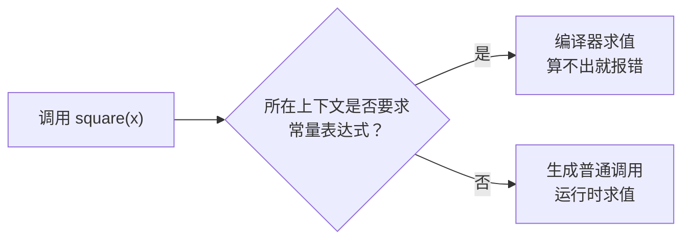

# 03 · constexpr 编译期计算

> **一句话**：`constexpr` 让编译期计算回到了普通函数的写法——同一份代码既能在编译期算出常量，也能在运行时正常执行。

## 从一条“不是常量表达式”的报错开始

假设你要在编译期生成一张固定大小的表：

```cpp
int square(int x) { return x * x; }

template <int N>
struct Buffer { char bytes[N]; };

Buffer<square(4)> buf;   // 编译失败
```

Clang 的报错是：

```text
error: non-type template argument is not a constant expression
note: non-constexpr function 'square' cannot be used in a constant expression
```

GCC 会说得更直白一点：`'square(4)' is not a constant expression`。

`square` 本身没写错。**编译器必须在编译期就知道 `N` 的值**，而 `square` 是一个普通函数：按 C++ 的模型，普通函数调用发生在运行时，编译器没有义务（也没有权限）替你先算一遍。

把 `int square(int x)` 改成 `constexpr int square(int x)`，这段代码立刻就能编译：`Buffer<16>` 被实例化出来，`square(4)` 在编译期求值。

改动只有两个字，`square` 在运行时的行为一点没变。这是 `constexpr` 最容易被误解的地方，也是它最有价值的地方：**它不是“编译期专用函数”，而是“允许在编译期求值的函数”。**

## constexpr 到底承诺了什么

`constexpr` 出现在两个位置，含义不同。

修饰变量时，它要求“用常量表达式初始化”，并且变量本身是 `const`：

```cpp
constexpr int kMax = 100;                        // OK
constexpr int kSize = kMax * 2;                  // OK
int n = 5;
constexpr int kBad = n;                          // 错误：n 不是常量表达式
```

修饰函数时，它承诺“只要实参是常量表达式，这次调用就可以在编译期完成”：

```cpp
constexpr int square(int x) { return x * x; }

constexpr int a = square(4);   // 编译期算，a 是常量
int b = 3;
int c = square(b);             // 运行时算，普通函数调用
```

同一个 `square`，两次调用的求值时机不同。决定时机的是调用所在的上下文，不是函数本身：



所谓“要求常量表达式的上下文”，常见的有：数组维度、`static_assert` 的条件、非类型模板实参、`constexpr` 变量的初始化、`case` 标签、位域宽度。除此之外的地方，`constexpr` 函数就是一个普通函数。

::: tip 头文件里的常量
命名空间作用域的 `constexpr` 变量默认是内部链接（因为它隐含 `const`），每个包含头文件的翻译单元各有一份副本。C++17 起可以写 `inline constexpr int kMax = 100;`，保证全程序只有一个实体，取地址的结果也一致。
:::

## static_assert：把检查提前到编译期

`static_assert` 是 `constexpr` 最直接的搭档：条件必须是常量表达式，为假就中断编译并打印消息。

```cpp
static_assert(sizeof(Header) == 16, "Header 必须是 16 字节，检查是否有填充或对齐变化");
```

它有几个常用的位置：

```cpp
// 1. 命名空间作用域：检查平台假设
static_assert(sizeof(void*) == 8, "本项目只支持 64 位平台");

// 2. 类作用域：检查布局
struct Packet {
    std::uint32_t id;
    std::uint32_t len;
    static_assert(sizeof(Packet) == 8, "Packet 不能有填充");
};

// 3. 函数作用域：检查模板参数
template <typename T>
void write_all(const T& v) {
    static_assert(std::is_trivially_copyable_v<T>, "write_all 只接受可平凡复制的类型");
    // ...
}
```

C++17 起允许不带消息的 `static_assert(cond)`，但消息还是该写：报错时它是唯一能解释“为什么这条约束存在”的东西。写 `static_assert(cond, "failed")` 等于没写。

一个实用的技巧：`static_assert` 可以检查编译期的计算结果，等于给 `constexpr` 函数写单元测试。库的作者经常这么干——用一批已知答案的输入，在头文件里静态验证实现没写错。

## 从模板递归到 constexpr 函数

在 C++11 之前，编译期计算基本只能靠模板递归。阶乘的经典写法是：

```cpp
template <int N>
struct Fact {
    static constexpr int value = N * Fact<N - 1>::value;
};

template <>
struct Fact<0> {
    static constexpr int value = 1;
};

static_assert(Fact<5>::value == 120);
```

这段代码能工作，代价却很明显。需要写一个终止特化；`Fact<-1>` 会无限递归，直到编译器报“template instantiation depth exceeded”；报错里全是模板实例化链条；你也没法在里面写循环。

C++14 放宽了 `constexpr` 函数的限制（允许局部变量、循环、多个 `return`），同一件事可以写成：

```cpp
constexpr int fact(int n) {
    int result = 1;
    for (int i = 2; i <= n; ++i) result *= i;
    return result;
}

static_assert(fact(5) == 120);
```

这已经不是“技巧”，就是普通的循环。斐波那契同理：

```cpp
constexpr long long fib(int n) {
    long long a = 0, b = 1;
    for (int i = 0; i < n; ++i) { auto t = a + b; a = b; b = t; }
    return a;
}

static_assert(fib(10) == 55);
```

对比一下两种写法：

| 维度 | 模板递归 | `constexpr` 函数 |
| --- | --- | --- |
| 写法 | 需要终止特化，逻辑是“展开”的 | 普通循环/递归，逻辑是“顺序”的 |
| 报错 | 实例化链条，难读 | 指向具体那一行 |
| 编译时间 | 深度大时急剧上升 | 通常更可控，但循环次数也是成本 |
| 能否调试 | 基本不能 | 可以抽出来在运行时跑，用调试器看 |
| 参数范围 | 只能是模板实参（编译期常量） | 编译期常量或运行时值都行 |

::: warning 别在编译期写指数级递归
朴素的递归 `fib`（`return n < 2 ? n : fib(n-1) + fib(n-2);`）在编译期是指数级的求值成本。`fib(40)` 在运行时要几秒，在编译期可能直接触发编译器的求值上限。编译期能承受的计算量比运行时小得多，写 `constexpr` 时优先用循环和记忆化。
:::

## if constexpr：编译期的分支

C++17 的 `if constexpr` 让“按类型选分支”不用再绕 SFINAE（第 04 篇）：

```cpp
template <typename T>
std::string stringify(const T& v) {
    if constexpr (std::is_pointer_v<T>) {
        return v ? "non-null pointer" : "null pointer";
    } else if constexpr (std::is_integral_v<T>) {
        return std::to_string(v);
    } else {
        return std::string(v);       // 要求 T 能构造 std::string
    }
}
```

**当条件依赖模板参数时，被丢弃的分支不会被实例化。** 所以 `stringify(42)` 不会去检查 `std::string(42)` 是否合法——那个分支根本没被实例化。这就是它能替代一大类 SFINAE 的原因。

它和普通 `if` 的区别在于：

- 普通 `if` 的两个分支都会被编译，运行时才选一个。
- `if constexpr` 在模板里会只保留被选中的分支，另一分支不产生代码、不实例化。
- 条件必须是常量表达式（不能依赖运行时值）。

但有两个容易踩的边界。

边界一：在非模板函数里，两个分支都会被完整检查。

```cpp
void f() {
    if constexpr (sizeof(int) == 4) {
        int x = "hello";      // 仍然编译失败
    }
}
```

这里没有模板参数，条件不依赖任何待定的东西，编译器没理由丢弃分支，它照样要检查语法和类型。`if constexpr` 的“丢弃”能力只在模板实例化时生效。

边界二：被丢弃的分支仍然要“看起来合法”。名字查找、语法解析照常进行，只是不实例化依赖模板参数的部分。所以 `if constexpr` 不能拯救一个拼错的函数名，也不能让未声明的类型通过。

## consteval 与 constinit

C++20 加了两个容易和 `constexpr` 混淆的关键字。

`consteval`（立即函数，immediate function）要求**每一次调用都必须在编译期求值**：

```cpp
consteval int square(int n) { return n * n; }

constexpr int a = square(4);   // OK
int b = 3;
int c = square(b);             // 错误：b 不是常量表达式
```

它适合那些“只在编译期有意义”的接口，比如生成查找表、在编译期把字符串字面量转成哈希、强制某个参数必须是字面量：

```cpp
consteval std::array<int, 8> make_table() {
    std::array<int, 8> t{};
    for (int i = 0; i < 8; ++i) t[i] = i * i;
    return t;
}

constexpr auto kTable = make_table();
```

`constinit` 管的是另一件事：它要求变量（必须是静态存储期）在**编译期完成初始化**，但变量本身不是 `const`，运行时可改：

```cpp
constinit int g_counter = 0;      // 常量初始化，之后可以 ++g_counter
int g_a = 0;                      // 也可能是常量初始化，但不保证

int compute();
constinit int g_b = compute();    // 错误：compute() 不是常量表达式
```

它解决的是“静态初始化顺序问题”（static initialization order fiasco）：只有常量初始化的全局变量，才保证在 `main` 之前、在任何动态初始化之前就绪。

三者对比：

| 关键字 | 作用对象 | 承诺 | 能否运行时使用 |
| --- | --- | --- | --- |
| `constexpr` | 变量 / 函数 | 可参与常量表达式 | 变量隐含 `const`；函数可以 |
| `consteval` | 函数 | 每次调用都必须编译期求值 | 不能 |
| `constinit` | 静态存储期变量 | 初始化必须是常量初始化 | 变量本身可修改 |

## std::is_constant_evaluated 与它的陷阱

有时同一个 `constexpr` 函数想在编译期和运行时走不同实现——比如编译期用手写循环，运行时调用一个高度优化的库函数：

```cpp
constexpr double power(double base, int exp) {
    if (std::is_constant_evaluated()) {
        double r = 1.0;
        for (int i = 0; i < exp; ++i) r *= base;
        return r;
    } else {
        return std::pow(base, exp);     // 非 constexpr，只在运行时走这里
    }
}
```

`std::is_constant_evaluated()` 在常量求值期间返回 `true`，否则返回 `false`。看着很干净，但有三个坑。

**坑一：它只在“这一次求值”里有意义。** `if (std::is_constant_evaluated())` 不是“编译期开关”，它就是一次普通的条件判断；在运行时上下文里永远走 `false` 分支。想根据模板参数做选择，要用 `if constexpr`，两者解决的完全不是一件事。

**坑二：放在 `if constexpr` 的条件里没有意义，而且容易写错。**

```cpp
if constexpr (std::is_constant_evaluated()) { /* ... */ }   // 别这么写
```

条件在模板定义时就要确定，`is_constant_evaluated()` 在那里并不是常量表达式语境下的求值。这个用法被标准委员会认定为缺陷，C++23 补了一个专门的语法 `if consteval`：

```cpp
constexpr double power(double base, int exp) {
    if consteval {                     // C++23
        // 编译期路径
    } else {
        // 运行时路径
    }
}
```

**坑三：`constexpr bool b = std::is_constant_evaluated();` 恒为 `true`**，因为初始化本身就是常量求值。拿它当“这个函数是不是被编译期调用”的全局标志会得到反直觉的结果。

## 编译期计算的边界

`constexpr` 不是“把运行时搬到编译期”的万能开关，它有硬边界和软边界。

**硬边界：语言层面不允许的操作。** 在常量求值中不能出现 `reinterpret_cast`、`asm`、`goto`（C++23 之前）、会导致未定义行为的操作（越界、有符号溢出、空指针解引用）。动态分配在 C++20 起有限放开：可以在常量求值里 `new`，但必须在同一次求值内 `delete` 掉，所以不能返回一个指向堆内存的常量对象。I/O 完全不支持——编译期没有 `printf`。

**软边界：实现定义的资源上限。** 标准允许编译器拒绝“太复杂”的常量表达式。GCC 有 `-fconstexpr-ops-limit` 和 `-fconstexpr-depth`，Clang 有 `-fconstexpr-steps`，超了会报 “constexpr evaluation hit maximum step limit”。这意味着同一段代码在不同编译器、不同优化级别下可能一个能过一个不能过。写库的时候不要把编译期计算推到临界点。

**工程边界：编译时间、可调试性、报错质量。** 编译期算一张 10 万项的质数表，会让每个包含该头文件的翻译单元都多花几十毫秒；编译期逻辑无法打断点，只能靠 `static_assert` 把中间值“逼”出来——故意写一个失败的断言，看编译器在诊断里化简出的值（较新的 GCC/Clang 会显示，但不保证）。所以：编译期计算适合“小、稳定、频繁使用”的东西（配置常量、尺寸计算、类型判断），不适合“大、一次性的数据加工”。

## 真实用法：把字符串折成常量

编译期计算最日常的落点是**哈希**：日志 tag、命令名、配置键，都是运行时要比较的字符串，而比较本身可以提前到编译期。

```cpp
consteval std::uint32_t fnv1a(std::string_view s) {
    std::uint32_t h = 2166136261u;          // FNV 偏移基准
    for (unsigned char c : s) {
        h ^= c;
        h *= 16777619u;                     // FNV 质数
    }
    return h;
}

consteval std::uint32_t operator""_h(const char* s, std::size_t n) {
    return fnv1a(std::string_view(s, n));
}

constexpr const char* dispatch(std::uint32_t cmd) {
    switch (cmd) {
    case "help"_h:    return "print help";
    case "version"_h: return "print version";
    default:          return "unknown";
    }
}
```

`"help"_h` 在编译期就变成了一个 `std::uint32_t`；`switch` 里比较的是整数，运行时不再有字符串比较。这个技巧在日志系统（event tag）、命令行解析、配置表里反复出现，原因很简单：**字符串常量是编译期已知的，比较它的成本却落在运行时**。

两个必须说清楚的限制：

- **哈希会碰撞。** 32 位哈希在几十万条字符串的规模上，碰撞概率已经不可忽略。安全敏感或必须精确匹配的场合，要么用 64 位、要么在 `case` 里再比较一次原串（编译期能拿到 `size` 也行）。日志 tag 这类“撞了最多打个错日志”的场合才适合裸哈希。
- **`consteval` 卡死了运行时路径。** 用户输入的命令名不能走 `"..."_h`，因为它的长度在运行时才知道。所以真实系统通常是“编译期表 + 运行时兜底”：已知命令走哈希跳转，未知命令走一次普通字符串比较再报错。

顺带一提，`std::hash` 的标准实现没有规定必须能在编译期求值（各家的实现不同）。自己写一个 `consteval` 版本，是唯一能保证“它真的在编译期算完”的办法。

## 人话总结

<div class="human-note">
<strong>如果只记住一件事：</strong><code>constexpr</code> 的准确定义是“允许在编译期求值的函数”，不是“编译期函数”。同一份代码，调用点决定它在什么时候跑；决定求值时机的是上下文，不是关键字。
</div>

## 常见误解

**误解一：`constexpr` 函数只在编译期执行。**

不是。`constexpr` 只是“允许”，不是“强制”。`square(b)` 里 `b` 是运行时变量，这行代码生成的就是普通函数调用。强制编译期求值的是 `consteval`。

**误解二：`constexpr` 函数一定是 `const` 的。**

变量是的（`constexpr` 变量隐含 `const`），函数不是。C++14 起，`constexpr` 成员函数可以修改对象，只要整个求值过程仍是常量表达式；它也可以重载，C++20 起还可以是虚函数。

**误解三：写了 `constexpr` 就一定能编译期求值。**

不一定。实参必须是常量表达式；函数体不能触碰上文的硬边界；还不能超过编译器的步数上限。任何一条不满足，编译器都会退回到运行时（如果上下文允许）或者直接报错（如果上下文要求常量）。

**误解四：`consteval` 就是更强的 `constexpr`。**

两者约束的东西不同。`constexpr` 约束“这个函数可以在编译期求值”，`consteval` 约束“这个函数只能在编译期求值”。后者的用途是把“必须在编译期”写进 API，让误用在调用点立刻暴露，而不是等到某个常量上下文里才炸。

## 本章小结

- `constexpr` 函数能否编译期求值，取决于调用上下文，而不是函数本身。
- 命名空间作用域的 `constexpr` 变量是内部链接；C++17 起用 `inline constexpr` 避免多份副本。
- `static_assert` 是最便宜的编译期测试，条件必须能在编译期算出。
- C++14 之后，编译期计算用普通循环写就行，不必再堆模板递归。
- `if constexpr` 的丢弃只发生在模板实例化时；非模板里两个分支都会检查。
- `consteval` 强制编译期求值，`constinit` 只管静态初始化时机，`constexpr` 两者都不强制。
- 编译期计算有步数上限（实现定义），也有调试和报错上的真实成本。

## 练习

1. 写 `constexpr` 版本的 `pow(base, exp)`（整数版）和 `gcd(a, b)`，并用 `static_assert` 覆盖至少三组边界：`exp == 0`、负数、`gcd(a, 0)`。
2. 用 `if constexpr` 写一个 `describe<T>()`：对整数返回 `"integer"`，对浮点返回 `"float"`，对指针返回 `"pointer"`，其他返回 `"other"`。再把它改写成对未知类型也能通过编译的版本（提示：最后的 `else` 不能依赖 `T` 的任何成员）。
3. 解释为什么下面这段代码在运行时也能正常工作，以及 `if constexpr` 在这里有没有必要：
   ```cpp
   constexpr int clamp(int v, int lo, int hi) {
       return v < lo ? lo : (v > hi ? hi : v);
   }
   int x = clamp(std::rand() % 100, 0, 10);
   ```
4. 下面这个函数有什么问题？给出两种修法。
   ```cpp
   constexpr bool is_compile_time() {
       return std::is_constant_evaluated();
   }
   constexpr bool flag = is_compile_time();
   ```

---

上一篇：[02 · 特化与偏特化](/cpp-tmp/02-specialization) · 下一篇：[04 · type_traits 与 SFINAE](/cpp-tmp/04-type-traits-sfinae)
