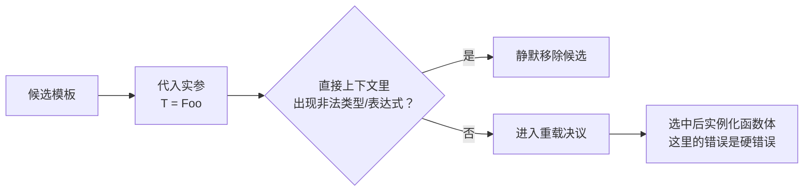

# 04 · type_traits 与 SFINAE

> **一句话**：`<type_traits>` 把“对类型提问”变成能参与编译期计算的常量；SFINAE 让这些回答决定某个重载**存不存在**，而不是让整个编译直接失败。

## 从一句 “substitution failure” 说起

先看一段看起来挺合理的代码：

```cpp
template <typename T>
auto to_string(const T& v) -> decltype(v.to_string()) {
    return v.to_string();
}

struct Foo {};

int main() {
    auto s = to_string(Foo{});
}
```

Clang 的报错是：

```text
error: no matching function for call to 'to_string'
note: candidate template ignored: substitution failure [with T = Foo]: no member named 'to_string' in 'Foo'
```

注意措辞：编译器没有说“`Foo` 没有 `to_string`，所以你的程序错了”。它说的是这个候选被忽略（candidate ignored），原因是一次“替换失败”（substitution failure）。

这就是 SFINAE 的字面意思：**Substitution Failure Is Not An Error**（替换失败不是错误）。编译器先推导出 `T = Foo`，再把 `Foo` 代入签名里的 `decltype(v.to_string())`。代入的结果不是一个合法类型，于是这个候选被安静地移出候选集，不产生编译错误。

只有当所有候选都被移除之后，才会变成 `no matching function`。所以模板库的报错总是先给你一句“没有匹配的函数”，具体理由藏在后面那条 note 里——这也是第 01 篇说“读第一条 note”的原因。

这套机制的用途是：**让“这个类型不支持某个操作”变成“这个重载不存在”，而不是“编译失败”。** 这是所有编译期分派的基础。

## type_traits 的骨架：integral_constant

`<type_traits>` 里几十个 trait，绝大多数都建立在同一个很小的东西上：

```cpp
template <typename T, T v>
struct integral_constant {
    static constexpr T value = v;
    using value_type = T;
    using type = integral_constant;
    constexpr operator T() const noexcept { return value; }
    constexpr T operator()() const noexcept { return value; }
};

using true_type  = integral_constant<bool, true>;
using false_type = integral_constant<bool, false>;
```

`true_type` / `false_type` 就是“编译期的 true / false”，只不过它们是类型，不是值。`is_integral<T>` 这种 trait 的实现方式是继承其中一个：

```cpp
template <typename T> struct is_integral : false_type {};
template <> struct is_integral<bool> : true_type {};
template <> struct is_integral<char> : true_type {};
// ... 每个整数类型一条
```

于是 `is_integral<int>::value` 是 `true`，而且 `is_integral<int>` 本身可以当 `true_type` 用——这就是为什么它能直接传给需要标签类型的函数。`operator T()` 和 `operator()` 让 `true_type{}` 既能当布尔值用，也能当谓词用（`std::sort(begin, end, std::greater<>{})` 就靠 `operator()`）。

C++17 给每个 trait 加了一个 `_v` 后缀的变量模板，省掉 `::value`：

```cpp
template <typename T>
inline constexpr bool is_integral_v = is_integral<T>::value;

static_assert(std::is_integral_v<int>);
static_assert(!std::is_integral_v<double>);
```

同理，`_t` 后缀的别名模板省掉 `typename ...::type`：

```cpp
template <typename T>
using decay_t = typename decay<T>::type;   // 去引用、去 cv、数组/函数退化成指针
```

`decay_t` 的用途是“把任意实参类型归一化成按值传递时的类型”。`decay_t<int&>` 是 `int`，`decay_t<const int[3]>` 是 `const int*`。写泛型代码时，凡是要“存一份值”，几乎都要先 `decay`。

::: tip 一个判断 trait 的小方法
看到任何 trait，先问两个问题：它暴露的是 `::value`（一个编译期布尔/整数）还是 `::type`（一个类型）？它的主模板给的是什么默认答案？回答了这两个问题，这个 trait 的行为基本就清楚了。
:::

## 写一个自己的 trait

第 02 篇已经用偏特化实现过 `is_pointer`，这里只回顾结构：

```cpp
template <typename T> struct is_pointer_impl : std::false_type {};
template <typename T> struct is_pointer_impl<T*> : std::true_type {};

static_assert(is_pointer_impl<int*>::value);
static_assert(!is_pointer_impl<int>::value);
```

**trait 的本质就是这个**：一个模板，主模板给出“默认答案”，偏特化给出“特殊情况答案”，答案通过 `::value` 或 `::type` 暴露出来。标准库里的 `is_integral`、`is_class`、`is_same`、`remove_cv` 全是这个形状，区别只在于“特殊情况”有多复杂。

有了这个认识，`enable_if` 就不再神秘：

```cpp
template <bool B, typename T = void>
struct enable_if {};                       // 主模板：没有 type 成员

template <typename T>
struct enable_if<true, T> { using type = T; };   // 只有 B 为 true 时才有 type
```

`enable_if_t<cond, T>` 在 `cond` 为真时是 `T`，为假时**这个类型根本不存在**——而“类型不存在”正好触发 SFINAE，把这个候选踢出去。

## enable_if 的两种常见写法

```cpp
// 写法 A：放在返回类型
template <typename T>
std::enable_if_t<std::is_integral_v<T>, T> twice(T x) { return x * 2; }

// 写法 B：放在模板参数（推荐）
template <typename T, std::enable_if_t<std::is_integral_v<T>, int> = 0>
T twice(T x) { return x * 2; }
```

两种都能工作：`twice(3)` 选中，`twice(3.0)` 因为替换失败被移除，最终报 `no matching function`。

推荐写法 B，理由有三个，都和风格无关：

1. 构造函数、析构函数、转换运算符没有返回类型可写。想给构造函数加约束，只能用 B：

```cpp
template <typename T>
class Wrapper {
public:
    template <typename U, std::enable_if_t<std::is_convertible_v<U, T>, int> = 0>
    explicit Wrapper(U&& v) : value_(std::forward<U>(v)) {}
private:
    T value_;
};
```

2. 返回类型要保持自然。写成 A 之后，返回类型被 `enable_if_t<...>` 包着，签名读起来像乱码；如果函数本来想用 `auto` 推导，A 也做不了。

3. 条件是签名的一部分，一眼可见。B 把“什么类型能调用”写在参数列表里，读函数声明就知道约束；A 把它藏在返回类型里，容易被忽略。

还有一个实践细节：B 里的 `= 0` 让调用者完全感觉不到这个参数的存在，`twice(3)` 照样只传一个实参。这是标准库和大量第三方库里最常见的写法。

## void_t：一个别名撑起检测惯用法

`std::void_t`（C++17）的定义只有一行：

```cpp
template <typename...>
using void_t = void;
```

它把任意多个类型参数“吃掉”，永远返回 `void`。而只要**任何一个模板实参本身不合法，这个别名特化就是非法的**，SFINAE 就这样被触发。

配合偏特化，就能写出“检测某个表达式是否合法”的惯用法（detection idiom）：

```cpp
template <typename T, typename = void>
struct has_to_string : std::false_type {};

template <typename T>
struct has_to_string<T, std::void_t<decltype(std::declval<const T&>().to_string())>>
    : std::true_type {};

struct WithStr { std::string to_string() const; };

static_assert(has_to_string<WithStr>::value);
static_assert(!has_to_string<int>::value);
```

逐行拆开：

- `std::declval<const T&>()` 在未求值上下文里“假装”有一个 `const T&` 的值，不需要 `T` 可默认构造。
- `decltype(...)` 只检查这个表达式的类型，不求值。
- `std::void_t<...>` 在这个类型合法时等于 `void`。
- 主模板的第二参数默认是 `void`，所以偏特化 `has_to_string<T, void>` 和主模板竞争；偏特化更特殊，表达式合法时胜出 → `true_type`；表达式非法时偏特化被丢弃 → 退回主模板 → `false_type`。

检测容器接口是同样的套路：

```cpp
template <typename T, typename = void>
struct has_size : std::false_type {};

template <typename T>
struct has_size<T, std::void_t<decltype(std::declval<const T&>().size())>>
    : std::true_type {};

static_assert(has_size<std::vector<int>>::value);
static_assert(!has_size<int>::value);
```

注意这里检测的是 `const T&` 上的 `size()`。如果某个类型只有非 `const` 的 `size()` 成员，`has_size<T>` 会得到 `false`。这是检测条件写死的“在 const 对象上能否调用”造成的，不算 bug。要覆盖两种情况，可以分别检测 `T&` 和 `const T&`，或者先想清楚你的接口到底要求哪一种。

检测“能不能用范围 `for` 遍历”则是多表达式检测：在 `void_t` 里并列写两个 `decltype`，任何一个不合法，整个偏特化就失效：

```cpp
template <typename T, typename = void>
struct is_range : std::false_type {};

template <typename T>
struct is_range<T, std::void_t<
    decltype(std::begin(std::declval<T&>())),
    decltype(std::end(std::declval<T&>()))>> : std::true_type {};

static_assert(is_range<std::vector<int>>::value);
static_assert(is_range<int[3]>::value);        // 数组也行，std::begin 支持
static_assert(!is_range<int>::value);
```

这里用 `std::begin` 而不是 `x.begin()`，是因为前者同时覆盖了数组成员和有 `begin()` 成员的类型。但它仍有一个盲区：只提供自由函数 `begin(x)`（靠 ADL 找到）的类型，`std::begin` 看不见。那种情况要自己写一个 `using std::begin; begin(x);` 的辅助别名，比一行 `decltype` 麻烦得多。这也是检测惯用法的共同局限：**它只能检测你写出来的那一种表达式形式。**

::: warning 检测的是“表达式合法”，不是“有这个方法”
`has_size<T>` 回答的是“`declval<const T&>().size()` 这个表达式能不能通过编译”。如果某个类型有个 `size` 成员但返回 `void`，或者是个接受参数的函数，检测结果可能是 `true`，但你的代码用起来照样炸。检测惯用法只保证“语法上能用”，语义要靠文档和测试。
:::

## 直接上下文：SFINAE 的边界

SFINAE 只对**替换的直接上下文**（immediate context）里的错误生效。直接上下文指的是声明本身：返回类型、参数类型、模板参数的默认值、异常规格、约束。这些地方出现非法类型或表达式，候选被静默移除。

而函数体、以及“实例化另一个模板时内部出的错”，不在直接上下文里，是硬错误：

```cpp
template <typename T>
struct Always { using type = typename T::nope; };

template <typename T>
void h(T, typename Always<T>::type* = nullptr);

struct Foo {};
h(Foo{});          // 硬错误
```

Clang 的输出：

```text
error: no type named 'nope' in 'Foo'
note: in instantiation of template class 'Always<Foo>' requested here
note: while substituting deduced template arguments into function template 'h' [with T = Foo]
```

注意最后一行：编译器确实在代入，但它报的是 `error`，不是“candidate ignored”。错误发生在 `Always<Foo>` 的实例化内部，不属于 `h` 的直接上下文。

函数体里的错误更直接：

```cpp
template <typename T>
void print_size(const T& v) { std::cout << v.size(); }

print_size(42);    // 硬错误：'int' 没有成员 'size'
```

函数体在重载决议之后才实例化，那时候候选已经选定了，没有“移除”这回事。所以“用 SFINAE 保护函数体”不成立：想保护，就得把条件写进签名（或者用 `if constexpr`）。



## 和 if constexpr 的分工

SFINAE 和 `if constexpr` 都能“按类型走不同代码”，但作用的层级完全不同：

| | SFINAE / `enable_if` | `if constexpr` |
| --- | --- | --- |
| 作用层 | 接口：候选存不存在 | 实现：函数体走哪条分支 |
| 影响重载决议 | 是 | 否 |
| 报错表现 | 候选被移除，最后“没有匹配” | 指向具体分支的行 |
| 可读性 | 差（条件藏在签名里） | 好 |
| 无法处理的情况 | 函数体里的类型错误 | 需要“让调用不成立”的场景 |

一条实用的判断标准：**如果“这个类型不支持这个操作”意味着“这个函数不该被调用”，用 SFINAE（或者 C++20 的 Concepts）；如果操作都支持、只是实现策略不同，用 `if constexpr`。**

还有一个容易忽略的层级差异：SFINAE 在接口匹配阶段生效，失败的表现是“候选不存在”。`if constexpr` 在函数体实例化阶段才生效，失败的表现是“分支里的代码不合法”。所以用 `if constexpr` 写的分派，即使对某个类型根本走不通，这个函数仍然留在候选集里——调用方拿到的错误会更靠后、更难读。这也是接口约束应该写在签名上的原因。

比如：

```cpp
// 接口约束：只有整数能调用 —— SFINAE / Concepts 的领域
template <typename T, std::enable_if_t<std::is_integral_v<T>, int> = 0>
T hash_combine(T a, T b);

// 实现分派：两种类型都能序列化，只是方式不同 —— if constexpr 的领域
template <typename T>
void serialize(const T& v) {
    if constexpr (has_size<T>::value) {
        write(v.data(), v.size());
    } else {
        write(&v, sizeof(v));
    }
}
```

C++20 的 Concepts 就是把第一种用法变成可读语法：

```cpp
template <std::integral T>
T hash_combine(T a, T b);
```

第 06 篇整章讲 Concepts。现在只要知道：**SFINAE 是机制，Concepts 是这套机制的现代包装**，新代码优先用后者，但读老代码必须认识 `enable_if` 和 `void_t`。

## 人话总结

<div class="human-note">
<strong>如果只记住一件事：</strong>SFINAE 不是“捕获所有编译错误”，它只处理替换过程中、声明直接上下文里的非法类型。它的产物是“这个候选不存在”，而不是“这个候选报错了”。想保护函数体，SFINAE 帮不了你。
</div>

## 常见误解

**误解一：SFINAE 能吞掉任何模板错误。**

只能吞掉直接上下文里的替换失败。函数体里的错误、实例化嵌套模板时的错误、以及 `static_assert` 失败（它本来就是故意的硬错误），都会正常报错。判断方法：错误指向的是签名，还是函数体或另一个模板内部。

**误解二：`enable_if` 是给函数加了个运行时判断。**

它不产生任何运行时代码。`enable_if` 只在编译期决定“这个声明是否存在”，条件为假时整个函数根本不参与重载决议——连符号都不会生成。

**误解三：`void_t` 自己在做检测。**

`void_t` 只是 `template<class...> using void_t = void;`，它一个字节的检测逻辑都没有。检测是偏特化匹配加替换失败共同完成的，`void_t` 只负责把“表达式是否合法”转换成一个可以塞进模板参数列表的 `void`。

**误解四：有了 `if constexpr`，SFINAE 就没用了。**

两者层级不同。`if constexpr` 不能阻止一个函数被选中——只要签名匹配，它就会进入候选。需要“这个类型压根不该调用这个重载”时（比如限制只接受整数、只接受迭代器、只接受可比较类型），仍然需要 SFINAE 或 Concepts。

## 本章小结

- trait 的本质是“模板 + 偏特化 + `::value`/`::type`”，`integral_constant` 是最小的那一个。
- `_v` / `_t` 后缀是 C++14/17 的语法糖，不改变 trait 的行为。
- `enable_if` 靠“条件为假时不存在 `::type`”来触发 SFINAE；写在模板参数里比写在返回类型里更通用。
- `void_t` 检测惯用法：主模板答 `false`，偏特化在表达式合法时答 `true`。
- SFINAE 只作用于替换的直接上下文；函数体和嵌套实例化里的错误是硬错误。
- SFINAE 管“候选存不存在”，`if constexpr` 管“实现走哪条”；C++20 起优先用 Concepts。

## 练习

1. 从头写一个 `has_size<T>`，要求对 `std::vector<int>`、`std::array<int, 3>`、`std::string` 返回 `true`，对 `int`、`double` 返回 `false`。再加一个只有 `size(int)` 成员的类型，解释检测结果为什么可能是 `true`。
2. 用 `enable_if` 写一个 `add(a, b)`，只接受两个同类型的整数。要求：`add(1, 2)` 通过，`add(1, 2.0)` 和 `add("a", "b")` 都不参与重载决议（而不是报函数体里的错）。
3. 把下面这段 SFINAE 改写成 `if constexpr` 版本，并说明改写后失去了哪种能力：
   ```cpp
   template <typename T, std::enable_if_t<has_size<T>::value, int> = 0>
   std::size_t count(const T& v) { return v.size(); }
   ```
4. 下面这段代码为什么是硬错误而不是“候选被移除”？给出两种让它变成 SFINAE 的修法：
   ```cpp
   template <typename T> struct Get { using type = typename T::type; };
   template <typename T> void use(typename Get<T>::type);
   struct Empty {};
   use<Empty>({});
   ```

---

上一篇：[03 · constexpr 编译期计算](/cpp-tmp/03-constexpr) · 下一篇：[05 · 变参模板](/cpp-tmp/05-variadic-templates)
