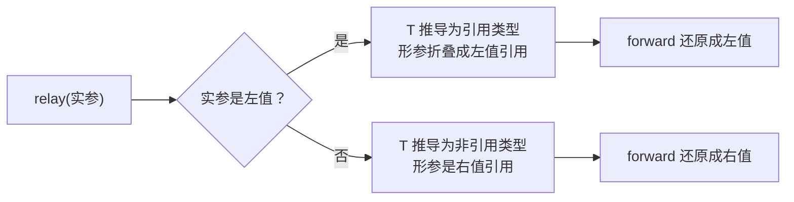

# 05 · 变参模板

> **一句话**：参数包把“任意多个参数”收成一张只能展开、不能遍历的列表；折叠表达式负责把它变成一次调用，完美转发负责让每个参数保持原来的值类别。

## 从一次“不能遍历参数包”开始

想写一个打印任意多个参数的函数，很自然会写成这样：

```cpp
template <typename... Args>
void print_all(Args... args) {
    for (const auto& a : args) {     // 编译失败
        std::cout << a << ' ';
    }
}
```

Clang 的报错是：

```text
error: invalid range expression of type 'int'; no viable 'begin' function available
```

`args` 是参数包（parameter pack），一个只在编译期存在的参数列表：没有 `begin()`、没有 `size()`，也不能用 `args[0]` 访问。对它唯一能做的事，是在特定的语法位置展开，让编译器替你写出 `a1, a2, a3`。

看懂 `std::make_unique<T>(args...)` 这种签名，需要的正是这三件事：包怎么声明、怎么展开、怎么把每个参数原样转交出去。

## 参数包的基本形态

两种包，声明时带 `...`，使用时不带：

```cpp
template <typename... Ts>      // 类型包
void f(Ts... values);          // 函数参数包

template <int... Ns>           // 非类型参数包
struct Ints {};
```

包的大小用 `sizeof...` 取，它返回 `std::size_t` 常量；语法是 `sizeof...(名字)`，括号不能省：

```cpp
template <typename... Ts>
constexpr std::size_t count(Ts...) { return sizeof...(Ts); }

static_assert(count(1, 2, 3) == 3);
static_assert(count() == 0);          // 空包完全合法
```

类模板里参数包必须放在最后；函数模板里包后面还可以跟别的参数，前提是它们能被推导出来或者有默认值——`template <typename... Ts, typename U> void f(Ts... ts, U u)` 合法，因为 `U` 能从最后一个实参推导出来，而同样的写法放到类模板上就不合法。写成 `template <typename U, typename... Ts>` 则总是可以。

包能展开的位置是固定的，常见的有：函数调用的实参、花括号初始化列表、模板实参列表、基类列表、lambda 的捕获列表（C++20）、`using` 声明。**不能**展开成一条语句、一个 `for` 循环、或者一次下标访问。

## 递归展开：C++11 的老办法

C++17 之前没有折叠表达式，只能用递归把包“一个一个剥掉”：

```cpp
void print_all() { std::cout << '\n'; }        // (1) 终止重载

template <typename T, typename... Rest>
void print_all(const T& first, const Rest&... rest) {
    std::cout << first;
    if (sizeof...(rest) > 0) std::cout << ", ";
    print_all(rest...);                        // (2) 递归，每次少一个参数
}
```

`print_all(1, 2.5, "hi")` 会依次实例化 `print_all<int, double, const char*>`、`print_all<double, const char*>`、`print_all<const char*>`，最后落到 `print_all()`。

这里有两个容易出错的地方。

第一，终止重载必须在模板定义之前可见。第 01 篇讲过两阶段查找：`print_all(rest...)` 是依赖调用，实例化时只补充 ADL 找到的候选。`int`、`double` 这些内置类型没有关联命名空间，所以 (1) 声明在模板后面，就永远找不到——结果要么是 `no matching function`，要么更糟：无限递归直到模板深度上限。

第二，每次递归都实例化一个新函数。传 10 个参数就生成 10 个 `print_all` 特化，目标文件里全是这些几乎一样的小函数。参数多、调用点多的时候，编译时间和代码体积都会上涨。

用 `if constexpr`（C++17）可以去掉终止重载，但仍有递归：

```cpp
template <typename T, typename... Rest>
void print_all(const T& first, const Rest&... rest) {
    std::cout << first;
    if constexpr (sizeof...(rest) > 0) {
        std::cout << ", ";
        print_all(rest...);        // 只有 rest 非空时才实例化
    }
}
```

## 折叠表达式：一次展开所有

C++17 的折叠表达式（fold expression）把递归压成一行。它有四种形式，区别只在“初值放哪边”和“括号怎么结合”：

| 形式 | 写法 | 展开结果 |
| --- | --- | --- |
| 一元右折叠 | `(pack op ...)` | `e1 op (e2 op (e3 op e4))` |
| 一元左折叠 | `(... op pack)` | `((e1 op e2) op e3) op e4` |
| 二元右折叠 | `(pack op ... op init)` | `e1 op (e2 op (e3 op init))` |
| 二元左折叠 | `(init op ... op pack)` | `((init op e1) op e2) op e3` |

最常用的求和：

```cpp
template <typename... Ts>
auto sum_all(const Ts&... xs) { return (xs + ...); }        // 一元右折叠

template <typename... Ts>
auto sum_all_safe(const Ts&... xs) { return (0 + ... + xs); }  // 二元左折叠
```

两者的区别在空包上：`sum_all()` 里没有任何元素，`(xs + ...)` 无法确定结果，编译失败；`sum_all_safe()` 有初值 `0`，空包时返回 `0`。一元折叠对空包只有三个运算符有定义：`&&` 得 `true`、`||` 得 `false`、`,` 得 `void()`。其他运算符都必须用二元形式给初值。

打印可以写成：

```cpp
template <typename... Ts>
void print_all(const Ts&... xs) {
    ((std::cout << xs << ' '), ...);      // 一元右折叠，逗号运算符
    std::cout << '\n';
}
```

`(std::cout << ... << xs)` 也能用（二元左折叠，初值是流对象），但它没法在元素之间插分隔符，要插就得用逗号折叠。

::: tip 折叠的括号不能省
`xs + ...` 是语法错误，必须写 `(xs + ...)`。这一对括号是折叠表达式的语法组成部分，省不掉。
:::

## 完美转发：把值类别也传下去

`make_unique` 收下任意多个参数，还要**保持每个参数原来的值类别**：传进去的是左值，到构造函数那里还是左值；传进去的是右值，到构造函数那里还是右值（可以被移动）。

这靠两个东西：转发引用和 `std::forward`。

转发引用（forwarding reference，也叫万能引用）长得像右值引用，但只在推导上下文里成立：

```cpp
template <typename T>
void relay(T&& v);        // T 由实参推导 → 转发引用

void f(int&& v);          // 固定类型 → 就是右值引用
```

当实参是左值 `int x`，`T` 推导为 `int&`，形参类型变成 `int& &`，经过引用折叠（reference collapsing）变成 `int&`；当实参是右值 `42`，`T` 推导为 `int`，形参是 `int&&`。

引用折叠的规则只有一条：**只要有一个是左值引用，结果就是左值引用。**

| 组合 | 结果 |
| --- | --- |
| `& &` | `&` |
| `& &&` | `&` |
| `&& &` | `&` |
| `&& &&` | `&&` |

`std::forward<T>(v)` 的作用是把 `T` 里记录的“原本是左值还是右值”还原出来：`T = int&` 时转成左值，`T = int` 时转成右值。**必须显式写出 `T`**，写成 `std::forward(v)` 就退化成无条件左值，转发失效。

```cpp
template <typename T>
void relay(T&& v) {
    target(std::forward<T>(v));    // 原样转交
}

int x = 1;
relay(x);        // target 收到左值
relay(42);       // target 收到右值，可以移动
```

这里为什么不能用 `std::move`？`std::move` 无条件转成右值。调用方传进来一个左值 `x`，你用 `std::move` 转交，下游就可能把 `x` 的内容搬走，调用方的对象莫名其妙被掏空。`std::forward` 只在本来就是右值时才转成右值。

`auto&&` 是同一个机制的另一种写法：`for (auto&& x : v)` 里的 `x` 会跟着元素的值类别走，左值元素得到左值引用，右值元素得到右值引用。在泛型代码里，需要“原样接住一个值”时，`auto&&` 比 `auto&` 和 `auto` 都更准确。



### 真实用法：`emplace_back` 省掉的是哪一次

变参模板加完美转发最日常的落点是容器的 `emplace_back`。它和 `push_back` 的区别不在于“快一点”，而在于**少构造了几个临时对象**：

```cpp
struct Tracker {
    static inline int copies = 0;
    static inline int moves = 0;
    int id;
    explicit Tracker(int i = 0) : id(i) {}
    Tracker(const Tracker& o) : id(o.id) { ++copies; }
    Tracker(Tracker&& o) noexcept : id(o.id) { ++moves; }
};

std::vector<Tracker> v;
v.reserve(4);
Tracker t{7};
v.push_back(t);              // 拷贝一次
v.push_back(std::move(t));   // 移动一次
v.emplace_back(9);           // 直接在容器内存里构造：0 拷贝 0 移动
```

`emplace_back` 的内部形状就是一个变参模板：

```cpp
template <class... Args>
T& emplace_back(Args&&... args) {
    // 找到空位，把转发过来的参数直接交给构造函数
    new (slot) T(std::forward<Args>(args)...);
    return *slot;
}
```

`push_back(T&&)` 要求你先有一个 `T` 对象（哪怕只是临时对象），再把它移动进容器；`emplace_back` 把参数原样送到 `T` 的构造函数，临时对象根本不存在。这正是标准库 `make_unique<T>(args...)`、`std::thread(f, args...)`、`std::optional::emplace(args...)` 共同的形状。

两个反直觉的地方：

- **`emplace_back` 不是总比 `push_back` 快。** 如果你手上已经有一个具名对象，`push_back(obj)` 走一次拷贝，`emplace_back(obj)` 也同样走一次拷贝——构造函数里那个参数仍然是左值。省不省，取决于参数是“构造所需的原料”还是“已完成的成品”。
- **`emplace_back` 会绕过显式性检查吗？** 不会，但它会做隐式转换：`v.emplace_back(3.5)` 对 `std::vector<int>` 是合法的（`3.5` 隐式转 `int`），而 `v.push_back(3.5)` 在 C++11 之后同样合法。真正容易踩的是 `emplace_back` 接受花括号列表推导失败，以及在某些实现里它对 `initializer_list` 的意外匹配。

## index_sequence 与 apply

有些展开需要“下标”，比如把 `std::tuple` 里的元素依次传给一个函数。这时用 `std::index_sequence`：

```cpp
template <typename Tuple, typename F, std::size_t... I>
void for_each_impl(Tuple&& t, F&& f, std::index_sequence<I...>) {
    (f(std::get<I>(t)), ...);          // 把 I... 展开成 0,1,2,...
}

template <typename Tuple, typename F>
void for_each(Tuple&& t, F&& f) {
    constexpr auto n = std::tuple_size_v<std::remove_reference_t<Tuple>>;
    for_each_impl(std::forward<Tuple>(t), std::forward<F>(f),
                  std::make_index_sequence<n>{});
}
```

`std::make_index_sequence<n>` 产生类型 `std::index_sequence<0, 1, ..., n-1>`，通过形参推导把这个序列“接”进函数，然后在折叠里当作下标用。`std::apply`（C++17）做的就是这件事：

```cpp
std::tuple<int, std::string> t{1, "hi"};
std::apply([](int n, const std::string& s) { /* ... */ }, t);
```

`index_sequence` 的典型用途是把“运行时才知道长度”的数组和“编译期必须定长”的参数列表接起来：遍历 `std::array`、把结构体字段逐个序列化、以及实现自己的 `apply`。

## 类模板里的包

包在类模板里最常见的两种用法是继承和存储。

继承包用来做“混入”（mixin）或者重载集合：

```cpp
template <typename... Fs>
struct Overload : Fs... {
    using Fs::operator()...;      // 把每个基类的调用运算符都拉进来
};

template <typename... Fs>
Overload(Fs...) -> Overload<Fs...>;   // C++17 推导指引，让 Overload{...} 能自动推导

auto f = Overload{
    [](int) { return "int"; },
    [](const std::string&) { return "string"; },
};
```

这是 `std::visit` 配合 `std::variant` 的标准写法：每个 lambda 是一个基类，`using Fs::operator()...` 把它们全部引入同一个作用域，重载决议自然选出匹配的那个。

存储包就是 `std::tuple`：

```cpp
template <typename... Ts>
class Tuple;   // 标准库的实现通常是递归继承：Tuple<T, Rest...> : Tuple<Rest...>
```

`std::tuple` 的布局、`std::get` 的索引访问、`std::tuple_size` 的特化，都是第 02 篇那些机制的组合。理解到这里，读元组相关的报错会轻松很多。

## 一个简化版 make_unique

把上面的东西拼起来，`std::make_unique` 的核心就是三行：

```cpp
template <typename T, typename... Args>
std::unique_ptr<T> my_make_unique(Args&&... args) {
    return std::unique_ptr<T>(new T(std::forward<Args>(args)...));
}
```

- `Args&&...` 为每个实参独立推导，左值保持左值、右值保持右值；
- `std::forward<Args>(args)...` 是包展开：对包里的每一项分别调用 `forward`，再一起塞进构造函数；
- `new T(...)` 在构造失败时自动释放内存，所以外面再包一层 `unique_ptr` 是异常安全的。

标准库的版本还处理了数组（`make_unique<T[]>(n)`）、`make_unique_for_overwrite`（C++20）等场景，并且实现上用了更底层的分配手法。上面的版本足够理解接口，但**不要拿它替换标准库**。

理解了这一层，`emplace_back` 也就通了：

```cpp
template <typename Container, typename... Args>
auto emplace(Container& c, Args&&... args)
    -> decltype(c.emplace_back(std::forward<Args>(args)...)) {
    return c.emplace_back(std::forward<Args>(args)...);
}
```

`emplace_back` 比 `push_back(T(...))` 强的地方在于：它把参数直接转发到容器内存里的构造函数，省掉一个临时对象，以及伴随临时对象的那一次移动或拷贝。对 `std::string`、`std::vector` 这种构造和移动都不便宜的类型，省下的开销不能忽略。

::: warning 过度转发
转发引用不是越多越好。典型错误是在同一个函数里对同一个参数转发两次（第二次拿到的是已经被移动的对象），或者在循环里反复 `std::forward`。判断标准是**一次转发对应一次“把所有权交出去”**。参数要多次使用，就先决定按值还是按引用接，不要用转发引用。
:::

## 人话总结

<div class="human-note">
<strong>如果只记住一件事：</strong>参数包只能展开，不能遍历；展开的位置决定了你写递归、折叠还是 <code>index_sequence</code>。而“转发”这件事的全部要点是：<code>T&amp;&amp;</code> 只在推导时才是转发引用，<code>std::forward&lt;T&gt;</code> 负责把值类别还原，<code>std::move</code> 不还原、它无条件变成右值。
</div>

## 常见误解

**误解一：`T&&` 就是右值引用。**

只有在推导上下文里（函数模板参数、`auto&&`）它才是转发引用。写在普通函数参数、或者类模板的成员函数里（`T` 是类模板参数、实例化时已固定），它就是普通的右值引用，只能接右值。

**误解二：`std::forward` 和 `std::move` 差不多，随便用一个。**

`std::move` 无条件把东西变成右值，用在转发引用上会把调用方的左值偷走；`std::forward<T>` 只还原“本来是什么”，左值仍然是左值。混用的后果是调用方对象被意外清空，而且编译器不会提醒你。

**误解三：参数包可以像数组一样用。**

不能下标、不能取地址、不能用范围 `for`。它只能展开到语言规定的位置。需要“按下标访问”时，得先用 `index_sequence` 造出一串下标，或者把包存进 `std::tuple`。

**误解四：折叠表达式能完全替代递归。**

对于“把所有元素用一个运算符合并”这类需求，折叠确实更好。但折叠不能做“按位置区分参数”（第一个参数特殊处理），也不能在展开过程中改变类型；这些场景仍然要递归或者 `index_sequence`。

## 本章小结

- 参数包只能在特定位置展开：函数实参、初始化列表、模板实参、基类列表等；`sizeof...` 取元素个数。
- 递归展开需要终止重载，而且它必须在模板定义之前可见；每个参数个数都会生成一个新特化。
- 折叠表达式有四种形式，空包时一元折叠只有 `&&`、`||`、`,` 有定义，其余要用二元形式给初值。
- `T&&` 只有在推导上下文里才是转发引用；引用折叠规则是“有左值引用就是左值引用”。
- `std::forward<T>` 还原值类别，`std::move` 无条件右值化；转发引用只能用前者。
- `index_sequence` 把编译期下标序列接进函数，`std::apply` 就是它的标准封装。

## 练习

1. 用折叠表达式写 `sum_all`，要求空包返回 `0`、支持混合数值类型（`sum_all(1, 2.5, 3)`），并说明为什么返回值不应该是 `int`。
2. 写一个 `emplace_back` 风格的包装函数，接受容器和任意参数，返回 `emplace_back` 的返回值。再写一个测试，用一个“只能移动、不能拷贝”的类型验证参数确实被移动而不是拷贝。
3. 下面这个类为什么无法完美转发？给出修法：
   ```cpp
   template <typename T>
   class Queue {
   public:
       void push(T&& v) { data_.push_back(std::forward<T>(v)); }
   private:
       std::vector<T> data_;
   };
   ```
4. 手写一个简化版 `apply`：接受一个可调用对象和一个 `std::tuple`，用 `index_sequence` 把元组元素展开成实参。然后用它调用一个三参数函数验证结果。

---

上一篇：[04 · type_traits 与 SFINAE](/cpp-tmp/04-type-traits-sfinae) · 下一篇：[06 · Concepts](/cpp-tmp/06-concepts)
