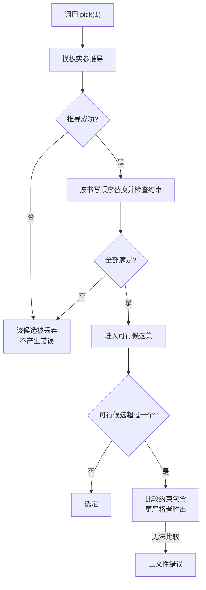

# 06 · Concepts

> **一句话**：Concepts 把“模板对类型的要求”从散落在返回类型和 `enable_if` 里的技巧，变成签名上一句能直接读出来的约束；模板能做什么不变，变的是谁被允许进来、进不来时报错长什么样。

## 从一个 20 行的报错说起

先看一段没有写任何约束的模板：

```cpp
#include <iostream>

struct Point { int x, y; };

template <typename T>
T add(T a, T b) { return a + b; }

int main() {
    std::cout << add(Point{1, 2}, Point{3, 4}).x;
}
```

这段代码错得很明显：`Point` 没有 `operator+`。但编译器给出的信息往往要翻好几屏（下面这段是示意，实际输出随编译器与版本不同）：

```text
error: no matching function for call to 'add(Point, Point)'
note: candidate: 'template<class T> T add(T, T)'
note:   template argument deduction/substitution failed:
note:   In instantiation of 'T add(T, T) [with T = Point]':
error: no match for 'operator+' (operand types are 'Point' and 'Point')
```

问题在于，签名里没有任何地方说明**“`T` 必须支持 `+`”**。这个要求只存在于模板作者心里，也只体现在函数体里。编译器得等到实例化函数体才发现错误，那时报错已经离“你调用错了”很远。

### C++17 的补救办法，以及它为什么不够

C++17 时代的标准做法是 `std::enable_if`。把“只接受整数”这个要求写出来，大致是这样：

```cpp
#include <type_traits>

template <typename T,
          typename = std::enable_if_t<std::is_integral_v<T>>>
T half(T x) { return x / 2; }
```

这段代码能用，但有四个问题：

1. 约束藏在默认模板参数里。读签名的人只看到 `template <typename T, typename = ...>`，得眯着眼去找 `enable_if` 才知道要求是什么。
2. 两个只差默认模板参数的重载，是同一个声明。下面这种“按条件选择实现”的写法根本无法编译——两条声明被当成同一个函数模板，而默认实参不能重复给出（clang 报 `template parameter redefines default argument`，GCC 报 `redefinition of 'f'`）：

   ```cpp
   template <typename T, typename = std::enable_if_t<std::is_integral_v<T>>>
   void f(T);

   template <typename T, typename = std::enable_if_t<std::is_floating_point_v<T>>>
   void f(T);   // error: template parameter redefines default argument
   ```

   要绕过去，就得改用返回类型、额外的 `int` 形参或者 `void_t` 检测惯用法——每一种都比上一种更像谜语。
3. 报错指向错误的位置。GCC 对 `half(3.5)` 的提示是 `no type named 'type' in 'struct std::enable_if<false, void>'`；如果 `enable_if` 挪到返回类型上，还会变成更误导人的 `couldn't deduce template parameter 'T'`——仿佛问题出在推导，而不是“`double` 不是整数”。（clang 的新版本好一些，但也只告诉你 `is_integral_v<double>` 不成立，不会点出“这个函数要求整数”。）
4. 约束无法组合。想要“整数且可哈希”，只能手写 `&&`，而且编译器不知道 `A && B` 比单独的 `A` 更严格，所以没法用它来给重载排序。

Concepts 正是逐条对应这四个问题设计的。

## concept：给一组约束起个名字

Concepts 的最小形态是一条 `concept` 定义：

```cpp
#include <concepts>

template <typename T>
concept Addable = requires(T a, T b) { a + b; };
```

拆开看：

- `concept` 定义**只能写在命名空间作用域**，不能写在类里，也不能是成员。
- `Addable` 是一个“布尔谓词模板”：`Addable<int>` 是一个 `bool` 类型的常量表达式，可以直接喂给 `static_assert` 或 `if constexpr`。
- 等号右边不一定是 `requires` 表达式，也可以是任意常量表达式，比如 `std::is_integral_v<T>`。

```cpp
// 假设前面已有：struct Point { int x, y; };
static_assert(Addable<int>);
static_assert(Addable<std::string>);        // 需要 #include <string>
static_assert(!Addable<Point>);
```

`Addable<Point>` 求值为 `false`，编译照常通过。这是 `requires` 表达式最关键的性质：**它把“这个表达式写不出来”变成 `false`**。

### requires 表达式里到底发生了什么

`requires(T a, T b) { ... }` 的花括号里是一串要求（requirement），外面那对小括号里声明的 `a`、`b` 是“假想的参数”：它们只是用来拼出表达式的名字，**不会被构造，也不会被求值**。所以即使 `T` 不可拷贝、不可默认构造，`requires(T a, T b)` 也完全合法。

换句话说，`requires` 表达式检查的是**表达式能不能通过编译**，不是它算出什么；函数体、模板体、运行时行为都不在检查范围内。

## requires 表达式的四类要求

这四类要求值得记住：它们决定了你能把约束写多精确。

```cpp
#include <concepts>
#include <cstddef>
#include <iterator>

template <typename T>
concept MyContainer = requires(T c, const T cc, std::size_t i) {
    // ① 简单要求：表达式必须合法
    c.begin();
    c.end();

    // ② 类型要求：这个类型必须存在且合法
    typename T::value_type;
    typename T::iterator;

    // ③ 复合要求：表达式合法 + 可选的 noexcept + 可选的返回类型约束
    { c.size() } -> std::convertible_to<std::size_t>;
    { cc.empty() } noexcept -> std::same_as<bool>;

    // ④ 嵌套要求：另一个约束必须被满足
    requires std::same_as<typename T::value_type,
                          std::remove_reference_t<decltype(*c.begin())>>;
};
```

四类要求逐个说清楚：

| 形态 | 写法 | 检查什么 | 不检查什么 |
| --- | --- | --- | --- |
| 简单要求 | `c.begin();` | 这个表达式能否通过编译 | 返回值是什么类型 |
| 类型要求 | `typename T::value_type;` | 这个类型名是否存在且合法 | 它有没有被使用 |
| 复合要求 | `{ expr } noexcept -> C;` | 表达式合法、是否 `noexcept`、`decltype((expr))` 是否满足约束 `C` | 表达式的值 |
| 嵌套要求 | `requires C<T>;` | 约束 `C<T>` 是否被满足 | —— |

几个容易踩的细节：

- **复合要求里的返回类型约束检查的是 `decltype((expr))`**，也就是带括号的形式。对返回左值的函数，这个类型是引用（`T&`），所以 `{ c.front() } -> std::same_as<int>` 通常不成立，而 `-> std::same_as<int&>` 或 `-> std::convertible_to<int>` 才是对的。
- **`noexcept` 是“必须 noexcept”**，不是“检查是否 noexcept”。写成 `{ f() } noexcept;` 而 `f()` 会抛，这条要求就是不满足。
- 嵌套要求可以直接写常量表达式，不一定是 concept，例如 `requires sizeof(T) == 8;`。它和复合要求的分工是：复合要求管“这个表达式存在吗”，嵌套要求管“这个已知事实成立吗”。
- 四类要求按书写顺序检查，**左边不满足时右边的表达式不会被替换**。所以把“便宜且最常失败的”排在前面是有实际收益的。

## 写法：三种等价形式

同一个约束有三种写法，理解它们的对应关系比记住语法更省事。

```cpp
// ① requires 子句：约束写在模板参数表后面
template <typename T>
    requires Addable<T>
T sum3(T a, T b, T c) { return a + b + c; }

// ② 受约束的模板参数
template <Addable T>
T sum3b(T a, T b, T c) { return a + b + c; }

// ③ 简写函数模板（abbreviated function template）
void show(Addable auto x);
```

三者对 `sum3` 来说是等价的。`show` 稍微特殊：它根本没写 `template <...>`，每个 `auto` 各自引入一个隐藏的类型参数。所以 `void f(Addable auto a, Addable auto b)` 里的 `a` 和 `b` 可以是不同类型，两个约束分别检查。

日常选择：

- 只有一个参数、约束简单 → 用简写 `f(Addable auto x)`，最短。
- 约束需要引用其他参数或返回类型（比如 `requires std::same_as<T, U>`）→ 用 ①，`requires` 子句能引用整张参数表。
- 类模板、成员函数、需要显式声明模板参数 → 用 ②。

::: warning 别在两个地方各写一半
`requires` 子句可以写两处：模板头后面（`template <typename T> requires C<T>`）和函数声明符后面（`void f(T) requires C<T>`）。两处都会参与约束包含（下一节），但同时写容易让人误以为有优先级差别。选一处写清楚就好。
:::

### 合取、析取与顺序

`requires` 子句里可以用 `&&`、`||`、`!`：

```cpp
template <typename T>
concept Numeric = std::integral<T> || std::floating_point<T>;

template <typename T>
    requires std::is_integral_v<T>              // 先检查：便宜、能挡掉大多数类型
          && requires(T a, T b) { a / b; }      // 再检查：只有上面通过才会看它
T divide(T a, T b) { return a / b; }
```

`&&` 满足**短路**：左边不满足时，右边连替换都不会发生。`||` 同理，左边满足就不再检查右边。这是标准规定的语义，所以给复杂约束排序有据可依。

`!` 虽然合法，但不建议用它来挑重载：否定式约束在逻辑上正确，却几乎不参与有用的约束包含，你会得到“两个候选都可行，却排不出谁更严格”的尴尬结果。

## 约束包含：为什么更严格的那个会赢

这是 Concepts 相对 SFINAE 最实质的进步：**编译器能比较两个约束的强弱**。

```cpp
#include <concepts>
#include <iostream>

template <typename T>
concept Integral = std::is_integral_v<T>;

template <typename T>
concept SignedIntegral = Integral<T> && std::is_signed_v<T>;

template <Integral T>
void pick(T) { std::cout << "integral\n"; }

template <SignedIntegral T>
void pick(T) { std::cout << "signed integral\n"; }

int main() {
    pick(1);      // signed integral
    pick(1u);     // integral
}
```

为什么 `pick(1)` 选第二个？规则叫约束包含（constraint subsumption）：每个约束最终会被拆成若干条原子约束（atomic constraint，大致就是“一个 concept-id 或一个常量表达式”）。`SignedIntegral<T>` 展开后是 `Integral<T> && std::is_signed_v<T>`，它的原子集合包含了 `Integral<T>` 的原子集合，因此它更严格，在两者都可行时胜出。

限制有两条：

- **原子约束按“拼写”判等，不按逻辑判等。** 写 `std::is_integral_v<T>` 和写 `std::integral<T>` 是两个不同的原子，即使它们永远同真同假——这时两条重载谁都不比谁严格，调用会变成二义性错误。这也是为什么库里普遍建议“约束尽量写成有名字的 concept，并且复用同一个 concept”。
- **只有参与约束的表达式才会被比较**。写在返回类型里的 `enable_if_t`、写在函数体里的 `static_assert`，都不参与排序。

用一张图收束整个流程：



## 报错对比：同一件事，两种说法

还是 `half` 那个例子。

```cpp
// 写法 A：enable_if
template <typename T, typename = std::enable_if_t<std::is_integral_v<T>>>
T half(T x) { return x / 2; }

// 写法 B：concept
template <std::integral T>
T half(T x) { return x / 2; }
```

调用 `half(3.5)` 时，写法 A（clang 22，`-std=c++20`）的报错核心是：

```text
error: no matching function for call to 'half'
note: candidate template ignored: requirement 'std::is_integral_v<double>' was not satisfied [with T = double]
```

写法 B 的报错核心是：

```text
error: no matching function for call to 'half'
note: candidate template ignored: constraints not satisfied [with T = double]
note: because 'double' does not satisfy 'integral'
note: because 'is_integral_v<double>' evaluated to false
```

现代 clang 对 `enable_if` 也已经给出了像样的提示，所以别指望“换成 Concepts 报错就自动变短”。差别有三点：

1. **候选签名里就写着约束**。版本 B 的候选声明是 `template <std::integral T>`，读声明即可知道要求，不用去翻默认模板参数。
2. 失败原因逐层展开。`because ... / because ...` 是一棵树，从“不满足 `integral`”走到“`is_integral_v<double>` 为假”，中间每一层都有名字。
3. 自己的 `requires` 表达式会指到具体那一条要求。把约束换成 `concept Pushable = requires(T c, typename T::value_type v) { c.push_back(v); };`，再调用 `f(42)`，clang 输出：

   ```text
   note: because 'int' does not satisfy 'Pushable'
   note: because 'v' would be invalid: type 'int' cannot be used prior to '::' because it has no members
   ```

   紧跟着还会有一行源码位置，`^` 正指在 `typename T::value_type` 上。这是排查“我的类型为什么进不来”时最省时间的信息；在 `enable_if` 写法的报错里，等价信息通常只表现为“某个 trait 求值为假”，不会指出是哪一条要求。

::: details GCC 上的样子
GCC 的措辞不同，`enable_if` 版本的提示更接近：

```text
note: candidate: 'template<class T, class> T half(T)'
note:   template argument deduction/substitution failed:
note:   no type named 'type' in 'struct std::enable_if<false, void>'
```

信息是一样的，只是它描述的是“某个 trait 为假”，而不是“某个概念没被满足”。
:::

## 真实用例：标准库怎么约束 ranges

`std::ranges` 是 concepts 最大规模的一次实际应用：每个算法都用约束声明“我需要什么样的范围”，而不是把要求写在文档里。

`std::ranges::sort` 的签名核心是这一行（libc++ 的写法）：

```cpp
template <random_access_range _Range, class _Comp = ranges::less, class _Proj = identity>
  requires sortable<iterator_t<_Range>, _Comp, _Proj>
constexpr borrowed_iterator_t<_Range>
operator()(_Range&& __r, _Comp __comp = {}, _Proj __proj = {}) const;
```

两层约束分工明确：`random_access_range` 要求“能随机访问”，`sortable` 要求“元素能比较、能交换”。换成 `std::list` 会得到一条**指向上游原因**的报错：

```text
error: no matching function for call to object of type 'const __sort'
note: candidate template ignored: constraints not satisfied [with _Range = std::list<int> &]
note: because 'std::list<int> &' does not satisfy 'random_access_range'
note: because 'iterator_t<std::list<int> &>' (aka '__list_iterator<int, void *>')
      does not satisfy 'random_access_iterator'
```

这条链就是概念的价值：编译器不是在“函数体里某一行”报错，而是从算法要求一路退到迭代器能力，最后落在“list 的迭代器不能随机访问”这个你真正需要知道的事实上。同样的错误用 `enable_if` 写，报错是 `no type named 'type' in enable_if<false>`，中间那层语义全丢了。

自己写库时可以直接借用同一个形状：

```cpp
template <class R>
concept countable_range = requires(R& r) {
    { std::size(r) } -> std::convertible_to<std::size_t>;
    std::ranges::begin(r);
    std::ranges::end(r);
};
```

一条 concept 就是一份**可复用的接口文档**，而且它会被编译器执行。这是 concepts 相对注释和文档最实质的收益。

## 和 if constexpr、enable_if 的分工

这三样东西经常被混为一谈，但它们管的是不同阶段：

- `if constexpr` 在函数体内部按编译期条件选分支。它适合“同一个算法，对不同类型有不同的实现”，但它不改变“这个重载是否存在”——你仍然得先有一个能接受该类型的重载。
- Concepts 管接口层面：这个重载/这个类对这个类型是否存在，以及多个重载之间谁更优先。
- `enable_if` / SFINAE 是 Concepts 的底层机制。Concepts 没有取代它，只是给它加了语法和排序规则。

那么什么时候仍然需要 SFINAE？

1. 工具链停在 C++17。这在嵌入式、老编译器、跨平台 SDK 里很常见。库代码通常用 `#if defined(__cpp_concepts)` 分成两套实现。
2. 要读别人的代码。标准库、Boost、各家 SDK 里 `void_t` 检测惯用法遍地都是，读不懂就没法判断一个重载为什么没被选中。
3. 需要在 C++17 里“条件性地存在一个成员”。C++20 可以用 `requires` 子句让成员函数按条件存在，C++17 只能靠 `enable_if` 加基类技巧。
4. 某些情形概念表达不了，比如约束依赖“某个表达式在当前作用域能否找到”（ADL 相关）这类上下文细节——这时 `requires` 表达式通常仍能写出来，但可读性会明显下降。

::: tip 一条实践建议
新代码里，**能用 Concepts 就不用 `enable_if`**；必须兼容 C++17 时，也尽量把检测逻辑收进一个 `is_xxx_v` 变量模板或 `void_t` 别名，让业务代码里只出现名字，不出现机制。
:::

## 人话总结

<div class="human-note">
<strong>如果只记住一件事：</strong>Concepts 是“写在门牌上的准入条件”。`enable_if` 把条件写在门背后的小纸条上，只有拆开模板参数的人看得见；Concepts 写在门口，编译器检查时按它拦人，出错时也照着门牌念给你听。条件写在门口，编译器才能比较两块门牌谁更严——这就是约束包含。
</div>

## 常见误解

**误解一：满足 concept 就说明这个类型“行为正确”。**

不是。`Addable<T>` 只保证 `a + b` 这个表达式能通过编译。`operator+` 是否满足结合律、是否返回了合理的东西，编译器一概不管。Concepts 检查的是语法层面的可用性（所谓“语义要求”只写在文档里，靠人遵守），它比 SFINAE 强，但仍然只是“合同”的一部分。

**误解二：有了 Concepts，SFINAE 就没用了。**

Concepts 是建立在 SFINAE 之上的：约束不满足时，那个候选仍然是被“替换失败”移出候选集的，只是现在有了更好的语法和排序规则。C++17 项目、老库接口、需要精细控制成员存在性的场景，仍然要用 `enable_if` 和 `void_t`。

**误解三：`requires` 里的表达式会被执行。**

不会。`requires` 表达式是未求值操作数（unevaluated operand），跟 `sizeof`、`decltype` 一样。写 `requires(T& r) { ++r; }` 不会真的自增任何东西，写 `requires { std::cout << t; }` 也不会打印半行。它只问一句：“这段代码如果写在这里，能编译吗？”

**误解四：约束写得越严越好。**

约束是接口的一部分。把每个函数都加上一堆 `requires`，会让本来能用的类型被挡在门外（尤其是隐式转换、代理引用、`const` 引用这些边角情况），还会因为原子约束拼写不一致破坏重载排序。**只约束你实际用到的东西**：函数体里用到了 `+`，就约束 `+`；没用到 `size()`，就别要求 `size()`。

## 本章小结

- `concept` 是命名空间作用域上的布尔谓词模板，`concept-id` 就是 `bool` 常量表达式。
- `requires` 表达式有四类要求：简单、类型、复合、嵌套；复合要求检查的是 `decltype((expr))`。
- 三种写法等价（`requires` 子句、受约束的模板参数、`Addable auto` 简写）；合取/析取左边先检查且短路，把便宜、最常失败的约束放前面。
- 约束包含让“更严格的重载”自动胜出，但原子约束按拼写判等，复用同一个 concept 很重要。
- Concepts 管接口可见性与排序，`if constexpr` 管函数体内的实现选择，`enable_if` 仍是底层机制和 C++17 的必需品。

## 练习

1. **写两个 concept。**
   - `Hashable<T>`：要求 `std::hash<T>{}(t)` 合法，且结果能转成 `std::size_t`；同时要求 `t == u` 合法且结果能转成 `bool`。
   - `Container<T>`：要求有 `value_type`、`begin()`/`end()`，且 `begin()` 的结果能解引用。
   然后分别用 `static_assert` 检查 `int`、`std::string`、`std::vector<int>`、`Point` 是否满足。

2. **重写第 04 篇的 `enable_if`。** 第 04 篇有两种典型写法，都请用 concept 重写：
   ```cpp
   // (a) 约束写在返回类型上
   template <typename T>
   std::enable_if_t<std::is_integral_v<T>, T> twice(T x) { return x * 2; }

   // (b) 只接受能求出 size() 的类型（04 篇的 has_size + count）
   template <typename T, std::enable_if_t<has_size<T>::value, int> = 0>
   std::size_t count(const T& v) { return v.size(); }
   ```
   (a) 很直接；(b) 才是有意思的那个——它依赖 04 篇的 `has_size` 检测惯用法。重写后故意传一个 `int` 给 `count`，比较两种写法的报错，指出哪一行才是真正有用的信息。

3. **解释“不求值”。** 下面这个 concept 恒为 `true`，`counter` 也不会变化。为什么？如果想让 `Weird<std::string>` 为 `false`，这行代码该怎么改？
   ```cpp
   int counter = 0;

   template <typename T>
   concept Weird = requires(T t) { ++counter; };
   ```

4. **判断重载结果。** 在 `Integral` / `SignedIntegral` 两个版本之外，再加一个完全不受约束的 `template <typename T> void pick(T)`。然后分别调用 `pick(1)`、`pick(1u)`、`pick(1L)`、`pick(1.0)`，说明每个调用选中哪个版本，以及为什么“没有约束的那个”在 `pick(1)` 里反而输掉了。

---

下一篇：[07 · 实战模式](/cpp-tmp/07-patterns)
