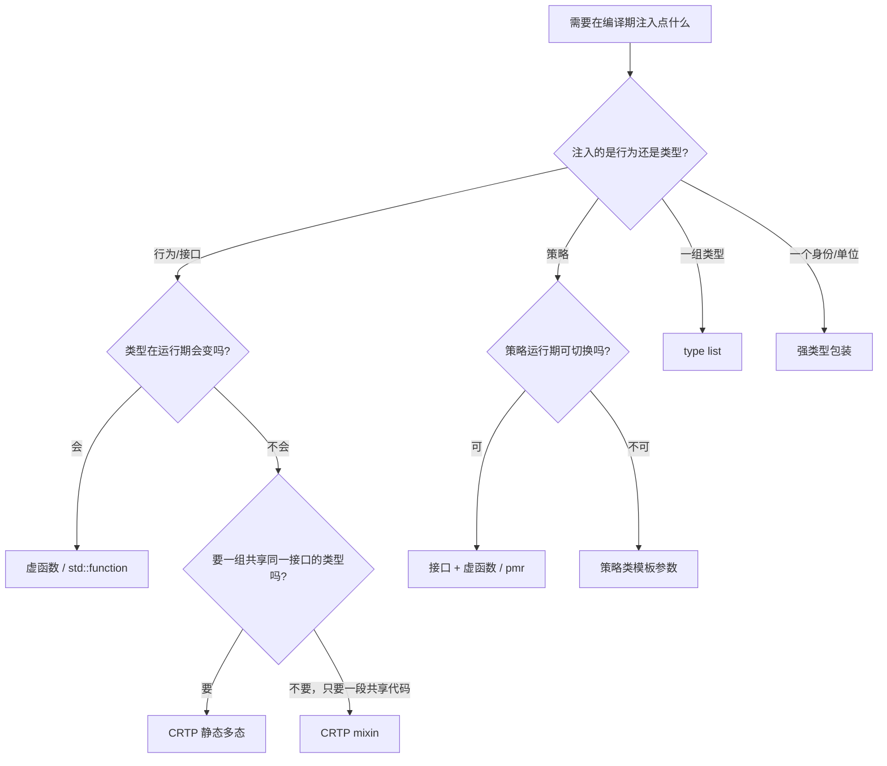

# 07 · 实战模式

> **一句话**：这些模式不是“高级技巧合集”，而是同一个问题的五种答案——**当你需要在编译期把“类型”或“策略”当成参数传进去时，代码该长什么样**；每一种都带着明确的代价，选错方向的代价通常比写错语法更大。

## 从一个重复三遍的需求说起

假设你在写一个资源管理库，需要知道“当前活着多少个对象”，用于泄漏检测。没有模式可用时，你只能给每个类抄一遍：

```cpp
struct Widget {
    static inline int alive = 0;          // C++17 inline 变量
    Widget() { ++alive; }
    Widget(const Widget&) { ++alive; }
    ~Widget() { --alive; }
};

struct Connection { /* 一模一样的三行，改成 ++Connection::alive */ };
struct Session    { /* 再来一遍 */ };
```

三份代码只有一个名字不同。更糟的是，只要有人在某个类里补了移动构造函数，计数就悄悄错位了——这类 bug 不会报错，只会让泄漏检测给出错误结论。

你想要的其实是“把这段行为**注入**到任意类里”。模板能做的事，本质上就是这个：**让行为、策略、类型集合成为可传递的参数**。本章的五个模式，可以看成五条不同的注入路线：

| 你想注入的东西 | 模式 | 关键机制 |
| --- | --- | --- |
| 一段共享的行为 | CRTP / mixin | 基类模板反过来调用派生类的成员 |
| 一组类型 | type list | 把类型打包成值传给模板 |
| 一个“按类型选实现”的决定 | 标签分派（tag dispatch） | 用标签类型的重载决议代替 `if` |
| 一个可替换的策略 | 策略类（policy） | 策略作为模板参数，编译期绑定 |
| 一个“不可混用”的身份 | 强类型包装 | 用 `struct` 把 `int` 包成新类型 |

## 模式一：CRTP（奇异递归模板模式）

CRTP（curiously recurring template pattern）的写法固定得像一句咒语：派生类把自己作为模板实参传给基类。

```cpp
template <class Derived>
class Shape {
public:
    double area() const {
        // 在调用点，Derived 已经是完整类型
        return static_cast<const Derived*>(this)->area_impl();
    }
};

class Circle : public Shape<Circle> {
    double r_;
public:
    explicit Circle(double r) : r_(r) {}
    double area_impl() const { return 3.14159265358979 * r_ * r_; }
};
```

为什么这段代码能编译？因为 `Shape<Circle>::area()` 的函数体是**延迟实例化**的：它只在被调用时才生成，那时 `Circle` 已经定义完整，`static_cast` 的下转型合法。这也解释了它的第一个限制：如果 `Shape` 里写了普通成员函数并在类内直接调用 `area_impl()`（比如放在构造函数里），实例化时机就会早于派生类完成，编译失败。

### 它解决什么问题

1. **静态多态**：调用点不需要虚表，`area()` 可以被内联，`Circle` 的 `area_impl` 也能被内联，整个调用链有可能塌成几条指令。
2. **混入（mixin）**：把一段行为塞进任意类。前面那个计数需求，一次就写完了：

   ```cpp
   template <class Derived>
   struct Counted {
       static inline int alive = 0;
       Counted()            { ++alive; }
       Counted(const Counted&) { ++alive; }
       ~Counted()           { --alive; }
   };

   struct Widget     : Counted<Widget> {};
   struct Connection : Counted<Connection> {};
   ```

   注意每个 `Counted<Widget>`、`Counted<Connection>` 都是**不同的类型**，所以各自有一份独立的 `alive`。这正是 CRTP 里“把自己传进去”的意义：如果写成普通的 `Counted` 基类，所有派生类会共享一个计数器。

   这段 mixin 还藏着一个真实的坑：`Counted` 声明了拷贝构造函数和析构函数，**隐式的移动构造函数因此不会被生成**。于是派生类的默认移动构造函数会退化成“拷贝基类”——上例里计数仍然正确（拷贝也会 `++alive`），但如果基类里持有资源，你会得到一个静默的拷贝而不是移动。

### 代价

- **每种派生类型生成一份基类代码**。`Shape<Circle>`、`Shape<Square>` 是两个毫无关系的类，`std::vector<Shape*>` 装不下它们——CRTP **不能**替代运行期多态。
- **下转型是 `static_cast`**。如果某个类写成 `class Fake : public Shape<Circle>`（把基类写错了），编译能过，运行时就是未定义行为（UB）。虚函数至少会在链接期或运行期暴露问题。
- **错误暴露得晚**。派生类忘了写 `area_impl()`，不会在类定义处报错，而是在第一次调用 `area()` 时炸掉，报错还夹着模板实例化栈。
- **符号膨胀**。每个实例化都是一个独立的类，调试信息、二进制体积、链接时间都会涨。

### 什么时候别用

需要把不同类型的对象放进同一个容器、需要运行期替换实现、需要稳定的二进制接口（ABI）、或者库会被别人继承并滥用时，用虚函数。**只有当某个调用确实出现在热路径上、并且你测出间接调用是瓶颈时**，CRTP 的性能收益才值得这些代价。

::: tip 和虚函数的取舍，一句话版本
需要“一组类型共享一个接口” → 虚函数；需要“一个接口对每种类型有不同实现，但类型在编译期就固定” → CRTP。
:::

## 模式二：Type list

Type list 是把“一组类型”变成可传递对象的办法：它不存值，只存类型。

```cpp
template <class... Ts>
struct type_list {
    static constexpr std::size_t size = sizeof...(Ts);
};
```

`type_list<int, double, std::string>` 是一个**类型**，可以当模板实参传给别的模板。有了它，就能写编译期算法。下面是两个最常用的：

```cpp
#include <type_traits>

template <class T, class List>
struct contains;

template <class T, class... Ts>
struct contains<T, type_list<Ts...>>
    : std::bool_constant<(std::is_same_v<T, Ts> || ...)> {};

static_assert(contains<int, type_list<int, double>>::value);
static_assert(!contains<char, type_list<int, double>>::value);
```

```cpp
template <class T, class List>
struct index_of;                                    // 主模板故意不定义

template <class T, class... Ts>
struct index_of<T, type_list<T, Ts...>>
    : std::integral_constant<std::size_t, 0> {};

template <class T, class U, class... Ts>
struct index_of<T, type_list<U, Ts...>>
    : std::integral_constant<std::size_t,
                             1 + index_of<T, type_list<Ts...>>::value> {};

static_assert(index_of<double, type_list<int, double, char>>::value == 1);
```

两个要点：

- **偏特化的匹配顺序**保证了“找到就停”：`type_list<T, Ts...>` 比 `type_list<U, Ts...>` 更特化，所以第一个命中，递归不会继续。
- **找不到时是“不完整类型”**，报错是 `incomplete type used in nested name specifier`，非常难读。工程里通常给 `index_of<T, type_list<>>` 加一条 `static_assert` 说明“T 不在列表里”，把人话塞进报错。

遍历用折叠表达式最省事。C++20 可以用模板 lambda：

```cpp
template <class... Ts, class F>
void for_each_type(type_list<Ts...>, F&& f) {
    (f.template operator()<Ts>(), ...);
}

// 调用：for_each_type(type_list<int, double>{}, []<class T>() {
//     std::cout << typeid(T).name() << '\n';
// });
```

### 和 `std::tuple` 的关系

`std::tuple<int, double>` 当然也能当类型列表用：`std::tuple_size`、`std::tuple_element` 提供了现成的索引访问，很多库直接拿 `std::tuple<Ts...>` 当 type list。区别在于 **`tuple` 还带有存值的能力**，它的构造函数、析构、对齐都会一起被实例化；纯类型计算用 `type_list` 更轻，也更容易看出意图。标准库没有 `type_list`，所以每个库都自己造一个（Boost.Mp11 叫 `mp_list`）。

### 代价与边界

- **编译期成本和报错深度**。一次 `index_of` 失败会展开成十几层模板栈，这是 type list 最主要的成本。
- **不能做运行期的事**。类型列表在运行期没有任何存在形式（空结构体，`sizeof` 为 1），所以它只能决定“生成哪些代码”，不能决定“执行哪条路径”。
- **只需要两三个固定类型时别用**。直接写重载或者用 Concepts 分别约束更清楚。type list 的价值出现在“类型数量由用户决定”的场合，比如插件注册表、`std::variant` 的替代类型集合。

## 模式三：标签分派（tag dispatch）

标准库的 `std::advance` 是标签分派的教科书例子。它对输入迭代器只能一步步走，对随机访问迭代器可以直接加偏移——同一个函数，按迭代器的能力选不同实现：

```cpp
#include <iterator>

template <class It, class Dist>
void advance_impl(It& it, Dist n, std::input_iterator_tag) {
    while (n-- > 0) ++it;
}

template <class It, class Dist>
void advance_impl(It& it, Dist n, std::bidirectional_iterator_tag) {
    if (n >= 0) { while (n-- > 0) ++it; }
    else        { while (n++ < 0) --it; }
}

template <class It, class Dist>
void advance_impl(It& it, Dist n, std::random_access_iterator_tag) {
    it += n;
}

template <class It, class Dist>
void advance_custom(It& it, Dist n) {
    using category = typename std::iterator_traits<It>::iterator_category;
    advance_impl(it, n, category{});
}
```

关键在最后一行：`category{}` 是一个**空类型**的临时对象，唯一的用途是参与重载决议。而迭代器标签之间是有继承关系的（`random_access_iterator_tag` 派生自 `bidirectional_iterator_tag`，一路到 `input_iterator_tag`），所以“能力层级”天然对应“重载的优先级”：一个随机访问迭代器同时匹配三个重载，最派生的那个胜出。

### 和 `if constexpr` 的对比

```cpp
template <class It, class Dist>
void advance_one(It& it, Dist n) {
    if constexpr (std::random_access_iterator<It>) {
        it += n;
    } else if constexpr (std::bidirectional_iterator<It>) {
        if (n >= 0) { while (n-- > 0) ++it; } else { while (n++ < 0) --it; }
    } else {
        while (n-- > 0) ++it;
    }
}
```

| | 标签分派 | `if constexpr` |
| --- | --- | --- |
| 代码形态 | 一组重载 + 一个转发函数 | 一个函数，分支在体内 |
| 条件来源 | 类型（重载决议） | 常量表达式（布尔） |
| 扩展性 | 新增能力只需加一个重载，不必改原函数 | 必须改原函数 |
| 报错位置 | 指向转发处，容易定位 | 指向分支内部 |
| 语言版本 | C++98 起 | C++17 起 |

**扩展性**是标签分派真正的优势：如果能力集合会被外部库扩展（ADL 找到新的重载），或者分支多到 `if constexpr` 的嵌套已经读不下去，标签分派更合适。反过来，条件只是一个简单的布尔判断时，`if constexpr` 写起来短、读起来直，不用额外引入一个 `_impl` 函数和一组标签。

两者都不处理“运行期才知道”的条件——那种情况只能靠虚函数、函数指针或 `std::function`。

## 模式四：策略类（policy-based design）

策略类的想法很直接：**把行为作为模板参数传进去**，而不是在函数体里写 `if`。

```cpp
#include <cstddef>
#include <iostream>
#include <memory>

struct VerboseLog {
    static void on_alloc(std::size_t n) { std::cout << "alloc " << n << '\n'; }
};

struct SilentLog {
    static void on_alloc(std::size_t) noexcept {}
};

template <class LogPolicy = SilentLog,
          class Alloc = std::allocator<int>>
class Buffer {
    Alloc alloc_;
public:
    void reserve(std::size_t n) {
        int* p = alloc_.allocate(n);
        LogPolicy::on_alloc(n);          // 编译期绑定：SilentLog 时这行是空的
        alloc_.deallocate(p, n);
    }
};
```

在 `Buffer<SilentLog>` 里，`on_alloc` 调用会被完全内联成空，`#ifdef` 都省了。这就是标准库 `std::allocator` 的直觉：容器**不应该知道**内存从哪来，它只要求“给我一个能 `allocate`/`deallocate` 的类型”。`std::vector<T, Alloc>` 的第二个模板参数就是这个策略。

C++17 的 `std::pmr::polymorphic_allocator` 是同一思想的运行期版本：策略不再是类型参数，而是一个持有虚函数的对象。这正好说明了取舍的边界。

### 代价

- **策略是类型的一部分**。`Buffer<VerboseLog>` 和 `Buffer<SilentLog>` 是两个不兼容的类型，不能放进同一个容器，不能通过同一个指针传递。每个策略组合都会实例化一整套代码。
- **类型名会变长**。报错里出现 `Buffer<VerboseLog, std::allocator<int>>` 还算好，嵌套三层之后基本没法读。
- **编译时间**。策略组合是乘法关系，库作者要小心别让策略数量失控。

### 什么时候别用

策略需要在**运行期**决定（比如从配置文件读）、或者策略会频繁组合出新类型时，用接口 + 虚函数，或者直接存一个 `std::function`。如果两个策略的差别只是“要不要打一行日志”，一个 `bool` 成员就够，不值得引入模板参数。

## 模式五：强类型包装

先看一段签名：

```cpp
void transfer(int from_account, int to_account, int amount_cents);
```

这三个 `int` 在类型系统里完全一样。`transfer(a, b, 100)` 和 `transfer(b, a, 100)` 都能编译，转账方向反了也没有任何提示；更有名的一类事故是把“金额（分）”和“金额（元）”混着传。

强类型包装（strong typedef / newtype）的做法是：用模板包一层，让每个概念拥有自己的类型。

```cpp
template <class Tag, class T>
struct Strong {
    T value;
    friend bool operator==(const Strong&, const Strong&) = default;
    auto operator<=>(const Strong&) const = default;      // C++20
};

struct AccountTag;
struct AmountTag;
using AccountId = Strong<AccountTag, int>;
using AmountCents = Strong<AmountTag, long long>;

void transfer(AccountId from, AccountId to, AmountCents amount);

// transfer(AccountId{1}, AccountId{2}, 100);   // 编译错误：int 不会隐式变 AmountCents
```

`Strong` 没有用户声明的构造函数，所以它是聚合（aggregate），`AccountId{1}` 走聚合初始化。`Tag` 参数的作用是让两种包装即使底层类型相同也互不兼容——这就是“强”的含义。

也可以用 `enum class`，但那要求底层是整数、且语义是“枚举若干取值”，不适合包 `std::string` 或浮点数。

### 要不要重载运算符

这是设计上最需要想清楚的一点：

- **相等和比较**：写，而且用 `= default`（C++20）。手写五个比较运算符容易写错一个。
- **算术**：**不要轻易写。** 给 `AccountId` 加 `operator+` 就把它退化成 `int` 了，`id1 + id2` 在业务上通常没有意义。
- **`explicit` 的取值转换**：需要和外界（JSON、数据库、C API）交互时，提供一个显式的 `explicit operator int()` 或 `.value` 成员，让转换留在代码里看得见。
- **`std::hash` 和格式化**：要在 `unordered_map` 里用，就得特化 `std::hash<AccountId>`；要打印，就得特化 `std::formatter`（C++20）或写 `operator<<`。这些是包装类型的固定税。

### 代价

一层包装在编译器优化后通常是零开销的，真正的代价在**工程侧**：每个新类型都要接上 hash、序列化、日志、与外部 API 的转换；ABI 上 `struct { int }` 和 `int` 的传参约定可能不同（取决于平台），跨动态库边界时要确认。

**什么时候别用**：参数只有一个 ID、且不存在混用的可能时，属于过度设计；当类型的值需要直接与外部格式一一对应、且转换层会因此变复杂时，也要先算一下收益。

## 另外两个值得认识的模式

这两个模式在库里出现频率很高，但展开讲会占掉整章篇幅，这里只给“是什么、什么时候用”。

### overloaded lambda + `std::visit`

`std::variant` 的访问需要一组处理函数。把多个 lambda 打包成一个重载集，是标准做法：

```cpp
#include <variant>
#include <string>
#include <iostream>

template <class... Ts>
struct overloaded : Ts... { using Ts::operator()...; };

template <class... Ts>
overloaded(Ts...) -> overloaded<Ts...>;    // C++17 推导指引

int main() {
    std::variant<int, std::string> v = std::string{"hi"};
    std::visit(overloaded{
        [](int i)                { std::cout << "int " << i << '\n'; },
        [](const std::string& s) { std::cout << "string " << s << '\n'; },
    }, v);   // 输出：string hi
}
```

C++20 还允许直接把 `overloaded` 写成 `auto vis = [](auto&& x) { ... }`——用泛型 lambda 一个函数处理所有替代类型，靠 `if constexpr (std::is_same_v<...>)` 区分。**选哪个**：处理逻辑各不相同时，`overloaded` 让“漏了某个类型”变成一个编译错误（没有匹配的 `operator()`），这是它最大的价值；所有类型共享大部分逻辑、只有局部差异时，泛型 lambda 更短。

### 表达式模板（expression templates）

Eigen、Blaze 这类数值库要解决的问题是：`d = a + b + c` 如果按普通写法，会先算 `a + b` 得到一个临时向量，再算 `+ c` 得到第二个临时向量——每个临时都是一整趟内存分配加遍历。表达式模板把 `a + b` **不求出值**，而是返回一个“记录了运算的结构”：

```cpp
template <class L, class R>
struct AddExpr {
    const L& l;
    const R& r;
    double operator[](std::size_t i) const { return l[i] + r[i]; }
};

template <class L, class R>
AddExpr<L, R> operator+(const L& l, const R& r) { return {l, r}; }

// d[i] = a[i] + b[i] + c[i]，一次遍历，零临时对象
```

真正的实现要处理别名、存储顺序、`const` 引用与移动语义，但**直觉就这一句：把运算编译成表达式树，等赋值时再按元素求值**。

代价很实际：`auto x = a + b;` 存的是**引用**，`a`/`b` 一旦是临时对象就会悬垂（这是这类库最常见的 bug）；编译期成本和报错可读性也会显著变差。**什么时候别用**：矩阵维度小、或者这段代码本来就不是热点时，老老实实算临时变量更清楚——现代编译器的内联和向量化往往已经吃掉了大部分收益。

## 选哪个：一张决策图



## 人话总结

<div class="human-note">
<strong>如果只记住一件事：</strong>这些模式都是把“本可以写在运行期的决定”提前到编译期——提前的收益是零开销和更早的报错，代价是类型爆炸、代码膨胀、报错变难。所以判断标准不是“哪个更高级”，而是“这个决定真的必须在编译期做吗”。
</div>

## 常见误解

**误解一：CRTP 是“编译期的虚函数”，可以随便替换虚函数。**

不是。虚函数提供的核心能力是**一个统一的类型 + 运行期选择实现**；CRTP 只有后者的一半：它没有统一类型，`Shape<Circle>` 和 `Shape<Square>` 之间没有任何继承关系，所以你没法写 `std::vector<Shape*>`，也没法在运行期切换。CRTP 换来的是内联机会，不是多态能力。

**误解二：模板一定比虚函数快。**

模板省掉的是**间接调用**，但如果代码因此膨胀、指令缓存命中率下降，整体可能更慢。经验做法是：先写虚函数版本，profile 出热点，再针对那一两个调用点换成 CRTP，并且用 Compiler Explorer 或 `perf` 确认真的变快了。

**误解三：type list 就是 `std::tuple` 的别名。**

`std::tuple<int, double>` 可以存两个值，`type_list<int, double>` 一个值都存不了（它是个空类型，`sizeof` 为 1）。前者是数据结构，后者是**编译期的类型容器**。当然 `std::tuple<Ts...>` 也能当类型容器用，只是会顺带实例化一堆构造/析构相关的代码。

**误解四：强类型包装越多越安全。**

包装本身几乎零开销，但它会把成本转移到集成层：每个类型都要接 hash、序列化、日志、外部 API 转换。一个只有单个 ID 参数的小工具里加三层包装，读代码的人只会多花时间找 `.value`。**只在“混用真的可能发生”的边界上加包装。**

## 本章小结

- CRTP 与 type list 是两种不同性质的编译期注入：前者注入**行为**（静态多态、mixin，收益是内联，代价是没有统一类型、错误暴露晚），后者注入**类型集合**（`contains`/`index_of` 是基本算法，找不到元素时的报错要靠 `static_assert` 补人话）。
- 标签分派用标签类型参与重载决议，扩展性优于 `if constexpr`；条件简单时 `if constexpr` 更短。
- 策略类把行为作为模板参数注入（`std::allocator` 是标准库范例），代价是类型组合爆炸、不能运行期切换。
- 强类型包装防的是“同类型不同含义”的混用，运算符要克制：比较可以默认，算术通常不该有。
- 表达式模板靠延迟求值消除临时对象，代价是悬垂引用风险和可读性，只在数值热点上划算。

## 练习

1. **写一个 `Counter<Derived>`。** 让它能统计“当前存活对象数”和“累计构造次数”，要求：派生类不需要写任何代码就能用；`Counter<Widget>` 与 `Counter<Connection>` 的计数互不干扰。然后加一个 `Widget(Widget&&) = default;`（这会隐式删掉默认构造函数，需要的话补一个 `Widget() = default;`），编译并观察：这个“移动构造”实际调用了基类的哪个构造函数？（提示：它不报错，但也没移动任何东西。）

2. **给 type list 加 `contains<T>` 和 `push_front<T>`。** 要求 `contains` 用折叠表达式实现（不要递归），`push_front` 返回一个新的 `type_list`。再写一个 `static_assert` 验证 `push_front` 之后 `size` 增加了 1。

3. **用 `std::visit` 处理一个 variant。** 定义 `using Value = std::variant<int, double, std::string>;`，用 `overloaded` 写一个 `to_string(Value)`。然后删掉其中一个 lambda，读出编译器给出的报错，说明这条报错为什么比“运行期 `if` 漏了分支”更安全。

4. **改造一段真实签名。** 找到你项目里一个有两个以上相同类型参数的函数（例如 `(int, int)`、`(string, string)`），用强类型包装改造它，然后记录：调用方改了几处、有没有出现意料之外的转换困难。

---

下一篇：[08 · 速查表](/cpp-tmp/08-cheatsheet)
