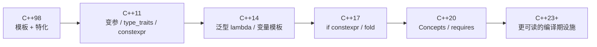

# C++ 模板元编程

> **一句话**：模板元编程（template metaprogramming, TMP）就是利用模板实例化机制，让编译器在编译期完成计算、选择与代码生成。

## 先划清边界

这条路线和前面的“类型论 × Agda”没有必须的联系。你不需要懂依赖类型、Curry–Howard 或宇宙层级，也能把模板用好。

两者只在一点上共享直觉：**类型本身可以被当作值来计算**。在 Agda 里这是语言的核心设计；在 C++ 里它是模板系统“意外长出来”的能力，后来才被标准化。

## 模板到底解决了什么问题

先看一个没有模板的世界：

```cpp
int max_int(int a, int b) { return a > b ? a : b; }
double max_double(double a, double b) { return a > b ? a : b; }
std::string max_string(std::string a, std::string b) { return a > b ? a : b; }
```

三个函数体一模一样，只是类型不同。模板让你只写一次：

```cpp
template <typename T>
T max(T a, T b) { return a > b ? a : b; }
```

但这只是起点。模板元编程做的是让编译器在程序还没运行时就完成这些事：

- 类型选择：根据条件选出不同的类型（`std::conditional`）。
- 数值计算：编译期算阶乘、斐波那契（`constexpr` / 模板递归）。
- 接口约束：只允许满足某些条件的类型调用（SFINAE、Concepts）。
- 代码生成：把参数包展开成任意长度的调用（变参模板、折叠表达式）。

## 一张演化地图



每一次演进都在解决同一个问题：让编译期计算更安全、更可读、报错更友好。

## 前三章和后三章的分工

前六篇把机制一个一个拆开看：推导、特化、`constexpr`、trait、参数包、Concepts。它们回答的是“这个语法在做什么”。但真实项目里的模板代码，难点不在单个语法，而在**几件机制必须一起协作，并且要能编译得动、报错看得懂、性能说得清**。

所以第 07 篇先给出五种模式的全景，第 08–10 篇是三个连续实战：每个都从零写一个小库，最后和真实库对照。

| | 你写出来的东西 | 用到的机制 |
| --- | --- | --- |
| 08 格式串检查 | 一个能编译期报错的 `format` | 字符串进类型、`consteval` 解析、concept 检查、tuple 展开 |
| 09 结构体序列化 | 一份字段表驱动 JSON 读写 | 成员指针、ADL、`apply` + 折叠、`if constexpr` 分派 |
| 10 类型擦除 | 一个能装进数组的 `Task` 和一张命令表 | 手写 vtable、约束构造函数、编译期注册表、实测对比 |

三章合起来覆盖了“高级模板”在工程里真正难的部分：把类型信息组织成数据、让编译器替你展开重复代码、最后用数字判断这次抽象值不值。

## 章节

<div class="chapter-grid">
  <a class="chapter-card" href="01-template-basics">
    <span class="no">01</span><span class="t">模板基础</span>
    <span class="d">函数模板、类模板、推导、实例化：先看清“代码是怎么被生成的”。</span>
  </a>
  <a class="chapter-card" href="02-specialization">
    <span class="no">02</span><span class="t">特化与偏特化</span>
    <span class="d">为特定类型开小灶，以及特化与重载、ADL 的配合方式。</span>
  </a>
  <a class="chapter-card" href="03-constexpr">
    <span class="no">03</span><span class="t">constexpr 编译期计算</span>
    <span class="d">从模板递归到 constexpr 函数：更接近“正常写代码”的编译期计算。</span>
  </a>
  <a class="chapter-card" href="04-type-traits-sfinae">
    <span class="no">04</span><span class="t">type_traits 与 SFINAE</span>
    <span class="d">替换失败不是错误：用 enable_if 和 void_t 做编译期分派。</span>
  </a>
  <a class="chapter-card" href="05-variadic-templates">
    <span class="no">05</span><span class="t">变参模板</span>
    <span class="d">参数包、递归展开、折叠表达式，以及完美转发。</span>
  </a>
  <a class="chapter-card" href="06-concepts">
    <span class="no">06</span><span class="t">Concepts</span>
    <span class="d">C++20 如何把“这个类型必须支持什么操作”写进签名。</span>
  </a>
  <a class="chapter-card" href="07-patterns">
    <span class="no">07</span><span class="t">实战模式</span>
    <span class="d">类型列表、标签分派、CRTP、表达式模板与策略类。</span>
  </a>
  <a class="chapter-card" href="08-format-checker">
    <span class="no">08</span><span class="t">实战：编译期格式串检查</span>
    <span class="d">把字符串搬进类型系统，用 static_assert 检查占位符数量与实参类型。</span>
  </a>
  <a class="chapter-card" href="09-serialization">
    <span class="no">09</span><span class="t">实战：结构体序列化</span>
    <span class="d">成员指针 + tuple 字段表，一份描述同时驱动 JSON 读写。</span>
  </a>
  <a class="chapter-card" href="10-type-erasure">
    <span class="no">10</span><span class="t">实战：类型擦除</span>
    <span class="d">手写 vtable 把不同类型装进同一个容器，并用实测回答“值不值”。</span>
  </a>
  <a class="chapter-card" href="11-cheatsheet">
    <span class="no">11</span><span class="t">速查表</span>
    <span class="d">常用 traits、语法模板、报错对照，以及机制到真实库的索引。</span>
  </a>
</div>

## 学习建议

1. 先接受“模板是代码生成器”。不要一开始就背 `std::enable_if` 的语法，先写一个最简单的模板，看编译器实例化出了什么。
2. 用 Compiler Explorer 观察汇编。模板的很多“零成本抽象”说法，只有看到生成的汇编才会相信；如果看不到差别，八成是被优化掉了，而不是“没有成本”。
3. 遇到长报错先找第一行。C++ 模板报错往往几十行，最有用的通常是“no matching function”之后的第一条候选失败原因。
4. 优先用新工具。能用 `if constexpr` 就不用 SFINAE，能用 Concepts 就不用 `enable_if`。老技巧要认识，但不一定要主动写。
5. 读完第 07 篇后不要停在“知道有这些模式”，按 08–10 的顺序各写一遍。只有自己写过一份字段表、一份 vtable，才知道真实库为什么那样分层。

::: tip 和类型论的关系
如果你已经读过类型论路线，可以把 C++ 模板看成一种**不保证终止、不保证一致、没有类型检查器保护的编译期函数式语言**。这个比喻不精确，但对理解 `template` 的计算能力很有帮助。
:::
