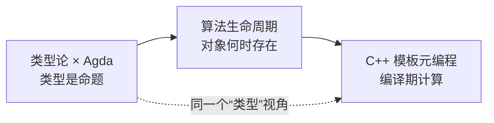

# 阅读指南

这是一个“用代码讲清楚概念”的站点，不是三本教科书的拼盘。三条路线各自有完整的叙事，也会在关键处互相指路。

## 三条路线

| 路线 | 核心问题 | 适合谁 | 前置知识 |
| --- | --- | --- | --- |
| [类型论 × Agda](/type-theory/) | 类型、命题、证明为什么是同一件事？ | 想理解类型系统底层逻辑的人 | 会写任意一门语言的基本函数即可 |
| [算法中的生命周期](/lifetime/) | 一个对象/资源/引用到底“活”到什么时候？ | 被悬垂指针、迭代器失效、回调踩过坑的人 | 会 C++ 基础语法（或愿意看对照） |
| [C++ 模板元编程](/cpp-tmp/) | 编译器能在运行前替我们做多少事？ | 想读懂/写出模板库的 C++ 使用者 | 会函数、类、基本 STL |

## 三条路线怎么配合



- **类型论**给你一个更准确的词汇表：类型、项、依赖、命题、证明。以后看到 `std::vector<T>`、Rust 的 `&'a T`、TypeScript 的联合类型，你会更容易说出它们“到底在保证什么”。
- **生命周期**把视角从“类型对不对”拉到“时间上对不对”。很多线上 bug 不是类型错误，而是对象已经死了，代码还在用它。
- **C++ 模板元编程**是工程 side quest：它和类型论没有必须的依赖关系，但共享一个直觉——**类型本身也可以被计算**。

## 代码约定

- Agda 代码使用 ```` ```agda ```` 代码块。示例尽量自包含，不依赖标准库；需要标准库时会明确写出 `open import`。
- C++ 代码默认 C++20，涉及 C++23 的地方会标注。示例以“能说明问题”为优先，不追求工业级封装。
- 术语第一次出现时给出英文原文，例如：**依赖类型（dependent type）**。
- 所有“人话解释”都会尽量配一个反例。只给正例的教程，通常会让人误以为自己懂了。

## 怎么读最有效

1. **先读每章开头的“一句话”**，确认这一章要解决什么问题。
2. **手敲代码**。尤其是 Agda：复制粘贴会错过 `C-c C-l` 加载、`C-c C-,` 看目标类型这些真正有用的交互。
3. **读“常见误解”小节**。每章末尾会列出初学者最容易混淆的点。
4. **做章末练习**。练习不多，但每道都对应一个真实的理解缺口。

::: tip 一个提醒
类型论不是“更高级的编程”，生命周期也不是“C++ 才有的麻烦”。它们只是两套描述程序行为的语言。学它们的目的，是让你在 Debug 时能更快地问出正确的问题。
:::
