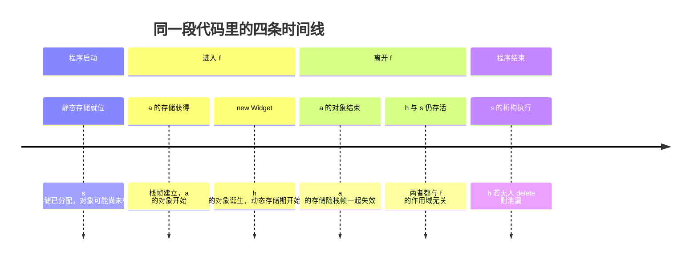

# 01 · 生命周期的三层含义

> **一句话**：生命周期不是一条时间线，而是四条——内存存在多久（存储期）、名字看得见多久（作用域）、对象活着多久（对象生命周期）、你能安全地通过它访问目标多久（引用有效期）；绝大多数“诡异的生命周期 bug”，都来自把它们当成同一条线。

## 先看一个不会报错的 bug

```cpp
#include <iostream>
#include <string>
#include <string_view>

std::string_view greeting() {
    std::string s = "hello";
    return s;              // 返回的是 s 的视图，不是副本
}

int main() {
    std::string_view v = greeting();
    std::cout << v;        // 这是 UB，不要依赖实际输出
}
```

这段代码能编译、能链接，通常还能打印出一个结果。`std::string_view` 只是“指针 + 长度”，构造它的时候一个字符都没有拷贝。而 `s` 在 `greeting` 返回的那一刻就被销毁了，`v` 仍然指着那块已经失效的存储。

为什么它“看起来哪里都对”？因为写代码时的三个直觉同时成立，又同时不够用：

- “`s` 是函数的局部变量，函数结束它就该没了。”——这条对。
- “我返回的是一个 `string_view` 值，按值返回总是安全的。”——这条只对了“视图对象本身”，错了“它指向的东西”。
- “类型检查都通过了，应该没问题。”——类型系统不认识“它指向的东西还活着吗”这件事。

要把这类问题说清楚，需要四个词，而不是一个。

## 存储期：这块内存存在多久

存储期（storage duration）回答一个很物理的问题：**为某个变量准备的存储（storage），从什么时候开始有效，到什么时候失效。** C++ 有四种。

### automatic：随块而生，随块而灭

块作用域里不加 `static`、`thread_local`、`extern` 的变量，以及函数参数，都是自动存储期。它们在**定义语句被执行到**时获得存储，在离开所属块时释放。

```cpp
void f() {
    int a = 1;              // 执行到这一行，a 才拿到存储
    if (a) {
        int b = 2;          // 进入 if 块，b 拿到存储
    }                       // 离开 if 块，b 的存储被释放
}                           // 离开函数，a 的存储被释放
```

“自动”指的是释放代码由编译器生成，你不用写 `delete`。它和函数调用栈绑定，下一篇会展开细节。

### static：程序活多久，它活多久

命名空间作用域的变量、块作用域里加了 `static` 的变量、类的静态数据成员，都是静态存储期。它们在程序启动过程中获得存储，在程序结束时释放，**全程只有一份**。

```cpp
int g = 0;                     // 命名空间作用域

void tick() {
    static int calls = 0;      // 第一次执行到此处初始化，之后一直存在
    ++calls;
}
```

块作用域的 `static` 变量，初始化发生在“第一次执行到定义处”（C++11 起保证这个初始化是线程安全的），但存储的分配早于那次执行；销毁发生在 `main` 返回之后。

### thread：每个线程一份

`thread_local` 变量。每个线程各有一份，在线程开始时（或该线程第一次执行到定义处时）创建，在线程结束时销毁。

```cpp
thread_local int depth = 0;    // 每个线程独立的递归深度
```

### dynamic：你申请，你负责

由 `new` / `malloc` 分配、由 `delete` / `free` 释放的存储。开始于分配成功，结束于显式释放。**没有任何作用域与它绑定**——这既是它能“活过函数返回”的原因，也是内存泄漏的来源。

```cpp
int* p = new int(42);          // 动态存储期开始
delete p;                      // 动态存储期结束
```

四种放在一起：

| 存储期 | 何时获得 | 何时释放 | 典型写法 |
| --- | --- | --- | --- |
| automatic | 执行到定义处 | 离开所属块 | `int x;` |
| static | 程序启动（初始化可推迟到首次经过） | 程序结束 | 全局变量、`static int n;` |
| thread | 线程开始（或首次经过） | 线程结束 | `thread_local int n;` |
| dynamic | `new` / `malloc` 成功 | `delete` / `free` | `new T` |

注意这里的用词：**存储期描述的是“存储”，不是“对象”。** 一块存储可以存在，但里面没有活着的对象。这句话在第 4 节会兑现。

## 作用域：这个名字在哪段代码里可见

作用域（scope）是**编译期**概念：一个名字在源代码的哪一段区间内可以被写出来。它不占运行时资源，也不生成任何机器指令。

```cpp
namespace net {                  // 命名空间作用域
int port = 80;

struct Conn {                    // 类作用域
    int fd = -1;                 // 成员名在类内可见
    void close();
};

void Conn::close() {}            // 函数作用域（函数体）
}

void run(int n) {                // 参数 n 的作用域是整个函数体
    int total = 0;
    for (int i = 0; i < n; ++i) {   // i 的作用域是整个 for 语句
        int tmp = i * 2;            // tmp 的作用域是循环体
        total += tmp;
    }
    // 这里既看不到 i，也看不到 tmp
}
```

作用域有三条容易忽略的性质：

1. **作用域可以嵌套，内层可以遮蔽（shadow）外层。** 遮蔽不是“外层变量被销毁”，只是这个名字暂时指向了另一个实体。
2. **作用域结束只意味着名字不可见。** 它不保证对象被销毁（`static` 就是反例），也不保证存储被归还（`new` 出来的对象更是如此）。
3. **作用域是静态的，用眼睛就能看出来。** 看大括号和声明位置即可确定；对象的生死却是运行时的，取决于控制流走到哪里。

第 3 条是很多争论的根源：两个人在讨论“这个变量什么时候没”，一个人说的是名字，另一个人说的是对象。

## 对象生命周期：从构造完成到析构开始

对象生命周期（object lifetime）是标准里定义得最精确的一个。对类类型：

> 对象的生命周期开始于**初始化完成**，结束于**析构函数开始执行**。

对非类类型（`int`、指针等），生命周期开始于存储获得且初始化完成，结束于存储被释放或被复用。

这三句话要拆开读：

- **“初始化完成”不等于“存储获得”。** 存储可以早就有了，对象可以晚一点才诞生。
- **“析构开始”不等于“内存归还”。** 析构只是把对象变成“不再是一个对象”，存储块还在原地。
- **对象结束之后，那块存储里可能还有一模一样的字节。** 字节不是对象。

用定位 new（placement new）能把这两条时间线彻底掰开：

```cpp
#include <new>

struct Widget {
    int id;
    ~Widget() { /* 释放 Widget 自己持有的东西 */ }
};

alignas(Widget) unsigned char buf[sizeof(Widget)];  // 存储先有了
Widget* w = new (buf) Widget{7};                     // 对象此刻才诞生
w->~Widget();                                        // 对象此刻结束
// buf 这块存储仍然有效，但里面已经没有 Widget 了
```

反过来，`delete` 做的是两件事：先调用析构函数（对象结束），再释放存储（存储期结束）。这两件事被一个关键字绑在一起，所以很多人误以为它们本来就是一件事。

## 引用有效期：观察者的时间窗

前三层描述的都是“被观察的东西”，而代码里真正出问题的往往是“观察者”：指针、引用、迭代器、`std::string_view`、`std::span`，以及 lambda 捕获的引用。

引用有效期（reference validity）不是标准术语，它描述的是一件工程事实：

> 从你拿到这个指针/引用/视图开始，到它指向的对象生命周期结束为止，这段时间内通过它访问是安全的；之后访问就是未定义行为（undefined behavior，UB）。

它有三个特点：

1. **它是派生量，不独立存在。** 引用的有效期由“目标对象活了多久”和“你是否还持有它”共同决定。
2. **类型系统不跟踪它。** `std::string_view` 可以从 `std::string` 构造出来，但前者不包含“我指向的字符串还活着”这条信息。编译器只在少数能静态判定的场景给出警告，例如返回局部变量的地址。
3. **它可以在你的变量一个字都没改的情况下失效。**

```cpp
std::vector<int> v{1, 2, 3};
int& first = v[0];          // first 有效
v.push_back(4);             // 可能重新分配，first 悬垂（dangling）
std::cout << first;         // UB，不要依赖实际输出
```

`first` 依然是 `int&`，依然能编译，依然能读出一个整数。类型没变，变的是它指向的对象已经不在了。

## 四条能直接用在 review 里的结论

**结论一：作用域结束 ≠ 对象销毁。**

```cpp
const std::string& name() {
    static const std::string n = "forge";
    return n;                 // 安全：n 活到程序结束
}
```

`n` 的作用域只在函数体内，但对象活到程序结束。反方向的错位同样常见：`new` 出来的对象可以在作用域结束后继续活着，只是没人再持有它的地址。

**结论二：对象销毁 ≠ 存储归还。**

析构函数执行完，对象就“死”了，但栈帧那块内存要等函数返回才回收，堆上的块要等 `delete` 才归还。所以对象销毁后继续访问，读到的往往是“上次留下的字节”，而不是立刻崩溃——这正是这类 bug 难以复现的原因。

**结论三：存储还在 ≠ 对象还活着。**

这是结论二的另一面，也是最容易踩的：内存是字节，对象是字节加生命周期。生命周期结束后，那块内存即使一个字节都没被改写，也不能再当作原来的对象使用。

**结论四：引用的有效期由目标决定，不由持有者决定。**

你把引用传给谁、存到哪里、拷贝多少份，都不会延长目标的寿命。能延长寿命的语言机制只有一种（`const&` 直接绑定临时对象），能用工程手段保证的也只有一种（用所有权类型把目标一起带在身上）。

## 一张图看清四条时间线

下面画的是函数 `f()`：它有一个局部对象 `a`、一个静态局部对象 `s`、一个 `new` 出来的对象 `h`。



看这张图只需要抓住一件事：**四条线不是同时开始，也不是同时结束。** 任何“它到底还在不在”的问题，都要先问清“你说的是哪条线”。

## 四者对照表

| 概念 | 回答的问题 | 开始 | 结束 | 编译期 / 运行期 |
| --- | --- | --- | --- | --- |
| 存储期 | 这块内存能安全读写多久 | 分配成功 | 释放 | 运行期（`static` 部分在启动时） |
| 作用域 | 这个名字能在哪里写出来 | 声明点之后 | 所在块结束 | 编译期 |
| 对象生命周期 | 这个对象还算不算存在 | 初始化完成 | 析构开始 | 运行期 |
| 引用有效期 | 通过它能安全访问目标吗 | 引用建立 | 目标生命周期结束 | 运行期，类型系统不跟踪 |

## 其他语言里，这四条线归谁管

- **Rust**：把“引用有效期”直接写进了类型。`&'a T` 里的生命周期参数（lifetime parameter）就是编译器核对“借用不能比所有者活得久”的依据；违反时是编译错误，而不是 UB。
- **Python / Java**：对象都住在堆上，存储的回收交给引用计数或垃圾回收（GC）。作用域结束只意味着名字消失、引用少了一个，对象可能还活着。它们消灭了“栈帧地址被带出去”这类问题，但没有消灭“逻辑上早就不该再用”的问题。

换句话说，别的语言是在替你关掉某几条线，而不是让这四条线合并成一条。

## 人话总结

<div class="human-note">
<strong>如果只记住一件事：</strong>“生命周期”是四条线，不是一条：内存、名字、对象、引用。右大括号 <code>}</code> 只关掉第二条线；<code>delete</code> 同时关掉第一和第三条；而引用这条线，没有任何人替你盯着，只有你自己。
</div>

## 常见误解

**误解一：出了大括号，变量就没了。**

“没了”的只是名字。块作用域的 `static` 变量出了块照样存在，`new` 出来的对象更是和块没有任何关系。准确说法是：自动存储期的变量在离开块时销毁并释放存储，其他存储期不受影响。

**误解二：`delete` 之后内存就还给系统了。**

`delete` 做两件事：调用析构函数、把存储归还给分配器。归还给分配器不等于还给操作系统，那块内存通常还留在进程地址空间里，只是被标记为可复用。所以 `delete` 之后继续访问，可能读到完好的旧数据——这不代表它是对的，它仍然是 UB。

**误解三：作用域和生命周期是一回事。**

作用域是名字的可见范围，编译期概念；对象生命周期是对象的存亡，运行期概念。两者经常重合，只是因为大多数变量恰好是自动存储期。一旦引入 `static`、`thread_local`、`new` 或返回引用，它们立刻分家。

**误解四：编译器会帮我抓悬垂引用。**

编译器只在少数静态可判定的场景报警告，比如返回局部变量的地址或引用。跨函数、经过容器、经过回调的悬垂，它基本看不见——这恰恰是后面几篇要讲的全部内容。

## 本章小结

- 存储期分四种：automatic、static、thread、dynamic，它决定存储何时有效。
- 作用域是编译期的名字可见范围，与对象的生死没有必然关系。
- 对象生命周期从初始化完成到析构开始；析构完成不等于存储释放。
- 指针、引用、迭代器、`string_view` 的有效期由目标的生命周期决定，类型系统不跟踪。
- 遇到“这个还能用吗”，先确认问的是哪条时间线。

## 练习

1. 下面每个标号的变量分别是什么存储期？作用域到哪里？对象生命周期到什么时候？哪个 `return` 返回的引用是悬垂的？

   ```cpp
   #include <string>
   #include <vector>

   std::vector<std::string> cache;                    // (a)

   const std::string& lookup(int id) {
       static std::string fallback = "none";          // (b)
       std::string local = "id=" + std::to_string(id); // (c)
       if (id == 0) return fallback;                  // (d)
       return local;                                  // (e)
   }
   ```

2. 下面这段代码哪里悬垂？给出两种修法，并说明各自的代价。

   ```cpp
   std::string_view make_label(int n) {
       std::string s = "item-" + std::to_string(n);
       return s;
   }
   ```

3. 判断对错并说明理由：“`std::string s = "hi";` 离开作用域后，`s` 占用的内存立刻被清零。”

4. 用一句话区分“对象被销毁”和“存储被释放”，各举一个能观察到差别的例子（提示：析构函数里打印一行，再在 `delete` 之后读那块内存）。

---

下一篇：[02 · 栈、堆与作用域](/lifetime/02-stack-heap-scope)
