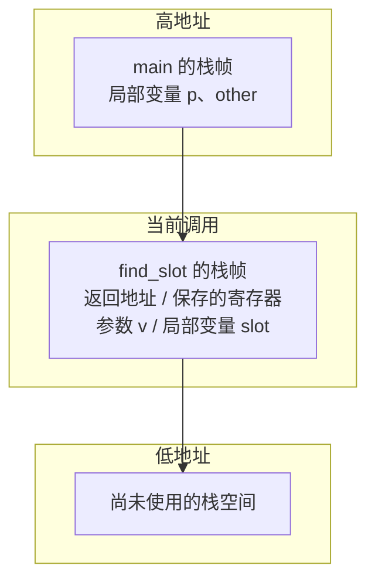

# 02 · 栈、堆与作用域

> **一句话**：函数调用就是压入一个栈帧、返回时弹出它；局部变量住在栈帧里，所以函数一返回，它们就随栈帧一起失效——你带走的只能是一份副本，不能是那块存储的地址。

## 一个“有时候对、有时候错”的函数

```cpp
#include <cstdio>

int* find_slot(int v) {
    int slot = v * 2;
    return &slot;          // 返回局部变量的地址
}

int main() {
    int* p = find_slot(21);
    std::printf("%d\n", *p);   // 这是 UB，不要依赖实际输出

    int other = 999;
    std::printf("%d\n", *p);   // 仍然是 UB，输出更不可信
    (void)other;
}
```

很多人第一次遇到这个 bug 时，看到的现象是“第一行打印 42，看起来完全正确”。于是判断“这样写没问题”，直到某次多调用了一个函数，输出变成了乱码或进程直接崩溃。

问题不在输出，而在**这段代码从一开始就是未定义行为（undefined behavior，UB）**。`slot` 的存储期在 `find_slot` 返回时结束，之后 `p` 指向的那块存储不再代表任何对象。读它得到什么，标准不作任何承诺。

GCC 会给出 `-Wreturn-local-addr` 警告，Clang 会给出 `-Wreturn-stack-address`（属于 `-Wall`），MSVC 会给出 C4172；但默认设置下它们通常只是警告，代码照样能编译出来。所以我们得自己知道为什么错。

## 一次函数调用发生了什么

先建立一个概念模型：**调用栈（call stack）由一个个栈帧（stack frame，也叫活动记录 activation record）串起来；每次函数调用压入一个栈帧，函数返回时它被弹出。**

一个栈帧里通常放着这些东西：

- 返回地址：函数执行完后该跳回哪里；
- 保存的寄存器：调用者希望你归还的那几个；
- 参数：放不下的、或者取了地址的那些；
- 局部变量：没被优化进寄存器的那些；
- 一些对齐填充，有时还有栈保护用的 canary 值。



这张图有三处必须说清楚，否则后面全会理解错：

1. **它是概念模型，不是内存布局规范。** 参数和局部变量具体放在哪里、按什么顺序放、是否向上还是向下增长，由 ABI（application binary interface，应用二进制接口）和编译器决定。x86-64 上栈通常向低地址增长，但这不是 C++ 语言的规定。
2. **编译器可以完全消除栈帧。** 函数被内联、局部变量被放进寄存器、尾调用被优化掉，这些都很常见。你写的“压栈”“弹栈”在优化后的机器码里可能根本不存在。
3. **它描述的是 automatic 存储期的实现方式**，不是所有变量都住在栈上。

有了这个模型，`find_slot` 的问题就很直白了：`slot` 是 `find_slot` 栈帧的一部分。函数返回时栈帧被弹出，`slot` 的存储期随之结束。`main` 手里的 `p` 是一个地址，指向一块“已经不属于任何对象”的栈空间。

## 为什么不是“内存立刻被覆盖”

这里有一个非常常见的错误理解，值得单独拆开：

> “函数返回后，局部变量的内存就被清空/覆盖了。”

两件事都不对：

- **不会被清空。** 弹出栈帧通常只是把栈指针挪回去，一个字节都不会写。
- **不会被立刻覆盖。** 那块空间只是重新变成“可用”，要等下一次函数调用用到它时才会被写入。

所以实际情况是：**存储还在，字节通常还是原样，但对象已经不存在了。** 你通过 `p` 读到的，是“一段没有对象的存储”。读它是 UB；在某些实现上它恰好还是 42，在另一些实现上它已经被新调用的栈帧改写。两种表现都符合标准，因为标准对此不作要求。

这也解释了为什么这类 bug 特别难查：它不报错、不崩溃、不复现，只在你演示给老板看的那一刻出问题。

::: warning 不要用“实际输出”验证 UB
“我跑了一下，打印出来是对的”不能作为“代码正确”的证据。UB 的含义就是编译器可以做任何事，包括在换个优化等级、换个编译器、加一行日志之后，行为完全改变。
:::

正确的写法只有一条路：**返回值，而不是返回地址。**

```cpp
int find_slot(int v) { return v * 2; }              // 返回值：安全
std::string make_name() { return "forge"; }         // 返回对象：安全，靠移动/拷贝
```

返回对象为什么安全？因为返回的是**一个新对象**（拷贝或移动构造出来的），它住在调用者的栈帧或调用者指定的位置里，与 `make_name` 的栈帧无关。这一点在第 03 篇讲移动语义时会再碰到。

## 栈溢出：栈不是无限的

栈的大小由操作系统和链接选项决定，不是由语言决定。Linux 上主线程栈常见默认 8 MB，Windows 上常见 1 MB（可用链接器 `/STACK` 调整）。超过这个范围的访问会撞到保护页（guard page），进程通常被操作系统杀掉。

两种典型触发方式：

```cpp
// 一：超大局部数组
void f() {
    int buf[1'000'000];    // 4 MB，在 1 MB 栈上直接溢出
    buf[0] = 1;
}

// 二：过深的递归
int dfs(int depth) {
    int local[64];         // 每层 256 字节
    local[0] = depth;
    return dfs(depth + 1) + local[0];   // 没有终止条件，也没有尾调用保证
}
```

第二段要注意两点：C++ 标准**不保证**尾调用优化（tail call optimization），所以“递归写得像循环”不等于不会爆栈；而 `local` 的存在让每层栈帧变大，爆得更快。

修法都很直接：大数组改用 `std::vector`（数据在堆上），深递归改成显式栈的迭代，或者用 `std::stack` 保存状态。

```cpp
void f() {
    std::vector<int> buf(1'000'000);   // 对象在栈上，元素在堆上
    buf[0] = 1;
}
```

注意 `std::vector` 这个例子本身也说明了一件事：**“栈上的对象”和“对象的数据在哪”是两回事。** `buf` 这个对象（指针 + 大小 + 容量，通常 24 字节）确实在栈上，它管理的百万个整数在堆上。

## 堆（heap）：为什么它能活过函数返回

动态存储期（dynamic storage duration）由 `new` / `delete` 或 `malloc` / `free` 管理。分配器向操作系统要内存（大块通常走 `mmap`/`VirtualAlloc`，小块从已有的 arena 里切），归还时也不一定马上还给系统。

```cpp
#include <memory>

std::unique_ptr<int> make_counter() {
    return std::make_unique<int>(0);   // 对象在堆上，返回的是所有权
}

int main() {
    auto counter = make_counter();     // 函数早就返回了，对象还活着
    *counter += 1;
}                                       // counter 析构，delete 自动执行
```

堆上的对象之所以能活过函数返回，原因很朴素：**它的存储期不由任何作用域决定，只由 `delete` 决定。** 栈帧弹不弹、函数返不返回，跟它没关系。

代价是责任转移了：谁 `new`，谁就要保证有人 `delete`；一旦这个“有人”没落实，就是泄漏。第 03 篇会用 RAII 把这份责任制度化。

::: tip `new` 与 `malloc` 的区别，只记两条
`new` 会调用构造函数、失败时抛 `std::bad_alloc`；`malloc` 只给一块字节、失败返回 `nullptr`。混用（`new` 配 `free`、`malloc` 配 `delete`）是 UB，不要试。
:::

## 静态与全局：最长命的存储，最麻烦的初始化

静态存储期的对象从程序启动活到程序结束，比任何栈帧都长。它们的问题不在“活多久”，而在“什么时候被初始化”。

```cpp
// a.cpp
int g_count = 42;

// b.cpp
extern int g_count;
int g_double = g_count * 2;   // g_double 可能是 0，也可能是 84
```

两个不同翻译单元（translation unit）里的全局对象，初始化顺序**未指定**。如果 `b.cpp` 的 `g_double` 先初始化，`g_count` 还是零初始化状态，结果是 0。这个问题有个专门的名字：静态初始化顺序灾难（static initialization order fiasco）。

常见的两种规避方式：

```cpp
// 方式一：把全局对象换成函数内 static，初始化推迟到第一次调用
int& count() {
    static int value = 42;    // C++11 起，这个初始化是线程安全的
    return value;
}

// 方式二：C++20 的 constinit，要求必须是常量初始化
constinit int kLimit = 1024;  // 编译期完成，不存在顺序问题
```

`constinit` 只能保证“常量初始化”，不能用于需要动态构造的类型（比如 `std::string`）。判断标准是：它的初始值必须在编译期就能算出来。

## 作用域结束、对象还活着的两个例子

这一节把上一篇的抽象结论落到两个具体场景。

**例子一：块作用域里的 `static`。**

```cpp
const std::string& tag() {
    static const std::string t = "v1";
    return t;                 // 安全
}
```

`t` 的作用域是函数体，但它活到程序结束。所以返回它的引用是安全的——它既不会提前销毁，也没有人能通过这个 `const` 引用改掉它。这也是为什么单例常用这种写法。

**例子二：块里 `new` 出来的对象。**

```cpp
Widget* w = nullptr;
{
    w = new Widget{};
}                             // 块结束，w 这个名字还在，对象也还在
delete w;                     // 真正结束对象的是这一行
```

大括号只结束了 `w` 这个名字的作用域，没结束对象本身。把这两件事混在一起，就会写出“出了块就以为已经释放”的泄漏。

## 其他语言怎么处理同一件事

- **Rust**：局部变量默认在栈上，`Box<T>` 在堆上。返回局部变量的引用会**编译失败**，错误信息通常是 `returns a reference to data owned by the current function`。这不是运行时检查，是借用检查器（borrow checker）在类型层面拒绝了它。
- **Python**：所有对象都在堆上，变量只是名字绑定。函数返回对象永远安全，因为返回的是引用，对象的存活由引用计数和循环垃圾回收（garbage collection，GC）决定。代价是你无法精确知道它什么时候被回收。
- **Java**：局部变量（基本类型值和引用）在栈上，对象在堆上。返回对象引用安全；语言里没有“指向局部变量的引用”这种类型，所以这类 bug 从语法上就不存在。回收时机由 GC 决定，`finalize` 早已不推荐使用。

三种语言都在用不同的机制回答同一个问题：**这块存储归谁管、管到什么时候。** C++ 把答案交给你，所以你必须知道栈帧是什么。

## 人话总结

<div class="human-note">
<strong>如果只记住一件事：</strong>栈帧是函数调用的“桌面”，函数返回时桌面被收走；你能带走桌上的东西的<em>复印件</em>，带不走桌子本身。想在函数返回后还留着某个东西，要么把它复制出来，要么把它放到堆上并说清楚谁负责收。
</div>

## 常见误解

**误解一：函数返回后，局部变量的内存会被清零。**

不会。弹出栈帧通常只是移动栈指针，字节保持原样。危险恰恰来自“看起来还是原来的值”——对象已经没了，字节还在。

**误解二：只要局部变量没被覆盖，读它就没事。**

“没被覆盖”是运行时的偶然状态，不是语言保证。对象生命周期结束后访问就是 UB，编译器有权假设它不会发生，并据此做优化（例如把整段读取删掉）。

**误解三：递归写成尾递归就不会爆栈。**

C++ 不保证尾调用优化。是否优化取决于编译器、优化等级、函数复杂度。要控制栈深度，就显式用循环或自己的栈。

**误解四：`std::vector` 的元素和它一起放在栈上。**

`vector` 对象本身很小（通常三个指针大小），元素在堆上。真正会把 4 MB 压在栈上的是 `std::array<int, 1000000>`，那才是货真价实的栈上数组。

## 本章小结

- 每次函数调用压入栈帧，返回时弹出；栈帧里通常有返回地址、保存的寄存器、参数和局部变量，具体布局由 ABI 决定。
- 局部变量的存储期随栈帧结束，返回它的地址或引用是 UB，而不是“值会变”。
- 栈大小有限，超大局部数组和深递归都会导致栈溢出；大块数据应放到堆上。
- 堆上的对象只由 `delete` 结束，因此能活过函数返回，也因此需要明确的所有权。
- 静态对象的寿命最长，但跨翻译单元的初始化顺序未指定，需要用函数内 `static` 或 `constinit` 规避。

## 练习

1. 指出下面三段代码各自的问题，并给出修法：

   ```cpp
   int& f1() { int x = 1; return x; }

   const std::string& f2() { std::string s = "a"; return s; }

   int* f3() { static int a[3]{1, 2, 3}; return a; }
   ```

2. 为什么 `std::string make();` 返回局部对象是安全的，而下面这段不是？

   ```cpp
   const char* bad() {
       std::string s = "forge";
       return s.c_str();
   }
   ```

   追问：`std::cout << std::string("hi").c_str();` 为什么反而没问题？

3. 估算一下：在默认栈大小为 1 MB 的平台上，下面这个函数大约递归多少层会溢出？怎么改？

   ```cpp
   void walk(int depth) {
       int buf[4096];              // 16 KB
       buf[0] = depth;
       walk(depth + 1);
   }
   ```

4. 用一句话解释：为什么 `std::vector<int> v(1'000'000);` 不会栈溢出，而 `int v[1'000'000];` 会。

---

下一篇：[03 · 所有权与 RAII](/lifetime/03-ownership-raii)
