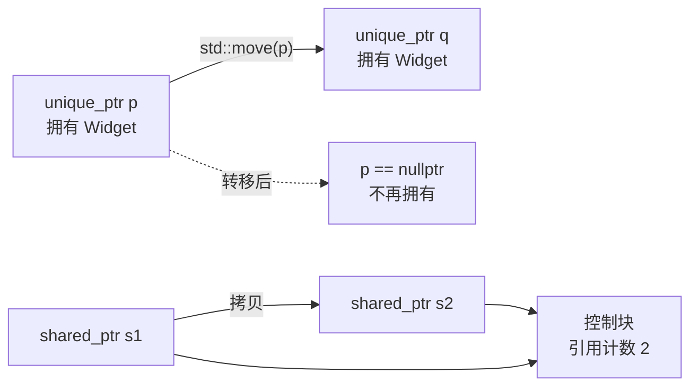

# 03 · 所有权与 RAII

> **一句话**：所有权（ownership）就是“谁负责在什么时候释放这个资源”；C++ 的答案不是靠自觉，而是把释放写进析构函数——构造时获取、析构时释放，于是栈展开、提前返回、异常抛出都不会漏掉清理。

## 一个“少写了一行”的函数

```cpp
#include <cstdio>

bool read_first_line(const char* path, char* out, int n) {
    FILE* f = std::fopen(path, "r");
    if (!f) return false;

    if (!std::fgets(out, n, f)) {
        return false;          // 忘了 fclose：泄漏一个文件句柄
    }

    std::fclose(f);
    return true;
}
```

这段代码很常见，也很危险。它有两个出口，只有一条走了 `fclose`。更糟的是，如果 `fgets` 之后的任何一行抛了异常，`std::fclose(f)` 同样不会执行。

手工管理的 bug 从来不是“你不会写 `fclose`”，而是**“清理点必须和所有出口一一对应”**。两个出口时还能数清，后来加了 2 个 `return`、再包一层 `try`，总有一次会漏。人不是不可以做对，而是不该靠这个来保证正确。

RAII 要解决的就是这件事：让清理点和对象的生命周期绑定，而不是和函数的控制流绑定。

## 所有权到底在说什么

先把“所有权”这个词定死：

> 对一个资源（内存、文件、socket、锁、数据库连接）的所有权，指的是**决定它何时被释放的责任**。

它有三条性质：

1. **所有权可以转移，但同一时刻最好只有一个“主人”。** 两个主人意味着两次释放，或者谁都不敢释放。
2. **所有权和“使用权”是两件事。** 你可以借用别人的对象（引用、指针），但借用者不负责释放。
3. **所有权是一种约定，不是类型系统自动强制的。** 在 C++ 里，它靠类型设计 + 代码规范来维持；Rust 把它写进了编译器。

没有明确所有权时，会出现三种经典 bug：

```cpp
// 1. 泄漏：分配了，没人释放
void leak() {
    int* p = new int[100];
    // 忘了 delete[] p
}

// 2. 重复释放：两个“主人”
void double_free() {
    int* p = new int(1);
    int* q = p;
    delete p;
    delete q;          // 这是 UB，不要依赖实际输出
}

// 3. 释放后使用：借用人不知道主人已经收走了
void use_after_free() {
    int* p = new int(1);
    delete p;
    std::cout << *p;   // 这是 UB，不要依赖实际输出
}
```

三种 bug 在语法上都没有任何异常。第 2、3 种在简单程序里可能“跑得好好的”，一上优化、一换分配器就爆炸。

## RAII：把释放写进析构函数

RAII 是 Resource Acquisition Is Initialization 的缩写，中文常译作“资源获取即初始化”。这个缩写其实起得不好——它听起来像是在讲初始化，实际讲的是**析构**。

准确的说法是两条绑定：

- **构造函数负责获取资源。** 构造成功 ⇔ 资源到手。
- **析构函数负责释放资源。** 对象销毁 ⇔ 资源归还。

这带来一个关键性质：**栈展开（stack unwinding）时，已经完整构造的自动对象一定会被析构。** 函数提前 `return`、抛出异常、`goto` 跳出，析构函数都会执行。清理不再依赖你写对每一个出口。

```cpp
void process(const char* path) {
    FileHandle f{path};             // FileHandle 的定义见下文
    if (!f.valid()) return;         // f 析构，什么都不会漏
    do_work(f.get());               // 如果这里抛异常……
}                                   // ……f 仍然会被析构
```

析构顺序也有保证：**同一个作用域内的自动对象，按构造的逆序销毁。**

```cpp
{
    FileHandle a{"a.txt"};
    FileHandle b{"b.txt"};
}   // 先析构 b，再析构 a
```

这条规则让“后获取的资源依赖先获取的资源”变得自然：锁和它保护的对象、事务和它操作的连接，只要按依赖顺序构造，释放顺序就自动正确。

::: warning 析构函数不要抛异常
栈展开过程中如果析构函数抛出异常，而外面没有捕获，程序会调用 `std::terminate`。析构函数应当默认 `noexcept`，把可能失败的操作放到显式的 `close()` 里。
:::

### 一个最小的 RAII 类

```cpp
#include <cstdio>

class FileHandle {
    FILE* f_;
public:
    explicit FileHandle(const char* path) : f_(std::fopen(path, "r")) {}
    ~FileHandle() { if (f_) std::fclose(f_); }

    FileHandle(const FileHandle&) = delete;
    FileHandle& operator=(const FileHandle&) = delete;

    bool valid() const { return f_ != nullptr; }
    FILE* get() const { return f_; }
};
```

逐行看几个决定：

- `explicit` 阻止 `const char*` 被隐式转换成 `FileHandle`，避免“看起来像传字符串、实际构造了一个临时对象”这种意外。
- 构造函数不检查失败，把 `nullptr` 存下来，由 `valid()` 报告。另一种做法是构造失败就抛异常——**如果构造没完成，析构不会执行**，所以构造函数必须自己保证“要么成功，要么不留下资源”。
- 拷贝构造和拷贝赋值被 `= delete`。如果允许拷贝，两个 `FileHandle` 会持有同一个 `FILE*`，析构时关两次——正是前面的 double free。
- 有了析构函数，这个类就**不能默认拷贝**。这是 C++ 的一条重要规则：资源所有者默认应当是不可拷贝的。

## Rule of 0 / 3 / 5

一个管资源的类，需要写几个特殊成员函数？规则是这样的：

| 规则 | 内容 | 什么时候适用 |
| --- | --- | --- |
| Rule of 0 | 一个都不写，让成员自己管自己 | 首选 |
| Rule of 3 | 析构、拷贝构造、拷贝赋值 | 需要手写析构（C++11 之前的世界） |
| Rule of 5 | 再加移动构造、移动赋值 | 需要手写析构且要支持移动 |

**Rule of 0 是默认目标。** 如果你的类里每个成员都已经会管好自己（`std::string`、`std::vector`、`std::unique_ptr`），那你就什么都不用写：

```cpp
class Buffer {
    std::vector<int> data_;        // 它自己负责释放
public:
    explicit Buffer(std::size_t n) : data_(n, 0) {}
    // 析构、拷贝、移动全部由编译器生成，且都正确
};
```

`Buffer` 的拷贝是深拷贝，移动是窃取 `vector` 的指针，析构是释放——全部免费。

**Rule of 3 的由来**：如果你需要手写析构函数，说明你在直接管理某个资源；那么默认的拷贝只会复制那个句柄，导致两个对象释放同一份资源。所以三个必须一起写。

**Rule of 5 补充**：C++11 之后，只要用户声明了析构函数，编译器就**不会**再隐式生成移动构造和移动赋值。这时拷贝会被用来顶替移动（通常性能更差），或者因为拷贝被 `delete` 而根本无法移动。所以要么补上移动操作，要么明确 `= delete`。

```cpp
class FileHandle {
    FILE* f_ = nullptr;
public:
    explicit FileHandle(const char* path) : f_(std::fopen(path, "r")) {}
    ~FileHandle() { if (f_) std::fclose(f_); }

    FileHandle(const FileHandle&) = delete;
    FileHandle& operator=(const FileHandle&) = delete;

    FileHandle(FileHandle&& other) noexcept : f_(other.f_) { other.f_ = nullptr; }
    FileHandle& operator=(FileHandle&& other) noexcept {
        if (this != &other) {
            if (f_) std::fclose(f_);
            f_ = other.f_;
            other.f_ = nullptr;
        }
        return *this;
    }
};
```

移动构造里必须把源对象的指针置空，否则源对象析构时会把资源关掉，目标对象手里的句柄立刻失效。

## 三种智能指针：把所有权写进类型

标准库提供了三个工具，把“谁是主人”这件事从注释搬进类型：

| 类型 | 所有权语义 | 典型用途 |
| --- | --- | --- |
| `std::unique_ptr<T>` | 独占，不可拷贝，只能移动 | 默认选择 |
| `std::shared_ptr<T>` | 共享，引用计数归零才释放 | 多方共同持有 |
| `std::weak_ptr<T>` | 观察，不增加计数 | 打破循环、缓存 |

### unique_ptr：独占所有权

```cpp
#include <memory>

auto p = std::make_unique<Widget>(7);   // 唯一主人是 p
auto q = std::move(p);                  // 所有权转移给 q，p 变成 nullptr

if (!p) { /* 这里会进来 */ }
```

`unique_ptr` 的大小和一个裸指针相同，没有运行时开销。它的价值全在编译期：**拷贝被删除，想转移必须写 `std::move`**。于是“这里到底有没有第二个主人”这个问题，在代码里是看得见的。

### shared_ptr：共享所有权

```cpp
auto a = std::make_shared<Widget>(7);
{
    auto b = a;                        // 引用计数 2
    std::cout << a.use_count();        // 2
}                                      // b 析构，计数回到 1
// a 析构时计数归零，Widget 被 delete
```

引用计数存在一个独立的控制块（control block）里，所以 `shared_ptr` 是两个指针的大小，并且复制/销毁都要做原子操作。**不要无脑用 `shared_ptr` 代替 `unique_ptr`**：多出来的开销和“所有权模糊”都是真实成本。

### weak_ptr：观察但不拥有

`shared_ptr` 有一个自身无法解决的问题：**循环引用**。

```cpp
struct Node {
    std::shared_ptr<Node> next;
    std::shared_ptr<Node> prev;    // 问题在这里
};

auto a = std::make_shared<Node>();
auto b = std::make_shared<Node>();
a->next = b;      // b 的计数 2
b->prev = a;      // a 的计数 2
// 离开作用域：a、b 各减 1，仍然都是 1 —— 两个对象互相持有，永远不会释放
```

`a` 和 `b` 都活着，因为对方替自己保着引用计数；而它们都不可达，因为外部已经没有指针。这就是 `shared_ptr` 版的泄漏：内存没丢，但拿不回来了。

把其中一条边换成 `weak_ptr`：

```cpp
struct Node {
    std::shared_ptr<Node> next;
    std::weak_ptr<Node> prev;      // 只观察，不增加计数
};
```

使用时必须 `lock()`，因为弱引用随时可能过期：

```cpp
if (auto p = node->prev.lock()) {
    p->do_something();             // 在这期间对象保证活着
} else {
    // 目标已经被销毁
}
```

`lock()` 返回一个 `shared_ptr`，它在当前作用域内替你保住了对象——这一步不能省，直接 `node->prev->...` 是编译不过的。

## 移动语义：`std::move` 不移动任何东西

这是最容易被误解的一处。`std::move(x)` 的准确定义是：

> 把表达式 `x` 转换成右值引用（rvalue reference）`T&&`，仅此而已。

它不分配、不拷贝、不修改 `x`。真正干活的是**移动构造函数**或**移动赋值运算符**——它们决定“怎么把资源偷过来”。

```cpp
std::string a = "hello, this is a fairly long string";
std::string b = std::move(a);      // 移动构造：b 接管 a 的缓冲区
std::cout << a.size();             // 合法，但值未指定（通常是 0）
```

两个必须记住的点：

1. **被移动后的对象仍然必须可析构、可赋值。** 标准保证它是“有效但未指定状态”（valid but unspecified）。你可以 `clear()`、可以重新赋值、可以让它析构，但不能假设它还是原来的内容。
2. **`std::move` 对 `const` 对象退化成拷贝。**

```cpp
const std::string s = "hi";
std::string t = std::move(s);      // 调用的是拷贝构造
```

原因很直接：`std::move(s)` 得到 `const std::string&&`，而移动构造的参数是 `std::string&&`，`const` 无法绑定上去，只能回退到 `const std::string&` 的拷贝构造。



## 其他语言里的同一件事

- **Rust**：所有权是语言核心。赋值默认是移动（move），移动后原变量不可再用；借用（borrow）分 `&T` 和 `&mut T`，编译器保证引用不会活得比所有者久。`Drop` trait 就是 RAII。
- **Python**：`with` 语句调用上下文管理器（context manager）的 `__enter__` / `__exit__`，即使抛异常也会执行清理。内存由引用计数 + 循环 GC 管理，但文件、锁、连接仍然需要 `with`。
- **Java**：try-with-resources 要求资源实现 `AutoCloseable`，`close()` 在离开 try 块时自动调用。内存交给 GC，但 GC 不负责关文件——`finalize` 不可靠且已废弃。

三者的共同结论：**GC 解决的是内存，不是资源。** 只要资源是有限的、需要显式归还的（文件描述符、锁、事务），RAII 式的“作用域结束即释放”就仍然是最可靠的模型。

## 人话总结

<div class="human-note">
<strong>如果只记住一件事：</strong>所有权不是一个哲学问题，而是一句工程承诺——“这块资源由我在这个时候释放”。RAII 把这句话写进析构函数，于是无论函数怎么退出，承诺都会兑现；智能指针则把这句话写进类型，让别人一眼看出谁是主人。
</div>

## 常见误解

**误解一：用了智能指针就不会泄漏。**

`shared_ptr` 的循环引用照样泄漏，`unique_ptr` 也挡不住“逻辑上该释放却一直持有”的问题。智能指针管的是“最后一个主人离开时释放”，不管“这个主人是不是该早点走”。

**误解二：`std::move` 会把对象搬走。**

`std::move` 只做类型转换。对象有没有被搬走，取决于有没有匹配的移动构造/移动赋值被调用。对 `const` 对象、对没有移动操作的类型，它什么都不会加速。

**误解三：移动之后的对象不能再用。**

可以析构、可以重新赋值、可以调用不依赖具体值的方法。标准只要求它处于“有效但未指定状态”。真正不能做的是假设它还保存着原来的内容。

**误解四：RAII 就是“在析构函数里 delete”。**

RAII 适用于任何成对的获取/释放：文件、锁、socket、事务、临时环境变量。`std::lock_guard` 一行 `delete` 都没有，却是最典型的 RAII。

## 本章小结

- 所有权是“谁负责何时释放资源”的责任，同一时刻最好只有一个主人。
- 手工管理的三大 bug：泄漏、重复释放、释放后使用，根源都是清理点与控制流脱钩。
- RAII 把获取放进构造函数、释放放进析构函数，栈展开保证清理一定发生。
- Rule of 0 是默认目标；需要手写析构时，按 Rule of 3/5 一起补齐拷贝与移动。
- `unique_ptr` 独占、`shared_ptr` 共享、`weak_ptr` 观察；`std::move` 只是类型转换。

## 练习

1. 把下面这个类改成 Rule of 0，并说明为什么改完之后拷贝语义反而更清楚：

   ```cpp
   class IntArray {
       int* data_;
       std::size_t n_;
   public:
       explicit IntArray(std::size_t n) : data_(new int[n]{}), n_(n) {}
       ~IntArray() { delete[] data_; }
       // 没有拷贝构造、拷贝赋值、移动构造
   };
   ```

2. 解释下面这段代码为什么泄漏，并用 `weak_ptr` 修复：

   ```cpp
   struct Parent;
   struct Child { std::shared_ptr<Parent> parent; };

   struct Parent {
       std::shared_ptr<Child> child;
       ~Parent() { std::cout << "parent destroyed\n"; }
   };

   int main() {
       auto p = std::make_shared<Parent>();
       p->child = std::make_shared<Child>();
       p->child->parent = p;
   }
   ```

3. 下面两组声明分别调用了什么构造函数？为什么第二组里的 `std::move` 没有生效？

   ```cpp
   std::string a = "hi";
   std::string b = std::move(a);
   const std::string c = "hi";
   std::string d = std::move(c);
   ```

4. `std::vector<FileHandle>` 扩容时，为什么更愿意用移动构造而不是拷贝构造？如果移动构造没有标记 `noexcept`，`vector` 会怎么选？（提示：强异常保证）

---

下一篇：[04 · 引用与悬垂](/lifetime/04-references-dangling)
