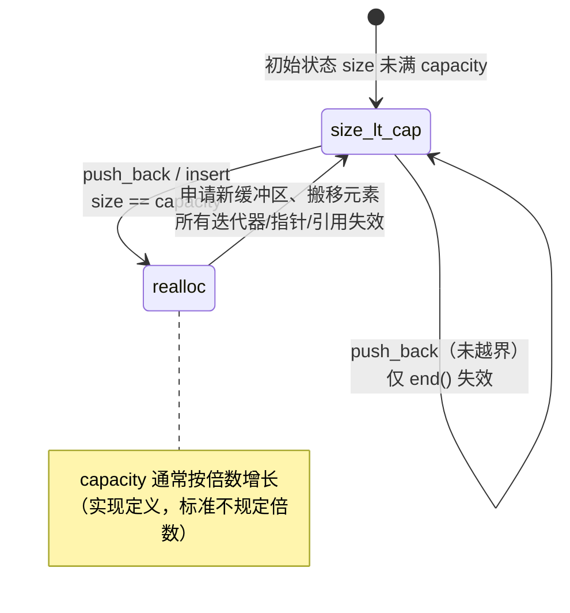

# 05 · 容器与迭代器失效

> **一句话**：迭代器、指针、引用只是指向某个位置的门牌号；容器一旦改变内部结构，原来的门牌号就可能指向已经被拆掉的房子——而容器不会通知你。

## 一个"看起来没问题"的删除循环

先看一段几乎所有 C++ 教材都会提到的代码：

```cpp
#include <vector>

int main() {
    std::vector<int> v{1, 2, 3, 4, 5, 6};
    for (auto it = v.begin(); it != v.end(); ++it) {
        if (*it % 2 == 0) {
            v.erase(it);          // it 指向的元素被移除
        }
    }
}
```

不少人的第一反应是"删掉偶数，剩 1 3 5，没问题"。这段代码的表现完全取决于输入和实现：把 `{1, 2, 3, 4, 5, 6}` 交给它，有的标准库会输出 `1 3 5`，有的会直接崩溃（笔者在 MSYS2 的 clang 22 + libc++ 下就是崩溃）；把输入换成 `{1, 2, 2, 3, 4, 4, 5}`，它会安静地输出 `1 2 3 4 5`。三种表现，同一个原因：**这是未定义行为（undefined behavior, UB）。**

拆成三步看：

1. `v.erase(it)` 把 `it` 之后的元素整体前移一位，同时把大小减一。此刻 `it` 已经不再指向任何有效元素，标准规定它失效。
2. 循环头部的 `++it` 是在一个失效的迭代器上自增，这是 UB。在 libstdc++ 的调试模式（`-D_GLIBCXX_DEBUG`）或开了容器标注的 AddressSanitizer 构建里，这一步会被直接拦下来。
3. 就算某次运行"恰好"让 `++it` 落到了有效的内存上，`erase` 造成的元素前移也意味着紧随被删元素之后的那一个元素被跳过了。`{1, 2, 2, 3, 4, 4, 5}` 输出 `1 2 3 4 5`，就是每一段连续偶数都只删掉了一个：删掉第一个 `2` 之后，第二个 `2` 前移到了 `it` 的位置，`++it` 直接从它头上跨了过去。

第三点比前两点更麻烦：它不一定崩，它可能安安静静地少删一个元素，然后在下游某个统计逻辑里变成"差一个"的诡异 bug。

正确写法有两种，选哪种取决于你想让循环表达什么：

```cpp
// 写法一：接住 erase 的返回值——它指向被删元素的下一个位置
for (auto it = v.begin(); it != v.end(); ) {
    if (*it % 2 == 0) it = v.erase(it);   // 不在这里 ++
    else              ++it;
}

// 写法二（C++20）：交给标准库
std::erase_if(v, [](int x) { return x % 2 == 0; });
```

写法一的关键是：`erase` 返回的是一个新算出来的、有效的迭代器，要把它接回循环变量。原来那个 `it` 对象本身没有任何变化，它只是"作废"了。

## 失效的到底是什么

"迭代器失效"这句话经常被含糊地使用，它同时涉及三类句柄，而它们的失效条件并不总是一致：

- 迭代器：一个可以被 `++`、`*` 的对象，内部往往就是一个指针加上一些调试信息。
- 指针：`&v[i]`、`v.data()` 拿到的地址。
- 引用：`int& r = v[0]` 绑定的那个对象。

之所以要区分，是因为有的容器会让迭代器失效，却保证引用和指针继续有效。`std::unordered_map` 的元素存放在一个个独立的节点里，rehash 只是重新排列桶里的指针，节点本身没有搬家，所以"指向元素的引用"还能用；但遍历顺序变了，桶指针变了，迭代器自然就废了。

那为什么会有失效这回事？因为容器要维护自己的不变量（invariant）。`vector` 承诺元素在内存里连续存放，所以一旦容量不够，它必须另找一块更大的内存、把元素搬过去，旧的地址全部作废。代价来自结构性改动，跟实现是否偷懒无关。

::: warning 失效不等于内存被释放
`erase` 一个元素之后，那块内存可能还在 `vector` 的缓冲区里，旧指针解引用过去甚至还能读到一个"看起来合理"的值（通常是最后一个元素被移动后的残留）。它不崩溃，只给你一个错误答案。
:::

## vector：扩容是一条分界线

`std::vector` 的规则可以压缩成一句话：**分清这次操作有没有触发重新分配（reallocation）。**



- `push_back` / `emplace_back`：如果 `size() < capacity()`，不重新分配，标准只保证 `end()` 失效，已有的迭代器和引用仍然有效。如果容量已满，就重新分配，**所有**迭代器、指针、引用失效。
- `insert` / `emplace`：位置在中间时，不管是否扩容，插入点及其之后的迭代器和引用都会失效（元素要后移）；如果触发了扩容，则是全军覆没。
- `erase` / `pop_back`：删除点及其之后的迭代器和引用失效，`end()` 一定失效。
- `reserve(n)`：当 `n > capacity()` 时重新分配，全部失效；`n <= capacity()` 时什么也不做（`reserve` 不会缩小容量）。

`reserve` 是唯一能让你主动控制这条分界线的工具：

```cpp
std::vector<Item> items;
items.reserve(n);              // 一次性把容量要够
for (int i = 0; i < n; ++i) {
    items.push_back(make_item(i));
    // 这里不会扩容，但也不要保存 begin() 之类的迭代器到循环外
}
```

最后那句注释的意思是：`reserve` 只保证"这 n 次 `push_back` 不扩容"，它不保证下标 `i` 就是最终下标，也不保证你之前保存的 `end()` 仍然有意义——`end()` 每次插入都会变。**`reserve` 解决的是地址稳定性，不是位置稳定性。**

还有一个容易忽略的点：`std::vector<bool>` 是标准库里的特化版本，它按位存储，`operator[]` 返回的是一个代理对象（proxy）而不是 `bool&`。所以 `auto& b = vb[0]` 根本编译不过，`auto b = vb[0]` 拿到的是值。这也是为什么很多规范建议用 `std::vector<char>` 或 `std::bitset` 代替它。

## 其它容器：稳定性各不相同

### deque

`std::deque`（双端队列）是一组分段连续的小块，外加一张中控表。这个结构决定了它的失效规则比 `vector` 细：

- 在两端插入：所有迭代器失效，但指向已有元素的引用和指针仍然有效。因为元素没有被搬走，只是中控表可能被重建。
- 在中间插入：所有迭代器和引用都失效（元素要挪位置）。
- 在尾部删除：只有被删元素的迭代器/引用和 `end()` 失效。
- 在头部删除：只有被删元素的迭代器/引用失效。
- 在中间删除：全部失效。

标准给出的保证就是上面这些，`libstdc++` 和 `libc++` 的实际行为通常不会比它更差，但也不要依赖"某个实现比我以为的更宽容"——你换一个标准库版本，代码的运气就用完了。

### list 与 forward_list

`std::list`（双向链表）和 `std::forward_list`（单向链表）的每个元素都是独立分配的节点。所以：

- `insert`、`emplace`、`splice`、`sort`、`merge`、`reverse`：不使任何迭代器失效，被移动的节点只是换了链接关系，节点地址没变。
- `erase`：只使被删除元素的迭代器失效，其它元素的迭代器、指针、引用全部保持有效。

这条性质是 `std::list` 存在的最大理由，第 07 篇的 LRU 缓存完全建立在它之上：哈希表里存 `list` 的迭代器，只要不删除那个元素，迭代器就一直有效。

### map、set 等有序关联容器

红黑树的节点同样是独立分配的，插入可能引起旋转，但旋转改变的是链接关系而不是节点地址。因此：

- `insert` / `emplace`：不使任何迭代器失效。
- `erase`：只使被删元素的迭代器失效（C++11 起 `erase` 返回下一个迭代器）。
- `extract`：把节点摘下来交给 `node_handle`，元素不销毁、不重新分配，可以改 key 再 `insert` 回去。

### unordered_map、unordered_set

无序容器最容易记错。标准保证是：

- 不触发 rehash 的 `insert`：不使任何迭代器失效。
- 触发 rehash 的 `insert`，以及显式调用 `rehash` / `reserve`：使所有迭代器失效，但指向元素的引用和指针仍然有效。
- `erase`：只使被删元素的迭代器失效。

为什么引用能活下来？因为元素是节点，rehash 只重排桶数组里的指针，节点地址不动。这就是为什么"在 `unordered_map` 里存 `Value*` 或 `Value&` 是相对安全的"，而"存 `iterator` 是危险的"。

### 一张表

| 容器 | 操作 | 失效对象 |
| --- | --- | --- |
| `vector` / `string` | 重新分配的操作：触发扩容的 `push_back`、`insert`、`reserve`、`shrink_to_fit` | 全部迭代器、指针、引用 |
| `vector` | 未扩容的 `push_back` | 仅 `end()` |
| `vector` | 未扩容的 `insert` | 插入点及之后的迭代器、引用（含 `end()`） |
| `vector` | `erase`、`pop_back` | 删除点及之后的迭代器、引用（含 `end()`） |
| `deque` | 两端插入 | 全部迭代器；引用、指针仍有效 |
| `deque` | 中间插入、中间删除 | 全部迭代器与引用 |
| `deque` | 两端删除 | 仅被删元素的迭代器、引用（尾删还包括 `end()`） |
| `list` / `forward_list` | `insert`、`splice`、`sort`、`merge`、`reverse` | 无 |
| `list` / `forward_list` | `erase` | 仅被删元素 |
| `map` / `set` / `multimap` / `multiset` | `insert` | 无 |
| `map` / `set` | `erase` | 仅被删元素 |
| `unordered_*` | 不触发 rehash 的 `insert` | 无 |
| `unordered_*` | 触发 rehash 的 `insert`、`rehash`、`reserve` | 全部迭代器；引用、指针仍有效 |
| `unordered_*` | `erase` | 仅被删元素 |

把这张表读成一句话：**连续存储的容器怕扩容，节点存储的容器只怕删除。**

## 三个高频踩坑场景

### 场景一：range-for 里修改容器

```cpp
for (int x : v) {
    if (x < 0) v.push_back(-x);   // UB：迭代器可能失效，还可能死循环
}
```

range-for 在展开后保存了 `begin` 和 `end` 两个迭代器。`push_back` 一旦扩容，这两个都作废，循环继续在一个失效的迭代器上走。就算不扩容，`end()` 也在变，而你手上那个旧 `end()` 永远不会更新，于是循环的终止条件失效——这就是"死循环"的来源。

要边遍历边增长，用下标循环并每次重新检查 `v.size()`，或者先收集要加的元素、循环结束后统一追加。

### 场景二：保存迭代器/指针/引用之后又改容器

```cpp
int& first = v.front();
v.push_back(42);      // 若触发扩容，first 悬垂
first = 7;            // UB
```

这类 bug 常常隔了好几层函数才出现：

```cpp
void add_all(std::vector<int>& out, const std::vector<int>& src) {
    const int& seed = out.front();       // 借用了一个引用
    out.insert(out.end(), src.begin(), src.end());  // 可能扩容
    std::cout << seed;                   // 可能已经是垃圾值
}
```

`out` 是引用参数，调用方看不出 `insert` 会让 `seed` 失效，因为失效发生在被调函数内部。**只要一个函数既持有元素的引用、又会修改容器大小，就要重新检查。**

### 场景三：非拥有视图（non-owning view）

`std::string_view` 和 `std::span` 是"指针 + 长度"的组合，它们不拥有数据，也不延长数据的生命周期。

```cpp
std::string_view sv = std::string("hello");   // 临时 string 在这一行结束就销毁
std::cout << sv;                              // UB

std::vector<int> v{1, 2, 3};
std::span<int> s(v);
v.push_back(4);                               // 可能扩容
std::cout << s[0];                            // UB
```

这两个类型的价值在于"传参时不用拷贝"，坑在于"存起来就会悬垂"。判断标准很简单：**视图的寿命必须严格短于它指向的对象的寿命。** 把它存成成员变量、放进容器、或者在 `co_await` 之后继续使用，都要重新想一想数据还在不在。

<div class="human-note">
<strong>换个说法：</strong>容器像一个会搬家的租户。迭代器是你上次记下的门牌号，引用是你手里那把旧钥匙。租户没搬家时，旧钥匙当然还能开门；一旦他搬了（扩容、rehash、元素前移），旧钥匙就只能开一扇不存在的门。标准库不会追着你换钥匙——它默认你自己记得租户什么时候搬过家。
</div>

## 常见误解

**误解一：`erase(it)` 之后 `it` 会自动指向下一个元素。**

不会。`erase` 返回下一个元素的迭代器，但不会修改 `it` 本身。`it` 在你调用它的那一刻就已经作废了。必须写 `it = v.erase(it)`。

**误解二：`unordered_map` rehash 之后所有引用都失效。**

只有迭代器失效。元素节点没有移动，指向元素的指针和引用仍然有效。这也是为什么在 `unordered_map` 里存 `Value&` 或 `Value*` 通常比存 `iterator` 更安全。

**误解三：`reserve` 之后就再也不会失效。**

`reserve(n)` 保证容量至少为 `n`。插入超过 `n` 个元素时照样扩容，照样全部失效。`reserve` 是"提前买够座位"，不是"永久锁定地址"。

**误解四：`std::remove` 会把元素删掉。**

`std::remove` / `std::remove_if` 只是把要保留的元素往前挪，返回新的逻辑结尾，容器大小不变，尾巴上留着"被移走的残骸"。必须配合 `erase` 才算删除，这就是 erase-remove idiom；C++20 起可以直接用 `std::erase` / `std::erase_if`。

**误解五：`list` 的迭代器永远有效。**

被删除的那个元素的迭代器一定失效，而且 `erase` 之后它指向的节点内存已经被释放。稳定性说的是"删除别人不影响你"，不是"删除自己也不影响你"。

## 本章小结

- 迭代器、指针、引用是三种不同的句柄，失效规则不一定相同：`unordered_*` rehash 会让迭代器失效但保留引用。
- `vector` 的规则分界线是"有没有重新分配"；`reserve` 能让你提前消除这条分界线，但只对已知上界有效。
- 连续存储的容器（`vector`、`string`、`deque` 中间操作）怕结构性改动；节点存储的容器（`list`、`map`、`unordered_*`）只怕删除自己。
- 删除循环必须用 `it = c.erase(it)` 或 `std::erase_if`；range-for 期间不要改变容器大小。
- `string_view` / `span` 不拥有数据，存起来就等于给自己埋一颗定时炸弹。

## 练习

1. 下面这段代码除了 UB，还有一个逻辑错误。指出它，并给出两种修复写法（一种手写循环，一种用标准算法）。

   ```cpp
   std::vector<int> v{1, 2, 2, 3, 4, 4, 5};
   for (auto it = v.begin(); it != v.end(); ++it)
       if (*it % 2 == 0) v.erase(it);
   ```

2. 一个函数需要往 `std::vector<Record>` 里追加 10000 条记录，同时在追加过程中用 `const Record&` 引用"第一条记录"做比较基准。请用 `reserve` 改写，使得引用在整个过程中保持有效，并说明为什么这样改是安全的。

3. 下面两个版本，哪个在 rehash 之后仍然正确？为什么？

   ```cpp
   std::unordered_map<int, std::string> m;
   auto it  = m.find(1);        // 版本 A：保存迭代器
   auto* p  = &m.find(1)->second;  // 版本 B：保存指针（假设 1 存在）
   for (int i = 0; i < 1000; ++i) m.emplace(i, "x");
   ```

4. 用自己的话解释：为什么 `std::list` 的迭代器在 `insert` 之后仍然有效，而 `std::vector` 的不行？这个差异分别来自两种数据结构的哪条不变量？

---

下一篇：[06 · 递归与回溯](/lifetime/06-recursion-backtracking)
