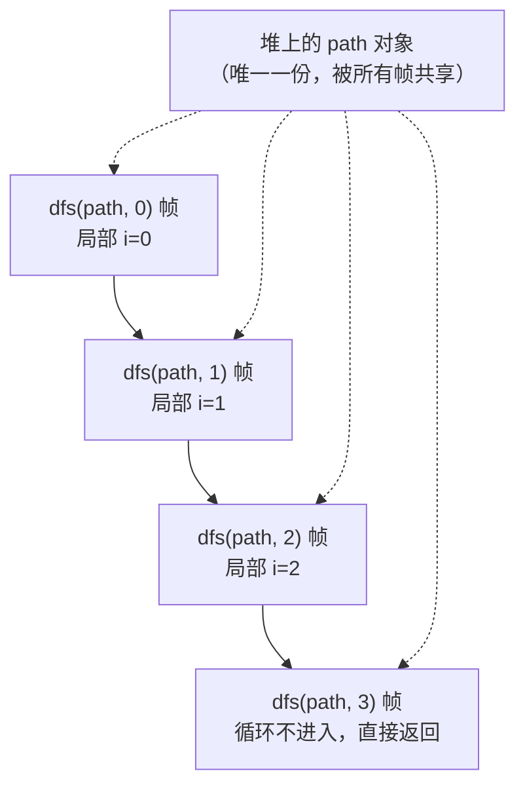

# 06 · 递归与回溯

> **一句话**：每次递归调用都拿到一套全新的栈帧，但传进来的引用仍然指向同一个对象；回溯就是在"离开这一层"之前，把共享的那份状态改回原样。

## 一个少写一行的 bug

下面这段代码想输出 `{1,2,3}` 的全部子集：

```cpp
#include <iostream>
#include <vector>

void dfs(std::vector<int>& path, int start, int n) {
    for (int x : path) std::cout << x << ' ';
    std::cout << '\n';

    for (int i = start; i < n; ++i) {
        path.push_back(i + 1);
        dfs(path, i + 1, n);
        // 这里少了一行 path.pop_back()
    }
}

int main() {
    std::vector<int> path;
    dfs(path, 0, 3);
}
```

期望输出是 8 行子集（第一行是空集）。实际输出只有 7 行，而且越往后越脏——用 clang 22 编译运行，拿到的是：

```text

1 
1 2 
1 2 3 
1 2 3 3 
1 2 3 3 2 
1 2 3 3 2 3 
1 2 3 3 2 3 3 
```

后四行已经不是任何子集了，它们是把前面几条分支的残留首尾接起来的结果。

原因很直接：`path` 是**引用参数**，整个递归树共用这一个 `vector` 对象。`push_back` 是对它的修改，`dfs` 返回并不会撤销这次修改。栈帧会被销毁，但 `path` 指向的堆内存不会。所以第一个分支探索完，`path` 里还留着它的痕迹，第二个分支就在这个脏状态上继续。

补上 `path.pop_back()`，输出立刻恢复正常。这一行不是"清理内存"，而是**恢复逻辑状态**。

## 递归调用时，内存里到底发生了什么

把一次函数调用拆开看，每个调用的**栈帧（stack frame / activation record）**通常包含：

- **返回地址**：函数执行完后跳回哪里；
- **参数**：传值的参数是被复制进栈帧的；传引用的参数只是一个地址；
- **局部变量**：包括循环变量、临时对象；
- **保存的寄存器**：调用者希望被调用者帮忙保管的那部分。

这些内容的**存储期（storage duration）**是自动的：进入函数时建立，函数返回时销毁。所以第 3 层递归里的局部变量 `i`，和第 4 层递归里的 `i`，是两个完全不同的对象，各占一块地址。递归能成立，靠的正是"每层都有自己的那一份"。



这张图是理解本章所有 bug 的钥匙：**栈帧是复制出来的，`path` 是共享的。** 于是同一个函数里，两类变量的"生命周期"行为完全不同：

- 局部变量 `i`：出了这一层就没了，下一层拿到自己的一份，天然互不干扰。
- 引用参数 `path`：它本身是栈帧里的一个指针，但它指向的对象活得比任何一层都久。你改的是对象，不是指针。

## 传值还是传引用：这是个设计决定

同样的子集问题，也可以写成传值：

```cpp
void dfs(std::vector<int> path, int start, int n) {   // 按值传递
    for (int x : path) std::cout << x << ' ';
    std::cout << '\n';
    for (int i = start; i < n; ++i) {
        path.push_back(i + 1);
        dfs(path, i + 1, n);      // 拷贝一份给下一层
    }
}
```

这里不需要任何恢复语句，因为每一层拿到的都是自己的副本，函数返回时副本跟着栈帧一起销毁。代价是每次调用都复制一遍 `path`：在深度为 $d$、路径长度为 $k$ 的搜索里，这可能是 $O(2^n \cdot n)$ 级别的额外开销。

所以选择很清晰：

| 方式 | 需要手动恢复？ | 代价 | 适用场景 |
| --- | --- | --- | --- |
| 传引用 `vector<int>&` | 需要 | 无拷贝 | 状态大、搜索树深、追求性能 |
| 传值 `vector<int>` | 不需要 | 每层一次拷贝 | 状态小、逻辑简单、容易写错 |
| 传引用但用 RAII 守卫 | 自动 | 一个小对象 | 想在性能和正确性之间折中 |

第三种写法值得单独提一句，因为它是 C++ 里"让编译器替你恢复现场"的标准手法：

```cpp
struct PathGuard {
    std::vector<int>& path;
    ~PathGuard() { path.pop_back(); }
};

void dfs(std::vector<int>& path, int start, int n) {
    // ... 记录当前状态 ...
    for (int i = start; i < n; ++i) {
        path.push_back(i + 1);
        PathGuard guard{path};     // 离开作用域时自动 pop_back
        dfs(path, i + 1, n);
    }
}
```

`guard` 的析构函数在每次循环体结束时执行，无论是正常返回还是异常抛出。这就是第 03 篇讲的 RAII 在算法里的直接应用：把"恢复"绑到作用域的生命周期上，而不是绑在你记得不记得写上。

## 回溯模板：为什么那两行不能省

把上面的经验固化成模板：

```cpp
void backtrack(std::vector<int>& path, std::vector<bool>& used, int n) {
    if (static_cast<int>(path.size()) == n) {   // 到达叶子
        record(path);
        return;                                  // 这里 return，不恢复
    }
    for (int i = 0; i < n; ++i) {
        if (used[i]) continue;
        used[i] = true;        // ① 做选择
        path.push_back(i);
        backtrack(path, used, n);   // ② 递归
        path.pop_back();       // ③ 撤销选择
        used[i] = false;
    }
}
```

逐行看这三步在时间上的位置：

- **① 做选择**发生在进入下一层之前。此刻 `path` 和 `used` 描述的是"已经选了 i 之后"的状态。
- **② 递归**期间，所有更深层的调用看到的都是这个状态。它们会继续往里加东西，也会在返回前把自己加的东西撤掉。所以 `backtrack` 返回时，`path` 和 `used` 应该**恰好**回到 ① 之前的样子。
- **③ 撤销选择**是这一层自己的责任。它必须和 ① 严格配对，而且必须在②之后、下一轮循环之前执行。

为什么不能省？因为循环还要继续。如果 `path.pop_back()` 少了，下一轮 `path.push_back(j)` 就会在一个更长的路径上继续，`record` 记录到的就不是"从根到当前节点的路径"，而是"若干条分支首尾相接的拼接"。`used[i] = false` 少了，问题更隐蔽：`i` 会被永久标记为已用，后面的所有分支都看不见它，搜索空间被悄悄剪掉一大块，结果是"少解"而不是"错解"。

**一个容易忽视的细节**：叶子节点 `return` 之前不需要恢复，因为这一层的选择是由**上一层**的 ③ 负责撤销的。每一层只撤销自己做的那个选择，责任边界不能乱。这也是为什么递归回溯里的"恢复"总是紧跟在递归调用之后，而不是写在函数末尾。

## 三类常见 bug

### bug 一：只恢复了一半

```cpp
used[i] = true;
path.push_back(i);
backtrack(path, used, n);
used[i] = false;        // 忘了 path.pop_back()
```

表现是"部分答案正确、长度逐渐失控"。因为 `used` 恢复对了，元素不会被重复选，但 `path` 里堆着历史残留，`record(path)` 输出的长度和内容都不对。

修复方法不只是补一行，而是**把成对的操作写在一起**：要么都用 RAII 守卫，要么把"做/撤销"封装成一对函数，减少漏写的可能。

### bug 二：递归返回后继续使用失效的引用或迭代器

```cpp
void collect(const std::vector<std::vector<int>>& g, int u,
             std::vector<int>& out) {
    out.push_back(u);                       // 悄悄改变了 out 的大小
    for (int v : g[u]) collect(g, v, out);
}

std::vector<int> order;
order.reserve(8);
collect(g, 0, order);          // 先跑一次，拿到第一份结果
int& first = order.front();    // 借用第一个元素

for (int u : start_nodes) {
    collect(g, u, order);      // 可能扩容
}
first += 1;                    // 若扩容过，first 悬垂
```

这段代码的危险在于 `collect` 的签名看不出它会改 `order`——`out` 是普通的 `std::vector<int>&`，调用方很容易以为它只是"读"。`reserve(8)` 也只挡住了前 8 个元素，后面的 `push_back` 照样会重新分配。

更常见的是迭代器版本：

```cpp
for (auto it = children.begin(); it != children.end(); ++it) {
    dfs(*it);                    // dfs 可能修改 children
    use(*it);                    // it 可能已经失效
}
```

这里的风险和 05 篇完全一样：`dfs` 内部如果对 `children` 做了增删，外层的迭代器就作废了。递归只是让"谁改的"变得更难看清——失效发生在几层调用之下，而你手上的句柄在几层之上。

### bug 三：把局部对象的地址带出递归

```cpp
const std::vector<int>& build(int n) {
    std::vector<int> result(n);
    // ...
    return result;      // 返回局部变量的引用：UB
}
```

返回 `std::vector<int>` 是安全的（有返回值优化和移动语义），返回 `const std::vector<int>&` 绑到局部变量则是悬垂引用。在递归里，这种错误的变体是"把某一层栈帧里的对象地址存进全局缓存"：

```cpp
std::vector<const int*> cache;

void dfs(int depth) {
    int local = depth * 2;
    cache.push_back(&local);   // 保存的是栈帧里的地址
    if (depth < 3) dfs(depth + 1);
}   // 返回后 local 销毁，cache 里全是野指针
```

如果确实需要跨层保存数据，就让数据活在堆上（`std::vector`、`std::unique_ptr`、值语义的容器），或者干脆按值复制。

## 递归深度、栈溢出与尾递归

递归不是免费的。每深入一层就要压一个栈帧，栈空间是有限的：Linux 上主线程默认 8 MB 左右，Windows 上默认 1 MB，线程栈可以调小到几十 KB。一个几百字节的栈帧乘以一百万层，就会**栈溢出（stack overflow）**——通常表现为段错误，而不是一个可捕获的异常。

几个经验值：默认 8 MB 的主线程栈上，深度几千到一万通常是安全的；到十万层就要按"栈帧字节数 × 深度"实际算一遍，很可能已经超了；一百万层几乎一定要改成迭代。注意"深度"不等于"输入规模"：快速排序在最坏情况下递归深度是 $O(n)$，所以工程实现里常改成"小分区递归、大分区循环"（尾递归消除的手工版）。

很多人会问："尾递归编译器会优化掉吧？"**C++ 标准不保证尾调用优化（tail call optimization）。** 编译器（GCC、Clang、MSVC）在开启优化时经常能把简单的尾递归变成循环，但只要栈帧里有非平凡析构的对象、有 `alloca`、或者取了局部变量的地址，优化就可能不发生。所以：

::: warning 不要把正确性寄托在编译器的优化上
"这段尾递归会被优化成循环"是一个**可能成立**的实现细节，不是语言保证。要么显式改成迭代，要么确认目标编译器和优化等级真的做了这项优化，并且写进注释——否则换一个平台或换成 Debug 构建，程序就可能栈溢出。
:::

## 记忆化缓存的生命周期

带记忆化（memoization）的递归多了一个新的生命周期问题：**缓存放在哪，什么时候清，键是什么。**

```cpp
std::vector<std::vector<long long>> memo;

long long solve(int i, int j, const std::vector<std::vector<int>>& grid) {
    if (i < 0 || j < 0) return 0;
    if (memo[i][j] != -1) return memo[i][j];
    // ...
    return memo[i][j] = ...;
}
```

三个必须想清楚的问题：

1. **缓存的归属**：写成全局变量，多个测试用例之间必须清空；写成函数内的 `static`，同样跨调用保留，在线判题系统（OJ）里是经典翻车点；写成参数传进去，生命周期清楚但签名变长。最稳的做法是把它包在一个类或 lambda 的捕获里，让它的生命周期和"一次求解"绑定。
2. **缓存键是否覆盖了全部状态**：如果递归的状态是 `(i, j, 已经选过的集合)`，而缓存只用了 `(i, j)` 做键，那么第二次到达同一个 `(i, j)` 但集合不同时，会直接返回上一次的答案——这是"答案看起来对了一半"的典型来源。判断标准：**两个不同状态如果可能给出不同答案，就必须有不同的键。**
3. **缓存里存的是什么**：存值最安全。存指针或引用就等于把某个对象的生命周期责任转嫁给了缓存，而缓存通常活得比被指向的对象久。

<div class="human-note">
<strong>换个说法：</strong>递归像在一栋楼里上下楼，每一层都有自己的房间（栈帧），但楼梯间是公用的（引用参数）。你从 3 楼往上走之前往楼梯间放了个箱子，回到 3 楼时必须把它拿掉，否则 4 楼的人会以为那是自己的。回溯的那两行，就是"把自己的箱子拿走"。
</div>

## 常见误解

**误解一：函数返回了，局部变量的内存就"没了"。**

栈帧确实被回收了，但"回收"只是把栈指针挪回去，那块内存里的字节通常还在。所以悬垂指针解引用经常能读到一个"看起来合理"的旧值——这是 UB 最擅长的伪装。

**误解二：传引用的参数在递归返回后会自动恢复。**

引用是别名，不是副本。你通过引用做的修改是对原对象的修改，没有任何机制会在函数返回时回滚它。

**误解三：尾递归在 C++ 里一定会被优化成循环。**

标准没有这项保证。是否优化取决于编译器、优化等级、栈帧里有没有需要析构的对象。写代码时应当假设它**不会**被优化。

**误解四：只在"需要的地方"恢复状态就够了。**

回溯的恢复必须和修改严格配对，并且每一层只负责自己那一份。凭直觉补一半，得到的往往是"少解"或"解的长度不对"这种最难定位的错误。

## 本章小结

- 每次递归调用创建独立的栈帧，参数副本、局部变量、返回地址都随栈帧生灭；引用参数指向的对象则跨层共享。
- 传值不需要恢复，传引用必须恢复；恢复语句要和修改语句严格配对，或者用 RAII 守卫让析构替你完成。
- 回溯的三步是"做选择 → 递归 → 撤销选择"，撤销必须发生在下一次循环之前，且每一层只撤销自己的选择。
- 递归深度受栈空间限制；C++ 不保证尾递归优化，深递归应显式改成迭代。
- 记忆化缓存要考虑三件事：放在哪、何时清空、键是否覆盖全部状态。

## 练习

1. 下面这段求全排列的代码会输出重复结果。找出原因并修复：

   ```cpp
   void perm(std::vector<int>& path, int n) {
       if ((int)path.size() == n) { print(path); return; }
       for (int i = 0; i < n; ++i) {
           path.push_back(i);
           perm(path, n);
           // 缺了什么？
       }
   }
   ```

2. 先故意删掉模板里的 `used[i] = false;`，运行一个 $n=3$ 的全排列，观察输出少了哪些结果，并解释"为什么是少解而不是错解"。

3. 用 `PathGuard`（RAII）改写第 1 题，使得循环体里不需要手写 `pop_back()`。注意守卫对象应该声明在循环体内的哪个位置，为什么不能声明在循环外？

4. 一个递归函数在默认 1 MB 的线程栈上处理规模为 $10^6$ 的链式结构时崩溃。请给出两种修复方案，并说明各自的代价。

---

下一篇：[07 · 图算法中的生命周期](/lifetime/07-graph-algorithms)
