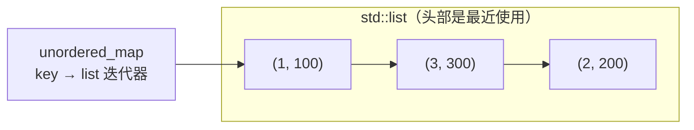

# 07 · 图算法中的生命周期

> **一句话**：图算法里的状态几乎全是"索引"而不是"对象"——一旦底层的容器重建、节点被删、或者两次查询之间忘了清空，索引就指向不存在的东西。

## 一个只在第二次查询时出错的函数

先看一个很常见的图封装：

```cpp
class Graph {
public:
    explicit Graph(int n) : adj_(n), visited_(n, false) {}

    void add_edge(int u, int v) {
        adj_[u].push_back(v);
        adj_[v].push_back(u);
    }

    bool connected(int s, int t) {
        dfs(s);                       // 用成员变量 visited_ 记录访问状态
        return visited_[t];
    }

private:
    void dfs(int u) {
        visited_[u] = true;
        for (int v : adj_[u])
            if (!visited_[v]) dfs(v);
    }

    std::vector<std::vector<int>> adj_;
    std::vector<bool> visited_;      // 只在构造时初始化过一次，之后从不清空
};
```

第一次调用 `connected(0, 5)`，`0` 和 `5` 在同一个连通分量里，返回 `true`，一切正常。问题出在后面的调用：假设图里还有另一个分量 `{6, 7}`，现在调用 `connected(6, 0)`。`dfs(6)` 会把 `6` 和 `7` 标成已访问，然后返回 `visited_[0]`——而 `visited_[0]` 是上一次查询留下的 `true`，于是这个函数信誓旦旦地告诉你两个不相连的节点是连通的。

注意这里没有越界、没有悬垂，`visited_` 的大小完全正确——它是一个**纯粹的逻辑错误**，也因此比 UB 更难被工具发现。根因是 `visited_` 从没在两次查询之间被清空，上一次遍历的结论被当成了这一次的前提。

这个 bug 的特征是：**单次调用永远正确，连续调用才出错**。它把"一次遍历的状态"错误地提升成了"对象的长期状态"。修法有三种，各有代价：

```cpp
// 方案一：每次查询新建（最安全，最直观）
bool connected(int s, int t) {
    std::vector<char> seen(adj_.size(), 0);
    // ... 用 seen 做 DFS ...
}

// 方案二：复用一个成员，但每次进函数先整体清空
std::fill(visited_.begin(), visited_.end(), false);

// 方案三：用"代数标记"避免清空
std::vector<int> stamp_;   // 记录每个节点最后一次被哪一轮访问
int round_ = 0;
```

方案三值得说一句：`stamp_[v] == round_` 表示"这一轮访问过"，判断完 `round_` 加一，上一轮的标记自动作废，清空成本从 $O(V)$ 降到 $O(1)$。它的代价是每个节点多存一个整数，而且 `round_` 溢出时要真的清一次。**这就是"生命周期"在算法里的典型形态：你可以用编号代替重置，但你必须清楚编号代表什么。**

## 图由谁拥有：索引还是对象

图有几种常见表示，它们的"所有权"结构完全不同：

```cpp
// 1. 邻接表：节点就是下标，边是整数
std::vector<std::vector<int>> adj;        // adj[u] 拥有 u 的所有邻居 id

// 2. 边列表：边是值，节点是编号
std::vector<std::tuple<int, int, int>> edges;   // (u, v, w)

// 3. 邻接 map：节点可以是任意可哈希的键
std::unordered_map<int, std::vector<int>> adj_map;

// 4. 指针图：节点是对象，边是指针
struct Node { std::vector<Node*> next; };
```

前三种里，"节点"只是整数 id，**没有任何生命周期问题**——`3` 这个数不会悬垂。真正需要管理的是容器本身：`adj.push_back({})` 可能让 `adj` 扩容，之前取出的 `adj[u]` 引用就失效了；边列表排序后下标顺序变了，旧的边下标不再对应同一条边。

第四种才是危险的：指针图里节点是 `new` 出来的对象，边是指向它们的指针。删掉一个节点，所有指向它的边立刻悬垂。如果图是无环的树结构，父子指针还能管住；一旦有环或者有"回边"，就必须引入 `shared_ptr` 或干脆退回 id 表示。

::: tip 一个实用原则
**能用 id 表示的关系，就不要用指针表示。** id 是不可变的整数，复制、排序、存进容器都不会失效；指针需要有人负责释放，还需要保证指向的对象活得够久。图算法里绝大多数"生命周期 bug"，都来自把 id 换成了指针。
:::

## visited 的生命周期

`visited` 是一个**每次遍历开始时的局部状态**，它的语义是"在这次遍历里，我有没有到过这个节点"。这决定了两条规则：

1. **每次遍历必须从全 false 开始**。新建、`fill`、或者代数标记，三选一。
2. **不要把它暴露成可以被外部读写的公共状态**。一旦别人能改它，它就不再描述"这次遍历"，而变成了一个没人说得清含义的全局变量。

`visited` 的类型也有讲究。`std::vector<bool>` 是位压缩的特化版本，`operator[]` 返回代理对象，不能取地址，`auto& x = visited[i]` 编译不过。图算法里元素数量可能很大，位压缩确实省内存，但如果你要传 `bool&`、要并发写不同下标（位压缩会导致同一字节上的**伪共享**和**数据竞争**），就应该用 `std::vector<char>`。

还有一个更细的问题：DFS 里有时需要区分"正在访问"和"已经访问完"，这就是三色标记（white / gray / black）。它多出来的那个状态不是装饰：如果遍历中遇到一条指向**灰色**节点的边（回边，back edge），说明它指向的正是当前 DFS 栈上的祖先，图中存在环。用两色标记就检测不出环，因为"访问过"和"正在栈上"被混成了一个状态。

## DFS 栈帧、BFS 队列，以及"什么时候标记"

DFS 用递归，状态活在栈帧里；BFS 用队列，状态活在堆上的队列里。两者的生命周期差异直接导致了标记时机的差异。

**BFS 必须在入队时标记，不能在出队时标记。**

```cpp
std::queue<int> q;
q.push(s);
visited[s] = true;              // ← 入队就标记

while (!q.empty()) {
    int u = q.front(); q.pop();
    for (int v : adj[u]) {
        if (!visited[v]) {
            visited[v] = true;  // ← 在这里标记，而不是在 pop 的时候
            q.push(v);
        }
    }
}
```

如果改成"出队时才标记"，同一个节点可能在队列里出现很多次：节点 `v` 被三个邻居同时发现，三个邻居都会把它入队，直到第一次出队才被标记。多出来的条目不仅浪费内存，还让你依赖的"队列里的顺序"变得不可解释。

`q.front()` 返回的是引用，`q.pop()` 之后它就失效了——这也是为什么几乎没有人写 `int& u = q.front(); q.pop(); use(u);`。要么先拷贝：

```cpp
int u = q.front(); q.pop();
```

队列通常是 `std::deque` 适配出来的，`push` 会让所有迭代器失效（见 05 篇），所以"保存队列里某个元素的指针"这个念头本身就应该被打消。

**DFS 的代价是栈。** 递归版 DFS 的搜索状态活在栈帧里（见 06 篇），每深入一层压一个帧。链状图是最坏的输入：一百万个节点首尾相连，递归深度就是一百万，栈溢出几乎是必然的。这种图要么改成显式栈的迭代版，要么换成 BFS。

**还原路径用的 `parent` 数组是另一条时间线。** 想在遍历之后回答"从 `s` 到 `t` 怎么走"，通常额外维护 `std::vector<int> parent(n, -1)`，发现 `v` 时记下 `parent[v] = u`：

```cpp
std::vector<int> parent(n, -1);
// BFS/DFS 中首次发现 v 时：
parent[v] = u;
```

三件事要注意：初始化成 `-1` 而不是 `0`，否则节点 0 会被当成许多节点的父节点，路径回溯会绕圈；`parent` 必须活得比遍历久——函数返回后路径信息就没了，所以要么把它作为输出参数交出去，要么在函数内部还原完整路径再返回；不要保存 `parent` 元素的引用，容器一旦重建，`int&` 就悬垂了。

和 06 篇的回溯不同，`parent` **不需要撤销**：一个节点只会在第一次被发现时写入一次，之后所有边都不会再改它。如果你的算法会在发现更短路径时覆盖 `parent[v]`（比如带路径还原的 Dijkstra），那它就不再是"首次发现即定稿"——这时必须让 `parent[v]` 和 `dist[v]` 在同一步更新，否则两者会互相矛盾：距离是新的，父亲还是旧的。

## Dijkstra：优先队列里的"过期条目"

Dijkstra 最容易被写错的地方，是很多人把 `priority_queue` 当成一个"可以修改优先级"的结构。它不是。**你只能往里塞新条目，不能修改已经在里面的条目。**

```cpp
// adj[u] 是 vector<pair<int, int>>：(邻居, 边权)
using P = std::pair<long long, int>;   // (距离, 节点)
std::priority_queue<P, std::vector<P>, std::greater<P>> pq;

std::vector<long long> dist(n, INF);
dist[s] = 0;
pq.push({0, s});

while (!pq.empty()) {
    auto [d, u] = pq.top();
    pq.pop();

    if (d != dist[u]) continue;   // ← 过期条目，直接跳过
    if (u == t) break;

    for (auto [v, w] : adj[u]) {
        if (dist[u] + w < dist[v]) {
            dist[v] = dist[u] + w;
            pq.push({dist[v], v});   // 塞一条新的，旧的留在堆里
        }
    }
}
```

这里发生了什么：节点 `u` 第一次被发现时可能是经由一条很长的路，`dist[u]` 记成 100，入队 `(100, u)`；后来发现一条更短的路，`dist[u]` 改成 10，再入队 `(10, u)`。堆里于是同时存在 `(100, u)` 和 `(10, u)`。

- **`dist` 数组是"当前已知最短距离"的权威来源**，它的生命周期覆盖整个求解过程。
- **堆里的条目只是"某一时刻的快照"**。它不拥有距离，它记录的是"我曾经以为距离是 100"。
- 弹出时比较 `d != dist[u]`，就是**惰性删除（lazy deletion）**：不真的从堆里删掉旧条目，而是等它浮到堆顶时再丢掉。代价是堆里条目数最多 $O(E)$，换来的是不用实现"可减键的堆"。

为什么不只靠 `visited`？因为 `visited` 是一个布尔值，它只能回答"这个节点定稿了吗"，回答不了"我现在这条路径多长、要不要用它去松弛邻居"。你还需要 `dist` 来做松弛判断。而且如果照搬 BFS 的"入队即标记"，第一次发现的路径不一定最短，Dijkstra 就直接错了——**`visited` 只能在弹出时标记，从而表示"距离已确定"。**

::: warning 负权边
Dijkstra 要求所有边权非负。有负权边时，"弹出的最小距离已经定稿"这个前提不成立，算法会给出错误答案而不是报错。这种图要用 Bellman–Ford 或 SPFA。
:::

## 并查集：结构会变，归属不变

并查集的全部生命周期问题，都围绕一个数组：

```cpp
struct DSU {
    std::vector<int> parent, rank_;

    explicit DSU(int n) : parent(n), rank_(n, 0) {
        std::iota(parent.begin(), parent.end(), 0);
    }

    int find(int x) {                       // 路径压缩
        return parent[x] == x ? x : parent[x] = find(parent[x]);
    }

    bool unite(int a, int b) {
        a = find(a); b = find(b);
        if (a == b) return false;
        if (rank_[a] < rank_[b]) std::swap(a, b);
        parent[b] = a;
        if (rank_[a] == rank_[b]) ++rank_[a];
        return true;
    }
};
```

几个关键点：

- **`parent` 的语义是"每个元素指向自己所属集合的代表"**，不是"父子关系的树"。路径压缩会把树压扁，节点直接指向根——**树的结构变了，但每个元素属于哪个集合没有变**。所以压缩是安全的，前提是你从根到叶的方向读它。
- **`find` 会修改 `parent`**。它不是 `const` 函数，也不能在多个线程里并发调用而不加锁。如果你在多线程里用并查集，要么只读、要么加锁、要么每个线程一份再合并。
- **多次查询之间必须重置**。`DSU` 的构造就是初始化，第二个测试用例应该新建一个 `DSU`，而不是复用上一个。如果非要复用，就得把 `parent[i] = i`、`rank_[i] = 0` 全部重来——这比新建一个更慢，也更容易漏。
- **不要保存 `parent` 元素的引用**。`std::vector<int>` 扩容会让引用失效；`parent` 本身如果被 `push_back` 扩展（动态加点），之前取出的 `int&` 就悬垂了。取下标，不要取引用。

`rank` 和 `size` 是两种可选的启发式：`rank` 记录"树的秩"，`size` 记录"集合大小"。按大小合并往往在实践中更快，而且 `size` 还能顺便回答"这个集合有多少元素"。两者只用其一即可。

## LRU 缓存：把 list 的稳定性用到底

LRU（least recently used）缓存的经典实现，是 `std::list` 加 `std::unordered_map`，哈希表里存 list 的**迭代器**：



这个结构之所以成立，完全依赖 05 篇讲的两条性质：

- `std::list` 的 `insert`、`splice` 不使任何迭代器失效；
- `std::list` 的 `erase` 只使被删元素的迭代器失效。

于是"把某个元素移到头部"可以只用 `splice`，不拷贝值、不重新分配、不影响哈希表里保存的迭代器：

```cpp
class LRUCache {
public:
    explicit LRUCache(int cap) : cap_(cap) {}

    int get(int key) {
        auto it = map_.find(key);
        if (it == map_.end()) return -1;
        items_.splice(items_.begin(), items_, it->second);   // 移到头部
        return it->second->second;
    }

    void put(int key, int value) {
        if (auto it = map_.find(key); it != map_.end()) {
            it->second->second = value;
            items_.splice(items_.begin(), items_, it->second);
            return;
        }
        if (static_cast<int>(items_.size()) == cap_) {
            int old_key = items_.back().first;   // 先记下 key
            map_.erase(old_key);                 // 再删表
            items_.pop_back();                   // 最后删节点
        }
        items_.emplace_front(key, value);
        map_[key] = items_.begin();
    }

private:
    int cap_;
    std::list<std::pair<int, int>> items_;
    std::unordered_map<int, std::list<std::pair<int, int>>::iterator> map_;
};
```

淘汰那段的三行顺序不能换。写反了会出两种不同的错：

```cpp
// 错误写法 A：先删节点，再按 back() 取 key
items_.pop_back();
map_.erase(items_.back().first);   // 删掉的是"新的尾巴"，key 错了

// 错误写法 B：先删节点，再用保存的迭代器
auto it = map_[key];
items_.pop_back();                 // 若 it 指向被弹出的节点
map_.erase(it);                    // UB：erase 一个失效迭代器
```

写法 A 是逻辑错误：删错了 key，缓存里留下一个永远不会被淘汰的幽灵条目。写法 B 是 UB，因为 `erase` 要求迭代器有效。

还有一个更隐蔽的问题：如果 `items_.emplace_front()` 之后你保存了 `items_.begin()`，然后**又对 `items_` 做了别的操作**——只要不删除这个节点，迭代器仍然有效；但如果你拷贝了 `iterator` 又把它存进另一个容器，就必须保证那个节点不会被 `pop_back` 掉。**哈希表里的迭代器不是"元素"的备份，它只是"位置"的备份。**

## 拓扑排序：入度数组的所有权

Kahn 算法需要一个入度数组：

```cpp
std::vector<int> indeg(n, 0);
for (int u = 0; u < n; ++u)
    for (int v : adj[u]) ++indeg[v];

std::queue<int> q;
for (int u = 0; u < n; ++u)
    if (indeg[u] == 0) q.push(u);

std::vector<int> order;
while (!q.empty()) {
    int u = q.front(); q.pop();
    order.push_back(u);
    for (int v : adj[u])
        if (--indeg[v] == 0) q.push(v);
}
```

- `indeg` 是**被消耗的**：每处理一条边就减一；在有向无环图里，算法结束时它全是 0，原始信息已经没了。如果你还要回答"原图的入度分布"，必须在开始前复制一份（`auto original = indeg;`）。
- 入队顺序决定了输出顺序：同一批入度为 0 的节点，谁先进队谁先输出。要字典序最小的拓扑序，把 `queue` 换成 `priority_queue`。
- `order.size() < n` 说明有环——这个判断依赖 `order` 的完整生命周期，别在中途清空它。
- 队列里存的是节点 id（值），所以没有失效问题；但如果你存的是迭代器或指针，`std::deque` 底层的每次 `push` 都可能让它们失效（见 05 篇）。

<div class="human-note">
<strong>换个说法：</strong>图算法里的数组（`visited`、`dist`、`parent`、`indeg`）都是"笔记本"，不是"资产"。笔记本每做一道题就该翻新一页；只有 `dist` 这种"本题的最终答案"才需要跨步骤保留。而 LRU 里的迭代器更像"座位号"——只要那个人没被请出去，座位号就一直有效；人一走，座位号就得从名册上划掉。
</div>

## 常见误解

**误解一：`visited` 是成员变量，所以只需要构造时初始化一次。**

构造时初始化只保证第一次遍历正确。第二次遍历看到的是上一次的残留，结果取决于调用顺序——这是最难复现的一类 bug。

**误解二：Dijkstra 的 `visited` 可以像 BFS 一样在入队时标记。**

BFS 的边权相同，先入队的就是最短的；Dijkstra 不是。入队时标记会锁死一条可能更长的路径，算法给出错误结果且不报错。

**误解三：并查集路径压缩会改变元素所属的集合。**

压缩只改 `parent` 的指向，让节点直接指向根；集合划分完全不变。真正改变划分的是 `unite`。

**误解四：LRU 里 `list::splice` 会让哈希表里的迭代器失效。**

同一容器内 `splice` 只改变链接顺序，节点不移动、不重新分配，迭代器保持有效。这也正是这个实现能成立的原因。

**误解五：优先队列可以"更新"某个元素的距离。**

标准 `std::priority_queue` 不支持减键（decrease-key）。能做的只有"塞新条目 + 弹出时跳过过期条目"，也就是惰性删除。

## 本章小结

- 图里优先用整数 id 表示节点，指针图会把"谁拥有谁"的问题带进算法。
- `visited` 描述"本次遍历"，每次遍历必须重置；代数标记可以把重置成本降到 $O(1)$，但要理解它的语义。
- BFS 在入队时标记；Dijkstra 在出队时确认、并靠 `dist` 判断条目是否过期。
- 并查集的 `parent` 会因路径压缩而改变形状，但元素归属不变；多次查询之间要重置。
- LRU 的正确性建立在 `list` 迭代器稳定之上：淘汰时必须先取 key、再删哈希表、最后删节点。

## 练习

1. 下面这个 LRU 淘汰逻辑有两个问题，找出来并修正：

   ```cpp
   if (items_.size() == cap_) {
       items_.pop_back();
       map_.erase(items_.back().first);
   }
   ```

2. 用自己的话解释：Dijkstra 中 `if (d != dist[u]) continue;` 这一行删掉之后，程序在什么情况下仍然正确、什么情况下会出错？举一个具体的图。

3. 一个类里有两个方法 `reachable(a, b)` 和 `shortest(a, b)`，都复用了同一个成员 `visited`。请说明把它们改成"每次调用新建局部数组"之后，性能上和正确性上分别发生了什么变化。

4. 并查集被用来动态加边。如果 `parent` 是 `std::vector<int>`，而你在某处保存了 `int& ref = parent[x]`，随后又 `parent.push_back(...)`，会发生什么？给出修复方案。

---

下一篇：[08 · 并发与异步](/lifetime/08-concurrency-async)
