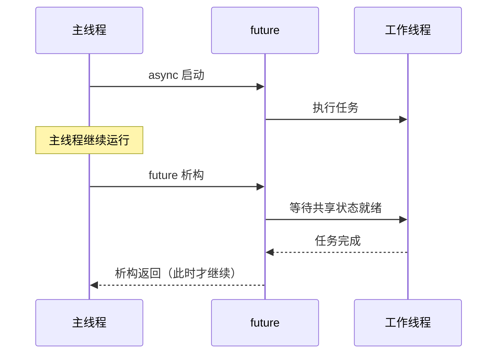

# 08 · 并发与异步

> **一句话**：单线程里"对象活着"和"代码在跑"是同一件事；一旦引入线程或回调，就是两条独立的时间线，而 C++ 不会替你同步它们。

## 一个安静的崩溃

```cpp
#include <thread>
#include <iostream>

void start() {
    int x = 42;
    std::thread t([&] { std::cout << x << '\n'; });
    t.detach();
}   // x 在这里销毁

int main() {
    start();
    std::this_thread::sleep_for(std::chrono::seconds(1));
}
```

这段代码有三种可能的结局，而且都"正常"：

1. 打印 `42`——因为栈内存还没被覆盖，看起来完全正确；
2. 打印一串随机数字——栈空间被 `main` 或其它调用复用了；
3. 直接段错误，或者更糟，破坏掉别处的数据。

`detach` 的语义是"我不管你了"：线程对象和底层线程解除关联，`start()` 返回后没有人在等它。`x` 的存储期也在 `start()` 返回时结束。lambda 捕获的是 `x` 的引用，于是线程拿着一个指向已销毁对象的引用继续跑。

这里叠加了两个问题：

- 悬垂（dangling）：`x` 的生命周期已经结束，访问它是 UB。这跟单线程里的悬垂引用是同一类错误。
- 数据竞争（data race）：如果 `x` 还活着，主线程写、工作线程读，两个线程没有同步，访问同一块内存且至少一个是写，同样是 UB。

两者经常同时出现，但修复手段不同：悬垂要靠"延长生命周期"，数据竞争要靠"同步"。**用 `std::mutex` 解决不了悬垂，用 `shared_ptr` 也解决不了数据竞争。**

## thread 对象本身也有生命周期

`std::thread` 是一个句柄，和底层执行流是两回事。关键规则只有一条：

> 一个 `joinable()` 的 `std::thread` 在析构时会调用 `std::terminate()`。

```cpp
void f() {
    std::thread t(work);   // t 是 joinable 的
}                          // 析构 → std::terminate → 程序直接死掉
```

程序直接终止，不抛异常，也捕获不了。所以每个 `std::thread` 都必须被显式处理：

- `join()`：阻塞等待线程结束，然后线程对象不再 joinable。适合"我确实需要结果"的场景。
- `detach()`：放弃控制权。适合"后台任务、进程退出时无所谓"的场景，代价是上面那种悬垂风险全都归你。
- `std::jthread`（C++20）：析构时自动 `request_stop()` 然后 `join()`。默认行为是安全的，而且它带一个 `std::stop_token`，让工作线程可以协作式地响应停止请求。

```cpp
std::jthread worker([](std::stop_token st) {
    while (!st.stop_requested()) {
        do_one_unit();
    }
});   // 离开作用域：先请求停止，再等待退出
```

注意"协作式"三个字：`request_stop()` 只是把标志置位，并调用注册过的 `stop_callback`。如果工作线程卡在一个不响应 `stop_token` 的阻塞调用里（比如 `read()` 一个永远不来数据的 socket），`jthread` 的析构就会**一直等下去**。自动 join 保证的是"不会 terminate"，不保证"不会卡住"。

## 捕获引用：什么时候是安全的

引用捕获不是原罪，问题在于**被引用对象的寿命是否覆盖线程的整个执行期**。

```cpp
// 安全：调用方等待，引用活得比线程久
void run_sync(std::vector<int>& data) {
    std::thread t([&data] { process(data); });
    t.join();          // 线程结束之前，data 一定还活着
}

// 危险：detach 之后没有任何人保证
void run_async(std::vector<int>& data) {
    std::thread t([&data] { process(data); });
    t.detach();        // data 可能在线程跑完之前被销毁
}
```

判断方法很机械：**把线程的生命周期画出来，看它是否完全包含在被捕获对象的生命周期里。** `join()` 能给出这个包含关系，`detach()` 给不出。

如果确实需要异步，就把数据的所有权转移过去：

```cpp
void run_async(std::vector<int> data) {          // 按值传入
    std::thread t([data = std::move(data)] {     // 移动进 lambda
        process(data);
    });
    t.detach();
}   // 数据在线程对象里，线程结束时才销毁
```

`[data = std::move(data)]` 是 C++14 起的初始化捕获（init-capture），它让 lambda 自己持有一份数据。这样"谁拥有数据"就清楚了：线程拥有它，线程结束时释放。

## 捕获 this：对象先死，回调后到

比捕获局部变量更常见的，是捕获 `this`：

```cpp
class Downloader {
public:
    void start() {
        std::thread([this] {
            auto result = fetch(url_);   // 读成员
            callback_(result);
        }).detach();
    }
    // ...
};
```

如果 `Downloader` 在 `fetch` 返回之前被销毁（比如 UI 关闭了那个面板），线程读 `url_`、调用 `callback_` 全都是访问已销毁对象——典型的 use-after-free。`this` 是一个裸指针，没有任何机制能知道对象已经死了。

三种常见修法，各自解决不同层面的问题：

修法一：`shared_ptr` + `weak_ptr`。让对象由 `shared_ptr` 管理，线程只持有一个 `weak_ptr`，用之前先 `lock()`：

```cpp
class Downloader : public std::enable_shared_from_this<Downloader> {
public:
    void start() {
        std::weak_ptr<Downloader> wp = weak_from_this();
        std::thread([wp] {
            if (auto self = wp.lock()) {     // 对象还活着才继续
                auto result = self->fetch(self->url_);
                self->callback_(result);
            }                            // self 在这里释放
        }).detach();
    }
};
```

`wp.lock()` 返回一个 `shared_ptr`：如果对象还活着，它保证在 `self` 的作用域内对象不会被销毁；如果已经销毁，返回空指针，线程安静退出。**关键在于 `lock()` 之后要一直用 `self`，不能用回 `this`**——否则在 `lock()` 到使用之间对象仍可能被销毁。

`enable_shared_from_this` 有一个硬性前提：对象必须已经由 `shared_ptr` 拥有。如果 `Downloader` 是栈对象，`weak_from_this()` 返回空的 `weak_ptr`，`lock()` 永远失败；调用 `shared_from_this()` 则抛 `std::bad_weak_ptr`。这不是一个"有时候能用"的接口：用错了，要么抛 `std::bad_weak_ptr`，要么安静地返回空 `weak_ptr`。

修法二：显式生命周期令牌。一个 `shared_ptr<Control>`，线程持有一份，析构时把 `*alive = false`，线程在每次迭代检查它。适合"任务由外部驱动、需要立即停止"的场景。

修法三：join 而不是 detach。如果 UI 面板关闭时能等到线程结束，问题就根本不存在。代价是关闭可能变慢。

修法一和修法二解决的是"对象死了怎么办"，修法三解决的是"对象不允许在任务结束前死"。选哪个取决于你能接受多长的关闭延迟。

## std::async 与 future 的"析构即等待"

`std::async` 有一个和直觉相反的行为：

```cpp
void fire_and_forget() {
    std::async(std::launch::async, [] { heavy_work(); });
}   // 这一行的分号处，future 析构 → 阻塞等待任务完成
```

如果 `std::async` 使用 `std::launch::async` 策略（或者 `async | deferred` 且实际选择了 async），它返回的 `future` 在析构时会**阻塞直到共享状态就绪**。标准这样规定，是为了避免"临时 future 被销毁但任务还在跑、任务访问的引用已经销毁"这类问题：用一个隐式的同步点，换掉悬垂风险。

后果是：

- 上例的实际效果是调用处同步等待，函数返回时任务已经完成，没有后台执行；
- 循环里写 `for (...) std::async(std::launch::async, task);`，每个任务都会被串行化，看起来像多线程，实际是一个接一个；
- 如果任务抛异常而 future 被丢弃，异常会被静默吞掉，因为没有人调用 `get()`。

想"发射后不管"，就必须把 future 移进一个长生命周期的容器（`std::vector<std::future<void>>`），并在合适的地方 `get()` 或 `wait()`。丢掉 future，就等于丢掉了结果和异常。

对照一下：`std::packaged_task` 和 `std::promise` 返回的 future 没有这个阻塞行为；`std::launch::deferred` 的 future 析构也不阻塞（它会在 `get()` 时才执行）。只有 `std::async` + async 这一条路径是特殊的。



## 回调、观察者与事件循环

回调的本质是"把一段代码和一个对象一起存起来，等以后再执行"。它天然带着两个生命周期问题：谁来执行，执行时对象还在不在。

观察者模式的经典错误是"注册了但没反注册"：

```cpp
class Panel {
public:
    Panel(EventBus& bus) : bus_(bus) {
        bus_.subscribe([this](const Event& e) { on_event(e); });
    }
    ~Panel() {
        // 忘了 unsubscribe：bus 里还留着捕获 this 的闭包
    }
};
```

`Panel` 销毁后，`EventBus` 下次派发事件就会调用一个悬垂的 `this`。修复方式有三种：

- 在析构函数里反注册（最直接，但必须保证 `bus_` 活得比 `Panel` 久）；
- 注册时返回一个 `Subscription` 句柄，让它自己管反注册（RAII，推荐）；
- 订阅时捕获 `weak_ptr`，派发时 `lock()` 失败就跳过（能兜底，但泄漏的订阅会一直堆积）。

事件循环里的闭包是同一类问题。一个延迟 200 ms 执行的闭包捕获了 `this`，而对象在 100 ms 时就被销毁——这在 UI 框架、网络库、`setTimeout` 风格的 API 里很常见。检查方法一样：闭包会在什么时候执行？执行的那一刻，它捕获的东西还活着吗？

Rust 在这里给出的是编译期答案：闭包捕获引用时必须满足借用规则，需要 `'static` 的地方就得用 `Arc`。Python 的 `asyncio` 则是运行时答案：`Task.cancel()` 会在下一个 `await` 点抛出 `CancelledError`，任务可能还没停下，`finally` 里必须清理资源。

## 锁保护数据，不保护生命周期

一个常见的误会是："我加了锁，就安全了"。锁保证的是互斥访问，不延长任何对象的寿命：

```cpp
class Counter {
    std::mutex m_;
    int value_ = 0;
public:
    void inc() { std::lock_guard lock(m_); ++value_; }
};

auto c = std::make_unique<Counter>();
std::thread t([&c] { c->inc(); });   // 捕获的是 unique_ptr 的引用
c.reset();                           // 对象销毁：m_ 跟着销毁
t.join();                            // 线程此时可能正在 lock 一个已销毁的 mutex → UB
```

`std::mutex` 被销毁时如果仍有线程在等它，是 UB。`std::lock_guard` 内部持有 `std::mutex&`，mutex 一销毁，锁对象也成了悬垂引用。

另外两条实践规则：

- 不要在持锁期间调用外部回调。回调可能反过来调用你的方法，造成死锁（`std::mutex` 不可重入）；也可能在回调里销毁了当前对象。
- 锁的粒度应该覆盖"数据被访问"的整个过程，而不是"取到数据"那一刻。`lock(); auto p = ptr_; unlock(); p->use();` 这种写法没有保护 `p` 指向的对象，只保护了指针变量的复制。

## 语言对照：谁负责生命周期

| 语言 | 机制 | 解决了什么 | 没解决什么 |
| --- | --- | --- | --- |
| Rust | `Send` / `Sync` + 借用检查 | 跨线程共享在编译期被限制；`'static` 强制要求 | 逻辑上的死锁、`Arc<Mutex<_>>` 里的运行时错误 |
| Go | goroutine + `context` | 取消是显式传递的；GC 保证对象不被提前回收 | 数据竞争（需要 `-race` 检测）；goroutine 泄漏 |
| Python | GC + `asyncio.Task` | 对象不会被提前释放；`cancel` 有明确入口 | 取消是协作式的，任务可能还在跑；回调里的引用形成环 |
| C++ | 无 | 给了你全部控制权 | 全部责任也归你 |

Rust 的 `Send` 表示"可以安全地转移所有权到另一个线程"，`Sync` 表示"可以被多个线程共享引用"。这两个 trait 把"数据竞争"变成了编译错误——但它管不了"对象已经死了"：`Arc` 能保证对象活到最后一个持有者释放。

Go 的 `context` 和 C++20 的 `stop_token` 是同一个思路：**取消是一个需要被检查的标志，不是一次强制终止。** Python 的 `Task.cancel()` 也一样，只是它把检查点藏在了 `await` 里。

<div class="human-note">
<strong>换个说法：</strong>`detach` 像是把一封信投进邮筒却没写回信地址——信会寄出去，但没人能保证收信时你还在原地。`shared_ptr` + `weak_ptr` 相当于给对方留一个"我还在吗"的查询号码：号码还有效就见面，失效就各自安好。`jthread` 则是关门前先敲门，确认屋里的人出来再锁门。
</div>

## 常见误解

**误解一：`detach` 之后线程会自己管好自己。**

`detach` 只是解除句柄关联，不复制任何数据、不延长任何对象的寿命。线程访问的每个引用都需要你自己保证有效。

**误解二：加了 `std::mutex` 就不会有生命周期问题。**

锁保护的是"访问的互斥性"，不是"对象是否存在"。悬垂的 mutex、悬垂的 `this`、悬垂的引用，锁一个都救不了。

**误解三：`std::async` 一定是异步的。**

带 `std::launch::async` 时确实在另一个线程跑，但返回的 future 析构会阻塞等待。想后台执行，必须把 future 存起来。

**误解四：`shared_from_this()` 在任何成员函数里都能用。**

只有当对象已经被 `shared_ptr` 拥有时才有效。对栈对象或 `unique_ptr` 持有的对象调用会抛 `bad_weak_ptr`。

**误解五：捕获 `this` 和捕获 `*this` 是一回事。**

`[this]` 捕获指针，对象销毁后照样悬垂；`[*this]`（C++17）拷贝整个对象，线程拥有自己的副本，反而安全。当然，要求类可拷贝。

## 本章小结

- `std::thread` 析构时若仍 `joinable()` 会 `std::terminate()`；`join`、`detach`、`jthread` 是三选一。
- 引用捕获的安全条件是"被引用对象的寿命覆盖线程整个执行期"，`join` 能保证，`detach` 不能。
- 捕获 `this` 的线程/回调要用 `weak_ptr` + `lock()` 兜底，并且 `lock()` 之后只用 `self`，不再碰 `this`。
- `std::async` 返回的 future 在析构时会阻塞等待；丢弃 future 等于丢弃结果和异常。
- 锁只保证互斥访问，不保证对象存活；持锁期间不要调用外部回调。

## 练习

1. 找出下面代码中的两处生命周期问题，并分别给出修复：

   ```cpp
   void Server::start() {
       std::thread([&] {
           while (!stop_) {
               handle(request_queue_.pop());
           }
       }).detach();
   }
   ```

2. 用 `shared_ptr` / `weak_ptr` 改写一个"定时器回调捕获 `this`"的实现，要求对象销毁后回调能安全地什么都不做。

3. 解释为什么下面这段代码实际上是一个串行循环，以及怎样改才能真的并行：

   ```cpp
   for (const auto& task : tasks)
       std::async(std::launch::async, [&] { run(task); });
   ```

4. 给一个 `std::mutex` 加 `std::lock_guard` 的函数，如果在持锁期间调用了一个用户提供的回调，可能出现哪两类问题？分别给出规避方案。

---

下一篇：[09 · 生命周期检查清单](/lifetime/09-checklist)
