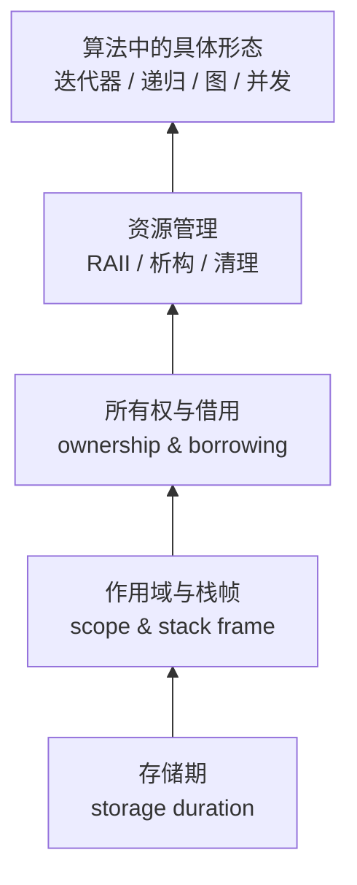

# 算法中的生命周期

> **一句话**：生命周期就是回答三个问题——这个对象什么时候出生？它能被谁使用？它什么时候死亡、由谁负责清理？

## 为什么算法里会冒出“生命周期问题”

算法题通常只关心时间复杂度和空间复杂度，但真实代码还会关心**时间维度上的正确性**：

- 你从 `vector` 里拿了一个迭代器，随后又 `push_back`，迭代器可能已经指向一块被释放的内存。
- 你在递归里传了一个引用，回溯时忘了恢复，上一层看到的是被改脏的状态。
- 你把 `std::string_view` 存进一个结构体，而它指向的临时字符串早已销毁。
- 你在异步回调里捕获了 `this`，对象先被销毁，回调后执行。

这些问题有一个共同点：**代码在语法上完全合法，类型也大多正确，但对象已经“死”了。**

## 你会学到什么

这条路线把“生命周期”拆成四层，从下往上建立直觉：

1. **存储期**：对象在内存里存在多久？栈、堆、静态区分别意味着什么？
2. **作用域**：名字在代码的哪个区间可见？可见性和存活时间不是一回事。
3. **所有权**：谁负责释放？谁只是借用？移动之后原对象还剩什么？
4. **算法形态**：容器扩容、回溯撤销、图遍历的 visited 标记、异步回调……都是前三条的组合。

## 章节

  <a class="chapter-card" href="/lifetime/01-three-meanings">
    01生命周期的三层含义
    存储期、作用域、所有权：先把三个容易混的词分开。
  </a>
  <a class="chapter-card" href="/lifetime/02-stack-heap-scope">
    02栈、堆与作用域
    函数调用时发生了什么？为什么局部变量的地址不能随便带出去？
  </a>
  <a class="chapter-card" href="/lifetime/03-ownership-raii">
    03所有权与 RAII
    从“手动 new/delete”到“构造即获取、析构即释放”，以及移动语义。
  </a>
  <a class="chapter-card" href="/lifetime/04-references-dangling">
    04引用与悬垂
    引用、指针、string_view、lambda 捕获：谁在悄悄延长谁的生命？
  </a>
  <a class="chapter-card" href="/lifetime/05-containers-iterators">
    05容器与迭代器失效
    vector 扩容、erase 循环、map 与 list 的差异，一次讲透。
  </a>
  <a class="chapter-card" href="/lifetime/06-recursion-backtracking">
    06递归与回溯
    栈帧的生命周期、引用参数、回溯时的“恢复现场”为什么必要。
  </a>
  <a class="chapter-card" href="/lifetime/07-graph-algorithms">
    07图算法中的生命周期
    visited 标记、节点归属、并查集路径压缩、LRU 的双向链表。
  </a>
  <a class="chapter-card" href="/lifetime/08-concurrency-async">
    08并发与异步
    detach 的线程、捕获 this 的回调、shared_ptr 与 weak_ptr 的分工。
  </a>
  <a class="chapter-card" href="/lifetime/09-checklist">
    09检查清单
    写代码时可以逐条对照的“生命周期体检表”。
  </a>

## 语言选择

示例以 **C++** 为主，因为 C++ 把生命周期的细节暴露得最充分：构造/析构、拷贝/移动、迭代器失效、引用捕获，全都能看到。

同时会做横向对照：

- **Rust**：借用检查器如何把很多问题变成编译错误。
- **Python / Java / Go**：垃圾回收解决了什么，又没有解决什么。
- **JavaScript / TypeScript**：闭包捕获与事件循环里的“逻辑生命周期”。

## 怎么读

前四篇是地基，建议按顺序读。第 5–8 篇是具体场景，可以跳读：

- 被 `vector` 迭代器坑过 → 直接看 [05](/lifetime/05-containers-iterators)
- 写回溯/DFS 时状态总是错 → 看 [06](/lifetime/06-recursion-backtracking)
- 写 LRU / 并查集 → 看 [07](/lifetime/07-graph-algorithms)
- 写线程池 / 异步回调 → 看 [08](/lifetime/08-concurrency-async)

::: warning 一个常见误会
“生命周期结束”不等于“内存被回收”。在 C++ 里，析构函数执行完，对象就结束了，但内存块可能还在；在 Java 里，对象不可达之后才可能被 GC。**对象的生命周期**和**内存的生命周期**是两条时间线。
:::
