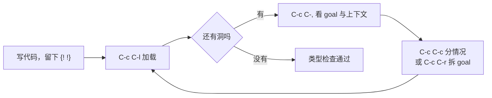

# 02 · Agda 入门

> **一句话**：Agda 里没有“跑一下看看”这一步——你写下一个类型，编译器就只问一件事：这个位置上的程序，凭什么是这个类型。

## 从一段“能跑但什么都没证明”的代码说起

先看一段 C++：

```cpp
#include <cassert>
#include <iostream>

bool not_(bool b) { return !b; }

int main() {
    for (bool b : {true, false})
        assert(not_(not_(b)) == b);
    std::cout << "ok\n";
}
```

它会打印 `ok`。但这句话证明的东西非常有限：它证明的是“在这两个具体输入下，结果相等”。如果明天有人把 `not_` 改成 `return b;`，`assert` 仍然会通过——因为 `!!b == b` 对 `b` 的两种取值都成立，改坏了也看不出来。测试覆盖的是你想到的情况，而不是所有情况。

现在换成 Agda 的写法（`Bool`、`not`、`≡` 在下面的“第一个模块”“交互式证明”两节里定义）。你要先声明“这件事是真的”是什么意思，然后交给编译器检查：

```agda
not-not : (b : Bool) → not (not b) ≡ b
not-not b = {! !}
```

加载之后，Agda 不会运行任何东西，它只会告诉你：这个洞里应该放一个类型为 `not (not b) ≡ b` 的表达式，而你的上下文里有 `b : Bool`。**它把“为什么”变成了一个必须填满的空位。** 本章要做的，就是让你能读懂这个空位，并且填上它。

## Agda 到底是什么

三个定位，按重要性排列：

1. **它是一门依赖类型（dependent type）的编程语言。** 类型可以依赖具体的值，`Vec A 3` 和 `Vec A 4` 是两个不同的类型。这一层是第 04 篇的主题。
2. **它是一个证明助手（proof assistant）。** 类型读作命题，程序读作证明。写下一个类型为 `A → B` 的函数，就等于证明了“A 蕴含 B”。
3. **它是 Martin-Löf 类型论的一个具体实现。** 语法上非常像 Haskell：`data`、`where`、模式匹配、缩进敏感。但语义上有两处关键不同：Agda 要求函数**能证明自己会停机**，也要求模式匹配**覆盖所有构造子**。

第三条值得展开。Haskell 里你可以写 `f x = f x`，它照样编译，只是跑到栈溢出；Agda 会直接拒绝，理由是终止检查器（termination checker）找不到“递归参数在变小”的证据。这不是 Agda 更啰嗦，而是它的目标不同：**如果一段程序可能不停机，它就不能被当作证明**——一个永不返回的“证明”证明不了任何命题。

所以准确地说，Agda 不是“更强的 Haskell”，而是“一个把编译器当成审核员的语言”。它不是生产语言：没有成熟的包管理生态，IO 性能不在考虑范围内，编译一个中等规模的项目可能要几十秒到几分钟。它的价值在于**把某个小问题的规格写到极致**，然后把结论带回日常语言（这是第 08 篇的内容）。

::: info 编译 = 类型检查
在 Agda 里，“编译”和“检查”几乎是同一件事。`agda Foo.agda` 会做类型检查；如果一切正常，它默认什么都不输出。没有输出就是好消息。
:::

## 三种上手方式

按“零安装 → 本地安装”的顺序，挑一个够用的就行。**只想跟读本章的话，路线一足够。**

### 路线一：Agda Pad（零安装）

打开 <https://agdapad.quasicoherent.io/>，在左侧编辑区粘贴代码，点界面上的加载/检查按钮（不同版本的位置和名字略有差异），右侧会显示 goal、上下文和错误信息。

它的好处是立刻可用：不用配环境、不用管版本、不用处理 Unicode 输入法。适合做的正是本章要做的事——改一行、加载、看 goal 怎么变。

局限也要说清楚：

- **单文件**。没有目录结构，不能 `open import` 别的文件。
- **没有标准库**。所以本站示例一律自包含，正是为了让这段代码能直接粘进去。
- **状态在页面里**。关掉标签页就没了，重要的代码自己存一份。
- 大量归一化（比如 `C-c C-n` 算一个很大的数）可能很慢，甚至被浏览器的资源限制打断。

### 路线二：本地安装

版本建议 **Agda 2.6.3 以上，推荐 2.8.x**。装完先自检：

```bash
agda --version
```

三条常见路径：

- **Windows**：官方 GitHub Releases 提供 Windows 二进制包，里面包含 `agda.exe` 和运行库。解压后把目录加入 `PATH`，再确认 `agda --version` 能跑。这是 Windows 上最省事的路；Emacs 插件（`agda2-mode`）需要另外安装和配置。
- **WSL / Fedora**：`sudo dnf install Agda Agda-stdlib`。发行版包的好处是依赖一次性解决，坏处是版本可能偏旧，先看一眼 `agda --version`。
- **cabal / stack**：`cabal install Agda`（或 `stack install Agda`）。灵活，但要求本机 GHC 版本与 Agda 兼容；装不上时，报错通常在“某个依赖要求不同的 GHC”这一层，而不是 Agda 本身。

装完之后，编辑器插件还要单独配一次（见下一节）。Emacs 用户通常需要跑一次 `agda-mode setup`，把 `agda2-mode` 写进配置文件。

::: warning 版本细节会变
上面的包名、二进制内容、安装命令都可能随版本调整。卡住时先看 Agda 官方文档的 installation 页面，不要照着三年前的博客折腾。本章代码在 2.6.x–2.8.x 下应当通过；报错时先查版本，再查缩进。
:::

### 路线三：标准库（可选）

标准库 agda-stdlib 2.0+ 提供了 `Data.Nat`、`Data.Vec`、`Relation.Binary.PropositionalEquality` 等模块。安装方式一般是把仓库路径写进 `~/.agda/libraries`，再把库名写进 `~/.agda/defaults`；用发行版包安装时通常已经配好。

**不装也能跟读本站。** 每篇的代码都是自包含的，需要的数据类型当场定义。当我说“标准库里的对应物是 `Data.Nat._+_`”时，那只是给你以后查文档用的坐标，不是运行前提。

## 编辑器不是重点，但是体验的一半

Agda 的交互式开发依赖一套固定的协议：编辑器把文件发给 Agda 进程，Agda 回传“当前有哪些 goal、每个 goal 的类型是什么、上下文里有什么”。所有插件都是这套协议的前端，所以**键位可以不同，能力是一样的**。

| 编辑器 | 插件 | 定位 |
| --- | --- | --- |
| Emacs | `agda2-mode` | 官方维护，功能最全，文档和教程默认按它写 |
| Neovim | `Cornelis` | 社区维护，补全和 hole 交互做得不错 |
| Vim | `agda-vim` | 老牌插件，够用 |
| VS Code | `banacorn.agda-mode` | 可选，社区维护；键位模仿 Emacs |

本章的命令用 Emacs 键位写，因为它是“普通话”。Agda Pad 和其它编辑器有对应的按钮或快捷键，看到 `C-c C-l` 时不必去找 Emacs，找“加载/检查”即可。

::: details 如果插件实在配不好
最低限度可以用命令行：`agda Foo.agda` 做完整类型检查，报错信息里会包含 goal 的类型和上下文。你没法一键 case split，但“改代码 → 看报错 → 再改”这个循环仍然成立。很多人的前两个小时就是这么过的。
:::

## 第一个模块

新建 `Chapter02.agda`，写下：

```agda
module Chapter02 where

data Bool : Set where
  true  : Bool
  false : Bool

not : Bool → Bool
not true  = false
not false = true
```

逐行读：

- `module Chapter02 where`：模块声明。文件名要和模块名一致（`Chapter02.agda`）。后面所有内容都属于这个模块。
- `data Bool : Set where`：声明一个新类型 `Bool`，它“住在” `Set` 里。`Set` 是类型的类型，第 07 篇会专门处理它；现在把它当成“小类型的集合”就够用。
- `true : Bool` / `false : Bool`：两个构造子（constructor）。它们是 `Bool` 仅有的两个值。
- `not : Bool → Bool`：类型签名。`→` 右结合，所以这是“一个参数”。
- 最后两行是**模式匹配**（pattern matching）定义，两行合起来才是 `not` 的完整定义。

这里有一条 Agda 特有的规矩，也是新手报错的第一大来源：**布局规则**（layout）。Agda 没有 `end` 关键字，块结构靠缩进表达：

- `data ... where` 后面的构造子必须从**同一列**开始；
- 一个函数的多条子句必须从**同一列**开始；
- 续行必须缩进到比声明起始位置更靠右。

`true  : Bool` 里 `true` 后面多打的两个空格只是对齐用，不影响语义；但 `true` 和 `false` 的起始列必须一致。

再来一个带中缀运算符的例子：

```agda
_&&_ : Bool → Bool → Bool
true  && b = b
false && _ = false

infixr 6 _&&_
```

`_&&_` 里的下划线是“参数槽位”的记号：`_&&_` 是一个接受两个参数的函数名，写成 `true && false` 时，两个参数分别填进两个槽。`_` 单独出现时是通配符，意思是“这个值我不关心，也不用给它起名字”。

最后那行 `infixr 6 _&&_` 不是可有可无的装饰。Agda **不会替你猜运算符的优先级和结合性**：所有运算符的默认设定都是“优先级 20、不结合”，所以两个同级运算符连写会直接报 `Could not parse`。`infixr 6` 的意思是“右结合、优先级 6”。写 `_≡_` 时我会用 `infix 4`（不结合、优先级 4），让“等于”的优先级低于算术运算符；等第 03 篇定义好 `+` 之后，`1 + 1 ≡ 2` 会解析成 `(1 + 1) ≡ 2`，而 `a ≡ b ≡ c` 会直接报解析错误——因为“等于”本来就不该连写。

在 Emacs 里把光标放在表达式上按 `C-c C-n`，Agda 会在 minibuffer 里预填光标处的表达式，回车后给出归一化结果。试试 `not (true && false)`，答案是 `true`。**归一化**（normalization）就是“把这个项按定义算到不能再算”，它是后面所有证明的基础。

::: tip Unicode 输入
Agda 源码是 UTF-8，`→`、`∀`、`≡`、`∷` 这些符号都是合法标识符。Emacs 的 `agda2-mode` 内置输入法：`\to` → `→`，`\forall` → `∀`，`\lambda` → `λ`，`\bN` → `ℕ`，`\equiv` → `≡`，`\::` → `∷`。用别的编辑器时，要么配同样的输入法，要么直接从文档里复制粘贴——能跑就行。
:::

## 交互式证明：把洞填上

先定义相等：

```agda
data _≡_ {A : Set} (x : A) : A → Set where
  refl : x ≡ x

infix 4 _≡_
```

这段声明的信息量很大，值得慢慢拆：

- `{A : Set}` 是**隐式参数**（implicit argument）：调用时不用写，Agda 从上下文推断。
- `(x : A)` 是显式参数，写在冒号左边；`_≡_` 的两个下划线槽位里，只有一个留给了右边的 `y`——所以 `x ≡ y` 就是 `_≡_ x y`，`x` 被固定在左边。
- 冒号后面是 `A → Set`：给定一个 `y : A`，得到一个类型 `x ≡ y`。也就是说，`_≡_` 不是“一个类型”，而是“一族类型”，每个 `y` 对应一族里的一个成员。
- 唯一的构造子 `refl : x ≡ x` 说明：**只有当两边是同一个值时，这个命题才有证明**。

现在把待证的命题写下来：

```agda
not-not : (b : Bool) → not (not b) ≡ b
not-not b = {! !}
```

`{! !}` 是一个**洞**（hole）。加载（`C-c C-l`）之后，把光标放进洞里：

- `C-c C-,`：显示 goal 的类型和上下文；
- `C-c C-.`：再多给一个“Agda 推断出的类型”；
- `C-c C-c`：对某个变量做 case split（分情况）；
- `C-c C-r`：refine，用构造子或函数把 goal 拆小；
- `C-c C-a`：自动搜索，能填就填。

在洞里按 `C-c C-c`，输入 `b`，回车。Agda 会把定义改写成：

```agda
not-not : (b : Bool) → not (not b) ≡ b
not-not true  = {! !}
not-not false = {! !}
```

两个洞的 goal 分别是 `not (not true) ≡ true` 和 `not (not false) ≡ false`。看着像还需要点什么，其实已经结束了：Agda 在检查 `refl` 的类型时会先归一化，`not (not true)` 一步步算成 `true`，于是 goal 变成 `true ≡ true`，正好是 `refl` 的类型。两个分支都填 `refl`：

```agda
not-not : (b : Bool) → not (not b) ≡ b
not-not true  = refl
not-not false = refl
```

<div class="human-note">
<strong>为什么这里不需要“归纳法”？</strong>因为 <code>Bool</code> 只有两个值，case split 一次就把所有情况列完了。<code>refl</code> 能成立，靠的是“两边归一化之后长得一样”。这两点是分开的：<strong>分情况</strong>解决“覆盖所有可能”，<strong>归一化</strong>解决“这一种情况下两边相等”。等到第 06 篇证 <code>n + 0 ≡ n</code> 时，你会发现分情况不够用了——因为 <code>n</code> 可以是任意自然数，而且 <code>n + 0</code> 不会自己算成 <code>n</code>。
</div>



这张图是 Agda 的日常节奏：**加载 → 看 goal → 拆 → 再加载**。写证明的时间，大部分花在 `C-c C-,` 上，而不是花在打字上。

## 五类常见报错

**1. Unsolved metas。** 黄色高亮，信息里写 `Unsolved metas at the following locations`。意思是“我推不出这个位置该是什么”，通常是因为 `_` 或者隐式参数没被推断出来。解决办法是补一个类型注解，或者把 `_` 换成具体的值。注意：unsolved meta 不是语法错误，代码结构是对的，只是有信息缺失。

**2. Termination checking failed。** 递归函数没有通过终止检查。典型写法是 `f n = f n`，或者递归调用的参数不是当前模式里的子结构。

**3. 解析错误与布局错误。** 两类最常见的原因：一是缩进（构造子没对齐、函数子句起始列不同），二是运算符缺 fixity 声明，像 `1 ∷ 2 ∷ []` 这种连写会报 `Could not parse`。报错位置往往指向一个看起来完全正常的行——因为解析器是在读到那一行时才发现前面结构不对。

**4. 词法错误（lexical error）。** 常见于把 `→` 打成 `->`，把 `∷` 打成 `::`，或者用了外形几乎一样的字符（比如希腊字母和拉丁字母混用）。有些编辑器保存成非 UTF-8 编码时也会触发。

**5. `Set` 与 `Set₁` 不匹配。** 报错形如 `Set₁ != Set`。`Bool : Set`，而 `Set : Set₁`——`Set` 本身也是一个类型，但它住在更大的宇宙里。如果你写了一个“接受任意类型”的函数，又把 `Set` 本身传进去，就会撞上这一层。第 07 篇会解释为什么必须这样分层。

## 人话总结

<div class="human-note">
<strong>如果只记住一件事：</strong>Agda 的工作方式是“声明类型 → 留洞 → 看 goal → 填洞”。类型是你写给自己的规格，洞是编译器替你保管的待办事项。`C-c C-l` 不是“运行”，而是“请审核员看一遍”；它通过，说明你确实构造出了一个符合规格的东西。
</div>

## 常见误解

**误解一：Agda 就是带依赖类型的 Haskell，Haskell 代码改改就能跑。**

语法确实像，但语义差得远。Haskell 允许不终止的函数、允许 `undefined`、允许不完整的模式匹配（只是运行时崩），Agda 三条全禁。反过来说，Agda 里的 `IO` 也不是 Haskell 的 `IO`：它只是一个被 postulate 出来的类型，真正的副作用要靠把程序编译到 GHC、再绑定 Haskell 函数才会发生。

**误解二：必须用 Emacs。**

Emacs 是官方支持最好的选择，不是唯一选择。编辑器只是 Agda 交互协议的前端；键位不同，能力相同。真正不可替代的是 `agda` 这个可执行文件。

**误解三：`refl` 能证明所有相等。**

`refl` 的类型是 `x ≡ x`，它要求两边**归一化到同一个项**。`2 + 2 ≡ 4` 可以，因为 `2 + 2` 会算成 `4`；`n + 0 ≡ n` 不行，因为 `n` 是变量，`n + 0` 停在那里不动。这不是 Agda 的缺陷，而是“定义相等”和“命题相等”的区别。

**误解四：类型检查通过就说明程序是对的。**

类型检查通过只说明“相对于你写的类型，这个程序是合法的”。类型写弱了（比如 `head : List A → A` 你根本写不出来，只能退化成 `Maybe A`），bug 照样在。这条在第 01 篇说过一次，在 Agda 里依然成立——只是“类型写弱”的代价变得更明显了。

## 本章小结

- Agda = 依赖类型语言 + 证明助手；它额外要求终止性和模式匹配完备性，因为不终止的程序不能当证明。
- 三条上手路线：Agda Pad（零安装，适合跟读）、本地安装（2.6.3+，推荐 2.8.x）、标准库（可选，本站示例自包含）。
- 编辑器可以换，`agda2-mode` 只是最完整的那个前端；命令以 `C-c C-l` / `C-c C-,` / `C-c C-c` / `C-c C-r` / `C-c C-a` 为核心。
- `data` 定义构造子，模式匹配消费构造子；布局规则用缩进代替 `end`。
- `_≡_` 只有 `refl` 一个构造子，所以它只能证明“两边算出来一样”的相等。

## 练习

1. 定义 `_||_`（逻辑或），用 `C-c C-n` 验证 `false || true` 归一化成 `true`。注意第二个子句里 `_` 的用法。
2. 证明 `not (b || false) ≡ not b`。先 `C-c C-c b`，然后两个分支都填 `refl`；如果你填完 Agda 还报错，把 goal 抄下来看看归一化到了哪一步。
3. 证明 `not (not (not b)) ≡ not b`，并解释：为什么这个证明不需要归纳，而 `n + 0 ≡ n` 需要（后者第 06 篇讲）。
4. 故意删掉 `not` 的一个分支再加载，抄下报错里 `Missing cases` 那一行。然后想想：如果这是 C++ 的 `switch`，同样的疏漏会在什么时候暴露？

---

下一篇：[03 · 归纳数据类型](/type-theory/03-inductive-types)
