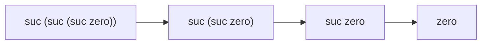

# 03 · 归纳数据类型

> **一句话**：归纳数据类型是一条生成规则——从构造子出发、用有限步造出来的东西才属于这个类型；递归能停，是因为每一步都在消耗一层构造子。

## 一个看起来像循环定义的定义

Agda 里自然数是这样定义的：

```agda
module Chapter03 where

data ℕ : Set where
  zero : ℕ
  suc  : ℕ → ℕ

{-# BUILTIN NATURAL ℕ #-}

data _≡_ {A : Set} (x : A) : A → Set where
  refl : x ≡ x

infix 4 _≡_
```

`{-# BUILTIN NATURAL ℕ #-}` 这一行有两个作用：把 `ℕ` 绑到编译器内置的自然数表示上，以及让 `0`、`1`、`2` 这些数字字面量可用。不写它，`2 * 3` 里的 `2` 会是一个未定义的标识符。（旁注：等价于 `suc (suc zero)` 的字面量，和构造子写法是同一个项。）

`_≡_` 是第 02 篇定义过的相等类型，这里再抄一遍，让本章代码可以单独跑通。本章只把 `≡` 当类型用，不做证明；证明技巧在第 06 篇。

第一次看到 `suc : ℕ → ℕ`，大部分人的反应是：这不是循环定义吗？右边用到了正在定义的 `ℕ`。

对照一下 C++。下面这段是编译不过的：

```cpp
struct Nat {          // error: incomplete type
    Nat next;
};
```

原因很具体：`struct` 定义的是内存布局。要算出 `Nat` 占几个字节，得先知道 `Nat` 占几个字节——无解。（写成 `Nat* next` 可以，因为指针大小固定，但那样一个值就只是指向另一个值，不再是包含另一个值。）

Agda 的 `data` 定义的不是布局，而是**值的生成方式**：

- `zero` 是一个 `ℕ`；
- 如果 `n` 已经是 `ℕ`，那么 `suc n` 也是 `ℕ`；
- 除此之外没有别的方式得到 `ℕ`。

第三条是“归纳”这个词的落点。前两条只说了 `ℕ` 对 `zero` 和 `suc` 封闭，会说“所有整数都行”的一大堆集合也满足这两条；第三条排除了它们：`ℕ` 是满足这两条的**最小**集合。所以 `ℕ` 的元素恰好是有限长的链：

`zero`、`suc zero`、`suc (suc zero)`、`suc (suc (suc zero))`……



每一条箭头都是“去掉一层构造子”。这个方向有终点，而反方向没有——这就是为什么你可以对 `ℕ` 做结构递归，却不能“往上爬”。如果允许 `suc` 无限套下去还能算一个值，那这个类型就不再是归纳的，而是余归纳（coinductive）的；那是另一套东西，本站不涉及。

## 自然数不是整数

`ℕ` 和 `int` 是两种东西，这个区别值得单独说：

- 没有位宽，没有溢出。`suc` 永远可以再用一次。
- 没有负数。减法要自己定义，而且在 `0` 处截断（见下文 `_∸_`）。
- 值是符号项，不是机器字。`suc (suc zero)` 和字面量 `2` 是同一个项的不同写法。

代价是性能：`100 + 100` 用 `C-c C-n` 算一下没问题，但一个上万层的 `suc` 链就会让你等到怀疑人生——归一化是真的把 `suc` 一层层展开。加上 `{-# BUILTIN NATURAL ℕ #-}` 之后，编译产物才会用高效的整数表示（转成 GHC 时是真机器整数），但在类型检查阶段，Agda 仍然把这个数当成一串 `suc`。这也说明：归纳定义是给你推理用的视角，不一定是给机器执行用的实现。

## 用构造子写函数

有了构造子，函数就是“把每种构造子的情况分别处理”：

```agda
_+_ : ℕ → ℕ → ℕ
zero  + m = m
suc n + m = suc (n + m)

infixl 6 _+_
```

读法：如果第一个参数是 `zero`，直接返回第二个；如果第一个是 `suc n`，就剥掉这层 `suc`，递归算 `n + m`，再把 `suc` 套回去。

`infixl 6` 和前面的 `infixr` 一样，是在告诉 Agda 这个运算符怎么结合。不写也能用，但只要表达式里出现第二个运算符就会报错——比如 `2 + 3 * 4`，Agda 不知道先算哪个。**运算符的优先级和结合性是声明出来的，不是约定俗成的**，这一点和 Haskell 一致，和 C++ 相反。

布局规则在这里体现得很直接：两条子句都从第 0 列开始；`zero  + m` 里 `zero` 后面的两个空格只是为了让 `+` 对齐，不影响语义。如果两条子句起始列不一致，Agda 会报解析错误，而且错误位置常常指向看起来没问题的第二行。

那为什么是对第一个参数递归，而不是第二个？因为终止检查器需要一个“结构上变小”的参数。下面这个写法同样合法：

```agda
_+′_ : ℕ → ℕ → ℕ
m +′ zero    = m
m +′ suc n   = suc (m +′ n)

infixl 6 _+′_
```

两份定义都停机，但**它们让不同的等式自动成立**。用第一版，`zero + n` 会直接归一化成 `n`，而 `n + zero` 停在原地；用第二版正好相反。第 06 篇要证明 `n + 0 ≡ n` 时需要归纳法，根源就在这里：**你的定义没有让这件事“自动”成立**。

乘法和截断减法（monus）：

```agda
_*_ : ℕ → ℕ → ℕ
zero  * m = zero
suc n * m = m + (n * m)

infixl 7 _*_

_∸_ : ℕ → ℕ → ℕ
zero  ∸ m     = zero
suc n ∸ zero  = suc n
suc n ∸ suc m = n ∸ m

infixl 6 _∸_
```

`_∸_` 值得多看两眼。第三行同时剥掉两边的 `suc`：这正是“两边都减一”。第一行是 `0` 减任何数得 `0`，所以 `1 ∸ 2 = zero` 而不是 `-1`。

对照 C++：`unsigned` 的 `1u - 2u` 会回绕成 `4294967295`。这是一个经典的真实 bug 来源——循环条件 `for (unsigned i = n - 1; i >= 0; --i)` 永远不结束。Agda 的 `_∸_` 用“截断”把这个陷阱明确写成了语义，而不是留给你去踩。

用 `C-c C-n` 试几个：`2 * 3` 得 `6`，`5 ∸ 7` 得 `0`（不是 `-2`）。归一化是逐条子句展开的，你可以盯着结果确认自己写的定义到底表达了什么。

## 递归为什么能停下来

前面说过 `f n = f n` 会被拒绝。拒绝它的是**终止检查器**。它的能力比你想的弱：只是一个语法层面的检查——**每次递归调用，至少有一个参数必须是当前子句模式里某个变量的严格子结构**。它不去证明“这个函数对任何输入都停机”。

按这个标准看几个例子：

```text
f (suc n) = f n          -- 通过：n 是 suc n 的子结构
g n       = g (suc n)    -- 拒绝：参数变大了
h n       = h (n + n)    -- 拒绝：n + n 和 n 没有结构关系
k zero    = zero
k (suc n) = k n          -- 通过
```

多个参数时可以“轮流变小”：允许 `f (suc a) b = f a (suc b)` 这类写法吗？不行，因为第二个参数变大了。但 `f (suc a) b = f a b` 和 `f a (suc b) = f a b` 都能通过，因为各自都有一个参数严格变小、另一个不变。Agda 用的是 size-change 一类的判据，具体细节不必背，“有一个参数在变小，其余不变或变小”就够了。

这个判据是保守的：它会拒绝一些确实停机的函数（比如 Collatz 序列的某个变体），但不会接受一个可能不停机的函数。保守是刻意的——因为 Agda 要用“函数一定会返回值”来支撑证明，任何不确定性都会让整座楼塌掉。

真的需要绕过去时，可以写：

```text
{-# TERMINATING #-}
```

这个 pragma 的含义是“我相信它会停，别查了”。它**放弃这一层保证**，不提供任何证明；写证明时用它，等于在合同里留了一个你自己签字的空白。可以接受，但要清楚代价。

## 列表：同一套套路用在参数化类型上

把“链”换成“分叉”，就得到了列表：

```agda
data List (A : Set) : Set where
  []  : List A
  _∷_ : A → List A → List A

infixr 5 _∷_
```

看 `List (A : Set) : Set` 这里的括号：`A` 是参数（parameter），它对整个类型固定；构造子的返回类型写 `List A`，不需要重复写 `A`。`_∷_` 读作 “cons”，`x ∷ xs` 就是“一个 `x` 接上 `xs`”。

`infixr 5 _∷_` 这一行在这里尤其重要。漏了它，写 `1 ∷ 2 ∷ []` 会得到：

```text
error: [NoParseForApplication]
Could not parse the application 1 ∷ 2 ∷ []
```

原因还是那个默认设定：`∷` 默认是“优先级 20、不结合”，`a ∷ b ∷ c` 这种连写没有唯一解析。声明成右结合之后，`1 ∷ 2 ∷ []` 才等于 `1 ∷ (2 ∷ [])`。这个报错信息里完全没提“fixity”这个词，所以新手很难自己定位。

`[]` 和 `_∷_` 都是构造子，一个不带参数，一个带两个。于是：

```agda
length : {A : Set} → List A → ℕ
length []       = zero
length (x ∷ xs) = suc (length xs)

map : {A B : Set} → (A → B) → List A → List B
map f []       = []
map f (x ∷ xs) = f x ∷ map f xs

foldr : {A B : Set} → (A → B → B) → B → List A → B
foldr f z []       = z
foldr f z (x ∷ xs) = f x (foldr f z xs)

_++_ : {A : Set} → List A → List A → List A
[]       ++ ys = ys
(x ∷ xs) ++ ys = x ∷ (xs ++ ys)

infixr 5 _++_
```

四个函数的形状完全一样：每个构造子对应一条子句。`[]` 是递归的底，`_∷_` 是递归的步。你只要问自己两个问题——“空列表怎么处理”“有一个头和一条尾巴怎么处理”——定义就写完了。

`{A : Set}` 是隐式参数：写 `length (1 ∷ [])` 时不用写 `{A = ℕ}`，Agda 从 `1 : ℕ` 推出来。`{A B : Set}` 里的 `B` 只在 `map` 的结果类型里出现，同样靠推断。如果你想显式给，写 `map {A = ℕ} {B = ℕ} ...`。

`_++_` 的第一个子句 `[] ++ ys = ys` 值得停一下：左边的 `[]` 是哪个 `List A`？Agda 从声明的类型 `List A → List A → List A` 知道第一个参数的类型是 `List A`，所以这个 `[]` 就是 `List A` 的 `[]`，`A` 被隐式地约束住了。这就是为什么隐式参数不需要在每个子句里重复出现。

## 模式匹配不完备会怎样

删掉 `length` 的第二条子句试试：

```text
Incomplete pattern matching for length. Missing cases:
  length (x ∷ xs)
```

大意是“你漏了非空列表的情况”。这是编译错误，不是警告。

这条规则的价值在于它把一类 bug 从运行时挪到了类型检查时。C++ 里对着 `enum class` 写 `switch` 漏一个分支，编译器最多给你一个 `-Wswitch` 警告（而且默认常常是关的），运行到那个分支就是未定义行为或者 `std::abort`。Agda 里根本不会生成这样的程序。

写的时候不需要自己数分支：把 `length xs = {! !}` 留个洞，`C-c C-c` 输入 `xs`，Agda 就按 `List` 的构造子把两条子句都生成出来。`C-c C-c` 读的是类型定义，不是你的猜测——这是它比“手动补 switch”可靠的地方。

::: warning 覆盖性检查依赖构造子的穷尽性
`data` 的“除此之外没有别的方式”这句话，不只是哲学。覆盖性检查器正是靠它来判断“这些分支够不够”。如果类型是开放的（比如面向对象里的基类可以被任意子类扩展），这个检查就没法做——这也是为什么 Agda 的类型都必须是封闭的 `data` / `record`。
:::

## 归纳定义可以嵌套

构造子可以带多个参数，也可以引用别的归纳类型：

```agda
data Maybe (A : Set) : Set where
  nothing : Maybe A
  just    : A → Maybe A

data Tree (A : Set) : Set where
  leaf : Tree A
  node : Tree A → A → Tree A → Tree A
```

`Tree` 的 `node` 有两个 `Tree A` 参数，所以它是二叉树而不是链。递归函数照样写：

```agda
size : {A : Set} → Tree A → ℕ
size leaf         = suc zero
size (node l _ r) = size l + size r
```

这里的递归调用有两个：`size l` 和 `size r`，它们都是 `node l _ r` 的严格子结构，所以终止检查通过。如果你想写 `depth`（最长路径），会发现需要 `max`，而 `max` 又需要比较——这些都不难，但已经超出了本章范围，留给你自己试。

::: details 构造子还能写得更野吗
有一条例外值得提前知道：构造子不能接受“以这个类型本身为参数”的函数。像 `bad : (Bad → ℕ) → Bad` 这样的定义会被 Agda 以“不满足严格正性（strict positivity）”为由拒绝。原因在逻辑上：允许这种构造子，就能造出类似自指悖论的项，从而证明出 `⊥`（假），整个系统随之失去意义。这条限制是第 07 篇“宇宙与一致性”的前置条件。
:::

`Maybe` 的用处是把“可能失败”写进类型。`List` 的 `head` 返回不了 `A`（空列表没有头），返回 `Maybe A` 就是诚实的做法。第 04 篇会展示另一条路：把“非空”写进类型，让失败的情况根本不存在。

## 人话总结

<div class="human-note">
<strong>如果只记住一件事：</strong><code>data</code> 的每一行都在说“这个类型的一个值是长这样的”。函数就是对每一行写一条子句；递归能不能停，取决于你是不是在处理“更小的一块”。你不需要证明自己会停，只需要让参数沿着构造子的方向走。
</div>

## 常见误解

**误解一：`ℕ` 就是无符号整数，只是写法奇怪。**

不是。它没有位宽、不会溢出、没有 `2^64` 这个上限。`suc` 是一个真实的构造子，`suc zero` 和 `1` 是同一个项。把它当整数会低估它的价值（结构归纳），也会低估它的代价（大数运算慢）。

**误解二：能算出结果的递归函数就能通过终止检查。**

终止检查看的是**语法结构**，不是运行结果。`f n = f (n + 1)` 每次调用参数都变大，必然不停，会被拒绝；反过来，下面这种写法也会被拒绝：

```text
pred : ℕ → ℕ
pred zero    = zero
pred (suc n) = n

loop : ℕ → ℕ
loop n = loop (pred n)      -- 拒绝：检查器不会去展开 pred 的定义
```

`pred n` 比 `n` 小，但终止检查器只认“当前子句模式里的变量”，不认“某个函数调用之后的结果”。遇到这种误判，通常应该改写定义（让递归直接作用在构造子上），而不是急着加 pragma。

**误解三：模式匹配就是运行时的 `switch`。**

`switch` 是运行时按值跳转，漏了分支是运行时问题；模式匹配是定义的一部分，完备性在类型检查时验证。而且 Agda 的分支是按构造子穷尽展开的，不是按值比较。

**误解四：`_+_` 只有一种正确写法。**

两种递归位置都合法，但它们让不同的等式自动成立。`zero + n = n` 的定义让 `zero + n` 归一化；`m + zero = m` 的定义让 `m + zero` 归一化。选择哪一种，取决于你希望哪些证明“不用证”。

## 本章小结

- `data` 定义的是“如何生成值”，不是内存布局；`ℕ` 是满足 `zero`/`suc` 封闭性的最小集合，所以每个值都是有限深的链。
- 函数定义 = 对每个构造子写一条子句；`_+_`、`_*_`、`_∸_`、`length`、`map` 都是同一个形状。
- 递归必须沿构造子变小的方向走；终止检查器是保守的语法检查，不是通用停机性判定。
- 覆盖性检查保证所有构造子都被处理，漏分支是编译错误而不是运行时崩溃。
- 定义的选择会决定哪些等式“自动成立”，这直接影响后面证明的难度。

## 练习

1. 用 `C-c C-n` 分别算 `2 * 3`、`5 ∸ 7`、`suc zero ∸ zero`。然后解释：为什么 `zero ∸ m = zero` 一条子句就覆盖了所有以 `zero` 开头的输入？
2. 实现 `replicate : {A : Set} → ℕ → A → List A`，使得 `replicate (suc (suc zero)) zero` 归一化成 `zero ∷ zero ∷ []`。
3. 实现 `take : ℕ → {A : Set} → List A → List A`：取前 n 个，不够就全给。写完后用 `C-c C-n` 验证 `take (suc zero) (1 ∷ 2 ∷ [])`。
4. 写出 `length (xs ++ ys) ≡ length xs + length ys` 的类型签名（只写签名，不写证明）。然后回答：为什么 `refl` 在这里填不上？提示：看看 `xs` 是不是变量，以及 `length (xs ++ ys)` 能不能归一化。

---

下一篇：[04 · 依赖类型](/type-theory/04-dependent-types)
