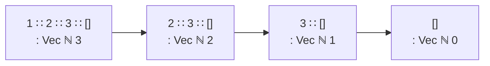

# 04 · 依赖类型

> **一句话**：依赖类型让类型“读得到”值；`Vec A n` 把长度写进类型之后，空列表根本进不了 `head`。

## 一个写不出来的签名

C++ 里取 vector 的第一个元素，你得这么写：

```cpp
template <typename T>
T head(const std::vector<T>& v) {
    if (v.empty()) throw std::logic_error("head of empty vector");
    return v[0];
}
```

这段代码没有类型错误，但它把“可能空”这个问题推给了每一个调用者：要么 `try/catch`，要么写文档，要么加 `assert`，要么干脆不检查然后 UB。问题的根源不在实现，而在签名——`std::vector<T>` 这个类型**没有说**“这里至少有一个元素”。

换到 Agda，你会立刻撞墙：

```text
head : {A : Set} → List A → A
```

这个签名写不出实现。`List A` 包含 `[]`，而 `[]` 里没有任何 `A` 可以返回。你只有三条路：

1. 返回 `Maybe A`（诚实，但每个调用点都要解包）；
2. 加一个默认值（要求 `A` 有一个可用的“空元素”，Agda 里没有这种东西）；
3. 把“非空”写进类型。

前两条你已经在 C++ 里用过了。第三条是本章的主题：这类函数从“可能失败”变成了“不会失败”。

<div class="human-note">
<strong>先把结论说清楚：</strong>依赖类型不增加运行时检查，它改变的是“谁能调用这个函数”。<code>head</code> 不接受空列表，是因为空列表的类型和参数类型对不上，跟运行时挡不挡无关——就像你不能把 <code>int</code> 传给一个要 <code>std::string</code> 的函数一样，这属于编译期。
</div>

## 把长度放进类型

```agda
module Chapter04 where

data ℕ : Set where
  zero : ℕ
  suc  : ℕ → ℕ

{-# BUILTIN NATURAL ℕ #-}

_+_ : ℕ → ℕ → ℕ
zero  + m = m
suc n + m = suc (n + m)

infixl 6 _+_

data Vec (A : Set) : ℕ → Set where
  []  : Vec A zero
  _∷_ : {n : ℕ} → A → Vec A n → Vec A (suc n)

infixr 5 _∷_
```

三行附加声明，各有各的用处：`{-# BUILTIN NATURAL ℕ #-}` 让 `1`、`2`、`3` 这些字面量可用（否则它们只是未定义的标识符）；`infixl 6 _+_` 和 `infixr 5 _∷_` 给出运算符的优先级和结合性，没有后者，`1 ∷ 2 ∷ []` 会直接报 `Could not parse`。`_+_` 在这一章暂时用不到，但下面的 `_++_` 会用到它——长度拼接需要加法。

和上一篇的 `List` 逐字对比，只差在冒号右边：

| | `List` | `Vec` |
| --- | --- | --- |
| 类型 | `List (A : Set) : Set` | `Vec (A : Set) : ℕ → Set` |
| 含义 | 一个类型 | 一族类型，每个 `n` 一个 |
| `[]` 的类型 | `List A` | `Vec A zero` |
| `x ∷ xs` 的类型 | `List A` | `Vec A (suc n)`，其中 `xs : Vec A n` |

`Vec A : ℕ → Set` 是关键：`Vec A` 本身不是类型，它是一个从自然数到类型的函数。`Vec A 3` 才是类型，`Vec A 4` 是另一个类型，二者不相容。

再看构造子的返回类型。`[] : Vec A zero`——空向量的长度就是 `zero`，不是“某个 n”。`_∷_` 的返回类型是 `Vec A (suc n)`，其中 `n` 是尾巴的长度。这意味着类型会随着构造过程自动计算：



每套一层 `_∷_`，长度就加一。这个“加一”在类型检查时由构造子的类型直接决定，运行时并不计算。

## `head` 为什么现在是全函数

```agda
head : ∀ {A n} → Vec A (suc n) → A
head (x ∷ xs) = x
```

只有一条子句。你可能会问：`[]` 的情况呢？

答案在类型里。要匹配 `[]`，它的类型 `Vec A zero` 必须和参数类型 `Vec A (suc n)` 统一，也就是要求 `zero ≡ suc n`。这两个项都是构造子形式，而且首构造子不同，所以不可能统一。覆盖性检查器正是靠这个判断：**`[]` 分支写上去也没有类型。**

于是 `head` 成了**全函数**（total function）：对每一个类型正确的输入，它都返回一个值，不需要异常、不需要 `Maybe`、不需要 `assert`。代价转移到了调用方：

```text
head (1 ∷ [])        -- ✓ 类型是 Vec ℕ 1，可以
head []              -- ✗ 类型是 Vec ℕ 0，不是 Vec ℕ (suc n)
```

第二行不是运行时崩溃，是类型错误。调用方必须先构造出一个长度至少为 1 的向量，才能调用 `head`——而“构造出长度至少为 1 的向量”这件事，本身就已经保证了非空。

::: tip 这就是“把证明放进类型”
`Vec A (suc n)` 这个类型本身就是“这条向量非空”的证据。类型检查器不需要理解“非空”这个词，它只需要知道 `zero` 和 `suc n` 不相等。所有语义都编码在构造子的形状里。
:::

## 让类型自己算长度

`tail`、`map`、`zip`、`replicate` 都能直接写出来，而且不需要任何证明——因为长度信息是跟着构造子走的：

```agda
tail : ∀ {A n} → Vec A (suc n) → Vec A n
tail (_ ∷ xs) = xs

map : ∀ {A B n} → (A → B) → Vec A n → Vec B n
map f []       = []
map f (x ∷ xs) = f x ∷ map f xs

data _×_ (A B : Set) : Set where
  _,_ : A → B → A × B

zip : ∀ {A B n} → Vec A n → Vec B n → Vec (A × B) n
zip []       []       = []
zip (x ∷ xs) (y ∷ ys) = (x , y) ∷ zip xs ys

replicate : ∀ {A} → (n : ℕ) → A → Vec A n
replicate zero    x = []
replicate (suc n) x = x ∷ replicate n x
```

`map` 的类型值得逐字读一遍：输入 `Vec A n`，输出 `Vec B n`，**同一个 `n`**。Agda 怎么知道长度不变？看第二条子句：`f x` 不改变长度，递归调用返回 `Vec B n`（归纳假设），外面套一层 `_∷_` 得到 `Vec B (suc n)`，正好是当前 goal。整个推理只用了构造子的类型，没有用任何引理。

`zip` 更严格：两个向量长度必须相同，否则根本调不了。你在 C++ 里写 `zip`，得自己检查 `min(a.size(), b.size())`，或者接受“截断到较短的那个”这种默认行为。Agda 把“长度相等”变成了调用前的义务。

`replicate` 展示了另一种用法：`n` 是显式参数，返回类型 `Vec A n` 依赖它。`replicate 3 true` 的类型是 `Vec Bool 3`，你可以直接把它传给一个要求 `Vec Bool 3` 的函数。

## `Fin`：把“下标合法”写进类型

长度解决了“不越界”的一半，另一半是下标。`Vec.lookup` 需要一个“小于 n 的数”，而这个东西在 Agda 里也是一个类型：

```agda
data Fin : ℕ → Set where
  fzero : {n : ℕ} → Fin (suc n)
  fsuc  : {n : ℕ} → Fin n → Fin (suc n)
```

`Fin n` 恰好有 `n` 个元素，它们对应 `0` 到 `n-1`：

- `Fin 0` 一个元素都没有（`fzero` 要求 `suc n`，`fsuc` 也要求 `suc n`）；
- `Fin 1` 只有 `fzero {n = 0}`；
- `Fin 3` 有三个：`fzero {n = 2}`、`fsuc (fzero {n = 1})`、`fsuc (fsuc (fzero {n = 0}))`。

::: info 为什么这里叫 fzero / fsuc
标准库里它们叫 `Fin.zero` 和 `Fin.suc`——因为它们在 `Data.Fin` 模块里，有命名空间，不会和 `ℕ` 的构造子冲突。本章为了自包含，把 `ℕ` 和 `Fin` 放在同一个模块里，而 Agda 不允许同一模块内出现重名定义，所以改名为 `fzero` / `fsuc`。名字不重要，形状才重要。
:::

有了它，`lookup` 就是全函数：

```agda
lookup : ∀ {A n} → Vec A n → Fin n → A
lookup (x ∷ xs) fzero    = x
lookup (x ∷ xs) (fsuc i) = lookup xs i
```

两条子句，覆盖了 `Fin n` 的两个构造子。`[]` 加 `Fin zero` 这一格不可能出现——`Fin zero` 没有值。你没法在运行时“检查下标越界”，因为越界的下标根本构造不出来：要构造 `Fin 3` 里的值，你只能数三步；数到第四步，类型就变成了 `Fin 4`。

对比 C++：`v[i]` 的 `i` 是 `size_t`，任何值都能传进去；`v.at(i)` 会在运行时抛 `std::out_of_range`。`Vec` + `Fin` 把这件事整个搬到了类型检查时。

把这一招再推一步，就得到依赖对（dependent pair，记作 Σ 类型）：`Σ (n : ℕ) → Vec A n` 读作“存在某个长度 `n`，以及一条长度为 `n` 的向量”。它相当于“带证据的存在量词”，标准库在 `Data.Product` 里。本章不展开，你只要知道 `Vec` 只是依赖类型最常用的一个例子，不是唯一形态。

## 与 C++ 对照

| C++ | Agda | 长度/下标信息在哪 |
| --- | --- | --- |
| `std::array<T, N>` | `Vec T N` | 类型里（`N` 是常量） |
| `std::vector<T>` | `List T` | 运行时 |
| `std::span<T>`（动态 extent） | 无直接对应 | 运行时视图 |
| `v[i]` | `lookup v i` | 需要 `Fin n` |
| `v.at(i)` | 无对应（不需要） | 运行时抛异常 |

`std::array<T, N>` 已经证明了“把长度放进类型”是可行的，甚至在高性能代码里很常见。但它有一个限制：`N` 必须是编译期常量表达式。Agda 的 `n` 虽然也是静态的，却可以是一个变量——你可以写一个对任意 `n` 都成立的 `map`，让类型检查器逐构造子跟踪 `n` 怎么变化。C++ 模板做不到这件事：模板参数是常量，而 Agda 的类型可以依赖一个“符号化的自然数”。

`std::span` 是另一个方向：它是运行时的视图，长度存在对象里，`span<T, 3>` 这种静态 extent 版本才有编译期长度，而且和 `Vec` 不同，它不拥有数据。

## 边界在哪：一次校验，之后全信类型

工程上更现实的用法，是把不可信输入都收进一个边界函数，在那里转换成带索引的类型。标准库里的 `Vec.fromList` 就是这个角色：

```text
fromList : (xs : List A) → Vec A (length xs)
```

注意它不需要 `Maybe`——长度不是猜的，是从 `xs` 算出来的，类型里写的正是这个算式。之后所有下游函数都可以拿 `Vec` 工作，不再做边界检查；要回到普通列表时用 `toList`，长度信息在这里被丢掉。

这个模式在 C++ 里叫 parse, don't validate：与其到处传 `std::vector` 并在每个函数里反复检查 `size()`，不如在入口构造一个“已经检查过”的表示。区别在于，C++ 里这个“已经检查过”靠约定和代码审查维持，Agda 里靠类型检查维持——类型不匹配的调用根本编译不过。

## 代价

说到这里，很容易产生“那所有容器都该用 Vec”的冲动。先看账单：

类型会变复杂。拼接两个向量的签名是：

```agda
_++_ : ∀ {A m n} → Vec A m → Vec A n → Vec A (m + n)
-- 只给签名：实现留给你，提示见本章练习
```

这个签名本身没问题，但一旦你的函数需要 `Vec A (n + m)` 而手上是 `Vec A (m + n)`，你就得先证明加法交换律，再用 `subst` 或 `rewrite` 把类型搬过去。这类“类型体操”在依赖类型编程里是日常，不是意外。

证明负担会蔓延。一个 `Vec` 版本的 `reverse` 要证明长度不变，`reverse (reverse xs) ≡ xs` 要归纳。每加一层抽象，就多一批引理。这些引理本身有价值（它们本身就是定理），但你得愿意写。

编译期更忙。类型检查要归一化类型里的项，`Vec A (f n)` 这种类型会逼 Agda 展开 `f`。项越大，检查越慢，错误信息也越长。

错误信息更难读。一个类型不匹配可能报出两屏 `Vec` 展开。这是实打实的成本。

所以合理的用法是：**在边界处用，不要在所有地方用**。协议解析、序列化格式、索引运算、状态机——这些地方的不变量值得写进类型；内部的业务逻辑用普通 `List` 更省事。这也是第 08 篇要讲的“把结论带回日常语言”。

::: warning 依赖类型不是运行时检查
`Vec` 的索引在编译后会被擦除（erasure）：运行时它就是一条链表，没有任何长度字段，也没有边界检查。它的保证全部来自类型检查——这也意味着，如果你用 `{-# COMPILE #-}` 之类的手段绕过了类型检查（或者用 `unsafeCoerce` 等价物），保证就不存在了。
:::

## 人话总结

<div class="human-note">
<strong>如果只记住一件事：</strong><code>Vec A n</code> 和 <code>List A</code> 的数据结构一样，差别在<strong>类型说了多少话</strong>。<code>head</code> 不需要处理空列表，是因为空列表进不了这个函数；<code>lookup</code> 不需要检查越界，是因为越界的下标造不出来。你付出的代价，是每次长度对不上时都要写证明。
</div>

## 常见误解

**误解一：依赖类型 = 运行时检查，只是写法更花哨。**

恰好相反。Agda 没有“运行时检查”这回事，`Vec` 的索引在编译后消失。`std::span` 的 `extent` 是运行时数据，`Vec` 的 `n` 是类型的一部分——两者长得像，机制完全不同。

**误解二：`Vec` 比 `List` 安全，所以总该用 `Vec`。**

安全性是有价格的：类型更复杂、证明更多、编译更慢、报错更难读。在长度无关紧要的地方（比如日志行缓冲区），`Vec` 只会让你多写一堆 `subst`。工程判断要回答的是：这条不变量值不值得写成类型。

**误解三：`head` 不返回 `Maybe`，说明 Agda 不考虑空列表。**

它考虑得比 `Maybe` 更彻底：`Maybe` 是“运行时可能失败，调用方处理”，`Vec A (suc n)` 是“编译期就失败，调用方必须提供证据”。前者把不确定性留在程序里，后者把它变成了前置条件。

**误解四：`Fin n` 就是“小于 n 的整数”，只是换了个名字。**

`Fin n` 是一个恰好有 `n` 个元素的类型，不是带约束的整数。你不能对 `Fin n` 做任意算术——`fsuc` 只能加一，而且要付出“`n` 也加一”的代价。想在 `Fin n` 上做任意加法，你得先证明“加完之后仍然小于 `n`”，那个证明就是函数的新参数。

## 本章小结

- 依赖类型让类型依赖值：`Vec A : ℕ → Set` 是一族类型，不是一个类型。
- 构造子的返回类型决定索引如何计算：`[] : Vec A zero`，`_∷_ : ... → Vec A (suc n)`。
- `head : Vec A (suc n) → A` 是全函数，因为 `Vec A zero` 和 `Vec A (suc n)` 无法统一。
- `Fin n` 把“合法下标”变成类型，`lookup` 因此不需要边界检查；`Fin zero` 是空类型。
- 代价是类型复杂、证明负担和编译时间；`Vec` 适合用在边界处，而不是替换所有 `List`。

## 练习

1. 实现 `Vec` 版本的拼接：

   ```agda
   _++_ : ∀ {A m n} → Vec A m → Vec A n → Vec A (m + n)
   -- 签名如上，两条子句足以写完全部内容
   ```

   提示：`_+_` 已经在上面模块里定义过了。先想清楚第一条子句里 `zero + n` 会归一化成什么，写完用 `C-c C-l` 检查。

2. `zip` 现在的类型要求两个向量等长。如果允许不等长，返回类型应该怎么写？为什么写不出来？（提示：你需要一个 `min`，而且 `min` 的结果不会自动和两个输入的长度对上。）

3. 解释这句话：“`lookup` 没有边界检查，但它不可能越界。”分别从类型检查时和运行时两个角度回答。

4. 试试写 `head′ : ∀ {A n} → Vec A n → Maybe A`（`Maybe` 只需三行，参见第 03 篇）。它和 `head` 的区别是什么？在什么情况下你仍然需要这个版本？

---

上一篇：[03 · 归纳数据类型](/type-theory/03-inductive-types) · 下一篇：[05 · 命题即类型](/type-theory/05-propositions-as-types)
