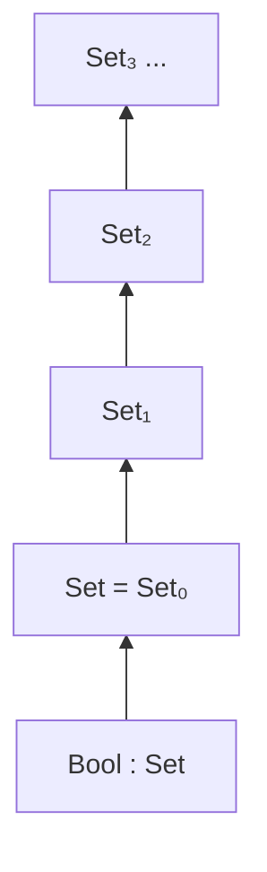

# 07 · 宇宙与一致性

> **一句话**：`Set` 是“小类型的类型”，它自己住在 `Set₁` 里，`Set₁` 住在 `Set₂` 里；这条没有尽头的阶梯不是洁癖，而是让系统保持不自相矛盾的必要代价。

## 一个理所当然的问题，一问就出事

你已经在很多代码里写过 `Set` 了：

```agda
module Chapter07 where

data Bool : Set where
  true  : Bool
  false : Bool
```

`Bool : Set` 读作“`Bool` 是一个类型”，或者更准确地说，“`Bool` 是一个**小类型**”。于是很自然地会问：`Set` 自己的类型是什么？

```agda
-- 试着写下这一行
bad : Set
bad = Set
```

Agda 会拒绝，报错大意是 `Set₁ != Set`。这个报错有点莫名其妙：明明所有类型都在 `Set` 里，`Set` 自己怎么就不在？

正确的写法是：

```agda
Set-is-a-type : Set₁
Set-is-a-type = Set
```

也就是说：`Set : Set₁`。多出来的下标 `₁` 就是答案：`Set` 只是这一层，不是“所有类型的集合”。上面还有一层，上面还有一层，一直往上。

## 为什么不能 `Set : Set`

这是数学上的一条硬边界，和 Agda 小不小气无关。要理解它，先看一个更古老的版本。

### 罗素悖论：一句话版本

设 `R` 是“所有不包含自己的集合”组成的集合。那么问：`R` 包含自己吗？

- 如果 `R ∈ R`，按定义 `R` 不包含自己，矛盾；
- 如果 `R ∉ R`，那它满足“不包含自己”，所以 `R ∈ R`，还是矛盾。

两边都通向矛盾，所以 `R` 不能存在。坏掉的是“允许一个集合包含所有集合”这条规则，集合论本身没有问题。

### 类型论里的同一个陷阱

在类型论里，“属于”写成 `:`。所以“一个类型包含所有类型”就是 `Set : Set`，而“一个类型属于自己”就是 `X : X`。允许 `Set : Set`，就等于允许了 `X : X` 这种自指。

Girard 在 1972 年发现，这个自指可以被精确地翻译成类型论里的矛盾：只要 `Set : Set`，你就能写出一个类型完全正确的项，而这个项**可以证明 `⊥`**。后来 Hurkens 在 1995 年给出了一个更短的构造，短到可以在 Agda 里完整写出来——只要你打开 `--type-in-type`。

::: warning `--type-in-type` 不是一个“省事开关”
这个编译选项会关掉宇宙层级检查，让 `Set : Set` 通过。代价是：系统不再一致（inconsistent）。你可以在里面证出 `⊥`，进而证出任何命题——包括“1 = 2”和“所有程序都会停机”。一个能证明一切的逻辑等于什么都没证明。永远不要为了绕过 `Set₁ != Set` 而打开它。
:::

更要紧的是，这个矛盾可以直接构造出来——`⊥` 的证明是一个能写下的项，不是“理论上可能存在”。这就是为什么类型论宁可在语法上加一条烦人的规则，也不肯放松这一点。

## 阶梯：`Set`、`Set₁`、`Set₂`……

宇宙（universe）就是“类型的类型”的层级。Agda 里的写法是：

```text
Bool  : Set        -- Bool 是一个小类型
Set   : Set₁       -- Set 是 Set₁ 的一个元素
Set₁  : Set₂       -- Set₁ 是 Set₂ 的一个元素
Set₂  : Set₃
...
```



方向从下往上是“住在里面”：`Bool` 住在 `Set` 里，`Set` 住在 `Set₁` 里，依此类推。这条阶梯没有顶端——至少没有一个“包含所有东西的顶端”，因为那正是我们要避免的。

这样问题就消失了：`Set : Set₁` 不是自指，`Set` 只是住在下一层，而“下一层”永远存在。罗素悖论需要的那句“包含所有集合的集合”在语法上就没法写出来了。

### 累积性：一条可以被打开、但默认关着的规则

有些类型论系统（以及某些配置下的 Agda）还有一条额外规则，叫**累积性**（cumulativity）：如果一个类型住在第 `ℓ` 层，那么它也住在任何更高的层。也就是说 `Set : Set₁` 成立之后，`Set : Set₂` 也跟着成立——变的只是断言的强度：说“住在更高层”是一个更弱的要求，并不是 `Set` 本身变大了。

但在 Agda 里这条规则**默认是关的**。默认设置下，每个 `Set ℓ` 只有一个类型：`Set (suc ℓ)`。所以下面第一个能过，第二个会被拒绝：

```agda
ok₁ : Set₁
ok₁ = Set          -- ✓

-- ok₂ : Set₂
-- ok₂ = Set       -- ✗ 报错：Set₁ != Set₂（UnequalSorts）
```

打开 `--cumulativity` 之后，被注释的那两行也能通过。这条规则有用，因为它让“住在高层”变成一个可以自由松口的事情；但它不是必须的，关掉它反而让每条判断只有唯一答案，报错更容易读。

::: tip 一个常见的说法，但它是错的
很多教程会顺口说“`Set` 也在 `Set₂` 里”。在默认的 Agda 里这句话是错的，而且它掩盖了一个更重要的事实：**`Set` 的类型就是 `Set₁`，不多不少。** 想验证的话，把 `ok₂` 那两行取消注释，看看编译器怎么回答你。
:::

## `Setω`：那个你会读到但不用写的层级

宇宙多态（下一节）会带来一个技术问题：一个“对所有层级都成立”的定义，它自己的类型是什么？

举一个最小的例子。恒等函数可以写成宇宙多态的：

```agda
-- 需要 open import Level using (Level)；这里只示意类型长什么样
id : {ℓ : Level} (A : Set ℓ) → A → A
id A x = x
```

这个定义对任意 `ℓ` 都成立，所以它不属于任何一个固定的 `Set ℓ`——因为 `ℓ` 是它的参数，不是它的常量。Agda 会把它放进一个不在 `Set₀, Set₁, Set₂, ...` 序列里的特殊位置，也就是 `Setω`（读作“Set omega”）。

要点有三条：

1. `Setω` 是 Agda 用来给宇宙多态定义分类的**超宇宙**（super universe），它不在 `Set₀, Set₁, Set₂, ...` 这条序列里。
2. `Setω : Setω` 同样被禁止。如果允许，你就在更高处重新造出了同一个自指问题，前面所有努力白费。
3. 你几乎不会主动写 `Setω`。它出现在错误信息里，作用是告诉你“这个定义的层级太高了，没法塞进你要的那个位置”。

在实践中，看到 `Setω` 通常意味着两件事之一：你在定义一个需要“自己的宇宙”的抽象（比如一个内部含类型解释器的小语言），或者你在错误的地方要求了一个具体的 `Set ℓ`。

## 宇宙多态：一份代码，任意层级

先看没有宇宙多态时的麻烦。最朴素的列表定义把元素类型固定在小类型上：

```agda
data List (A : Set) : Set where
  []  : List A
  _∷_ : A → List A → List A

infixr 5 _∷_
```

这段代码能用，但它有个隐含限制：`A` 必须住在 `Set` 里。如果你想做一个“装类型的列表”——比如一个小型解释器要维护类型环境——`A` 就是 `Set` 本身，而 `Set` 住在 `Set₁`，于是 `List Set` 通不过检查。

一种糟糕的解法是复制一份：

```text
data List₁ (A : Set₁) : Set₁ where ...
data List₂ (A : Set₂) : Set₂ where ...
```

每升高一层就复制一遍，再升高一层再复制一遍。这种代码没法维护，根源是列表本身不关心元素有多大。

宇宙多态把层级变成一个参数：

```text
-- 标准库 Data.List.Base 的形状（示意）
data List {a} (A : Set a) : Set a where
  []  : List A
  _∷_ : A → List A → List A
```

现在 `List` 对任意层级都成立，`List Set`、`List (Set → Set)` 都能用同一份定义。标准库里的 `Level` 模块提供了这套工具：

- `Level` 是层级的类型，`Level : Set`，它的元素写作 `ℓ`、`a`、`b`；
- `zero`、`suc`、`_⊔_`（取上界）用来拼层级表达式；
- `Set ℓ` 是“第 `ℓ` 层的类型”；
- `Lift` 把一个低层级的类型“抬”到更高层，让它可以被用在要求更高层级的位置上。

`Lift` 本身是标准库里一个很短的 `record`，作用只有一个：`Lift {a} {ℓ} (A : Set a) : Set (a ⊔ ℓ)`。当你有一个 `Set` 里的类型，而某个接口要求 `Set₁` 里的类型时，`Lift` 就是那座桥。它没有运行时内容——抬升只发生在类型层面。

层级不会进入运行时：宇宙参数在编译期就被消解掉了，`Set ℓ` 没有内存表示，`Lift` 也没有额外开销。宇宙多态是为了让类型检查通过，不是为了让你在运行时多付钱。

## 什么时候你真的会碰到 `Set₁`

一个很具体的场景：写一个小型解释器，你需要一个“装类型的环境”，也就是类型列表。第一反应是：

```agda
-- 想这么写
Env : Set
Env = List Set
```

这一行过不去，卡在 `Set` 上：`List` 的元素类型参数是 `(A : Set)`，要求 `A` 住在 `Set` 里；而 `Set : Set₁`，它不住在 `Set` 里。所以 `List Set` 这一步就卡住了。

出路有两条。一是用宇宙多态的 `List`，于是 `List Set : Set₁`，你的 `Env` 也住在 `Set₁`；二是承认“类型环境是另一个层级的东西”，把它单独定义成 `Set₁` 里的一族。两条路的共同点是：`Set` 塞不进一个“元素必须是 `Set` 的元素”的容器。这是宇宙层级在正常工作，别把它当麻烦。

类似的情形还有：写一个把语法树编译成类型的函数（`typeOf` 的返回值是 `Set`）、写一个泛型的解析器组合子库、写一个证明搜索器。它们的共同特征是代码里出现了“类型”这个值。只要你在代码里谈论类型而不是只使用类型，就会撞上 `Set₁`。

## 实践建议

绝大多数写 Agda 的人，百分之九十的时间都待在 `Set` 里。下面是几条能省时间的经验：

- 看到 `Set₁` 不要慌。它几乎总是意味着“你正在把类型当成值来用”：写解释器、写类型检查器、写泛型容器、写 `Set` 的列表。这是正常的，不是你的代码坏了。
- 业务代码只用 `Set`。如果你在写一个排序算法或一个协议解析器，`Set` 足够，别提前引入 `Level`。
- 写库的时候才考虑宇宙多态。一个会被别人在任意层级使用的数据结构（`List`、`Maybe`、`⊤`）才值得加 `{ℓ : Level}` 参数。加了之后类型签名会变长，这是真实的成本。
- 不要用 `--type-in-type` 换便利。如果你的目标是证明而不是原型，它摧毁的正是你想得到的东西。
- 报错里的 `Setω` 通常是结构问题。它往往说明某个定义被要求同时“对所有层级成立”又“属于某个具体层级”，这两件事不能同时满足。

<div class="human-note">
<strong>一个类比，以及它的边界：</strong>宇宙层级像楼层。`Bool` 是二楼的一个房间，`Set` 是三楼，`Set₁` 是四楼。每个东西只属于它自己那一层的“户口”，除非你打开累积性（相当于允许“住在三楼的东西也算住在四楼”）。类比到此为止：楼层有顶，宇宙没有；而且“上一层”不是物理空间，只是语法上的一个下标。
</div>

## 常见误解

**误解一：`Set` 是所有类型的集合。**

不是。`Set` 是“小类型”的层级。`Set` 自己不是它的元素，`Set₁` 里的类型也不是它的元素。如果你需要一个“能装下 `Set` 的类型”，那个类型住在 `Set₁`，不是 `Set`。

**误解二：`Set₁` 是一个“更大的集合”。**

“更大”这个词在这里会误导人。`Set₁` 不是把 `Set` 的元素加更多东西凑出来的超大集合，它是下一个层级：它的元素是“住在第 1 层的类型”，其中恰好包括 `Set`。用“集合的大小”去想它会让你在遇到累积性时彻底糊涂。

**误解三：宇宙层级会让程序变慢。**

不会。层级完全在编译期处理，运行时没有 `Set` 这个东西。唯一能感知到的成本是编译时间和类型签名的长度。

**误解四：`--type-in-type` 只是关掉一个过度严格的检查。**

它关掉的是**一致性**。打开之后，你依然能写程序、依然能通过类型检查，但你证出来的每一个定理都不再可信——因为系统能证明 `⊥`，而从一个矛盾可以推出任何命题。这就像把烟雾报警器拆了来证明家里没着火。

## 本章小结

- `Bool : Set`，`Set : Set₁`，`Set₁ : Set₂`；每一步都是“住在下一层”，不是自指。
- `Set : Set` 会导致 Girard 悖论，在 Agda 里表现为可以用 `--type-in-type` 证出 `⊥`，系统因此不一致。
- 累积性是可选的（`--cumulativity`）：打开后 `Set : Set₂` 也成立；默认关着，`Set` 的类型就是 `Set₁`。
- `Setω` 是给宇宙多态定义用的超宇宙，它不在 `Set₀, Set₁, ...` 序列里，也不能自指。
- 宇宙多态让一份定义适用于任意层级；日常代码用 `Set` 就够，写库时再引入 `Level`。

## 练习

1. 判断下面三个判断哪些在默认设置的 Agda 里成立：`Set : Set₁`、`Set₁ : Set₂`、`Set : Set₂`。分别用 `_ : Set₁`、`_ : Set₂` 之类的签名验证，然后再用 `agda --cumulativity` 跑一遍，说明第三次为什么结果不同。
2. 如果把 `data Bool : Set` 改成 `data Bool : Set₁`，`true : Bool` 还有效吗？`(A : Set) → A → A` 还能接收 `Bool` 吗？分别说明理由——这题的关键是分清“`Bool` 是一个类型”和“`Bool` 属于 `Set`”。
3. 用一段话解释为什么 `Setω : Setω` 也必须被禁止。如果允许它，你能在最高层重新构造出什么问题？
4. 假设你要写一个“任何层级都能装的容器”，而 `List : Set → Set` 不够用。写出你会怎么改类型签名，并说明为什么不能简单地把 `Set` 全换成 `Set₁`。

---

下一篇：[08 · 回到日常语言](/type-theory/08-back-to-mainstream)
