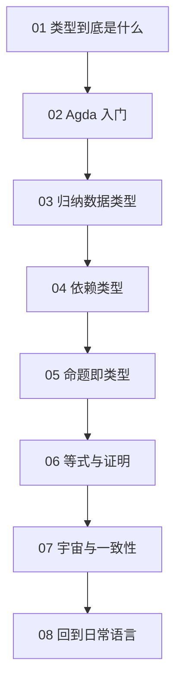

# 类型论 × Agda

> **一句话**：Agda 是一门依赖类型（dependent type）的编程语言，也是一个证明助手。在这里，写程序和写证明是同一件事。

## 为什么用 Agda 讲类型论

大多数语言也有类型系统，但它们通常会“放过”很多问题：

```cpp
// C++ 里这能过编译，但运行到 vec[10] 就是未定义行为
std::vector<int> vec{1, 2, 3};
int x = vec[10];
```

C++ 的类型系统只保证“`vec[10]` 返回 `int&`”，不保证下标真的在范围内。Agda 可以把这个保证写进类型里：长度为 3 的向量，只能取下标 0、1、2。换句话说，类型不仅能描述“是什么形状”，还能描述“满足什么条件”。

这带出一个视角转换：

| 日常语言 | Agda / 类型论 |
| --- | --- |
| 类型是变量的“种类” | 类型是值与值之间的承诺 |
| 函数签名描述输入输出 | 函数类型是一份规格说明 |
| 测试覆盖部分情况 | 证明覆盖所有情况 |
| 断言 `assert(x > 0)` | 类型本身要求 `x > 0` |

## 你会学到什么

这条路线不追求把类型论讲全，只挑五个能改变你写代码方式的概念：

1. **类型与项**：为什么 `true` 和 `false` 都属于 `Bool`，而 `true : Bool` 是一个判断（judgment）。
2. **归纳数据类型**：`Nat`、`List`、`Vec` 是怎么“定义出来”的，为什么模式匹配必须覆盖所有构造子。
3. **依赖类型**：让类型依赖具体的值，例如 `Vec A n` 表示“长度为 `n` 的列表”。
4. **命题即类型（Curry–Howard）**：`A → B` 既是函数类型，也是“A 蕴含 B”；证明就是构造出对应类型的程序。
5. **相等与归纳**：`refl` 为什么能证明 `1 + 1 ≡ 2`，又为什么不能直接证明 `n + 0 ≡ n`。

## 学习地图



## 章节

<div class="chapter-grid">
  <a class="chapter-card" href="/type-theory/01-what-is-a-type">
    <span class="no">01</span><span class="t">类型到底是什么</span>
    <span class="d">从“类型是集合”讲到“类型是命题”，建立整条路线的直觉。</span>
  </a>
  <a class="chapter-card" href="/type-theory/02-agda-basics">
    <span class="no">02</span><span class="t">Agda 入门</span>
    <span class="d">模块、声明、模式匹配、交互式证明，以及那些让你少走弯路的小技巧。</span>
  </a>
  <a class="chapter-card" href="/type-theory/03-inductive-types">
    <span class="no">03</span><span class="t">归纳数据类型</span>
    <span class="d">用构造子定义自然数与列表，理解“递归定义”和“结构归纳”。</span>
  </a>
  <a class="chapter-card" href="/type-theory/04-dependent-types">
    <span class="no">04</span><span class="t">依赖类型</span>
    <span class="d">从 List 到 Vec：让长度进入类型，体验“下标越界”在编译期被排除。</span>
  </a>
  <a class="chapter-card" href="/type-theory/05-propositions-as-types">
    <span class="no">05</span><span class="t">命题即类型</span>
    <span class="d">把 ∧、∨、→、⊥ 翻译成数据类型，理解证明与程序的一一对应。</span>
  </a>
  <a class="chapter-card" href="/type-theory/06-equality-and-proofs">
    <span class="no">06</span><span class="t">等式与证明</span>
    <span class="d">同一性类型、refl、cong、归纳法，以及为什么加法交换律要证明。</span>
  </a>
  <a class="chapter-card" href="/type-theory/07-universes">
    <span class="no">07</span><span class="t">宇宙与一致性</span>
    <span class="d">Set、Set₁、Setω：为什么“所有类型的类型”不能也是自己。</span>
  </a>
  <a class="chapter-card" href="/type-theory/08-back-to-mainstream">
    <span class="no">08</span><span class="t">回到日常语言</span>
    <span class="d">把 Agda 的视角带回 TypeScript、Rust、Haskell、C++ 和 Python。</span>
  </a>
</div>

## 环境准备

阅读本身不需要安装任何东西。如果你想动手改代码，有三条路：

- 零安装：用 [Agda Pad](https://agdapad.quasicoherent.io/) 在浏览器里直接写、直接加载，适合跟读和试错。
- 本地安装：Agda 2.6.3+（推荐 2.8.x），标准库可选；不想装标准库也能跟读本站示例。
- 编辑器：Emacs 的 `agda2-mode` 官方支持最好；Neovim 可用 `Cornelis`，Vim 可用 `agda-vim`。VS Code 不是必需品。

具体步骤在 [02 · Agda 入门](/type-theory/02-agda-basics) 里。

::: tip 不要怕报错
Agda 的报错信息通常很长，但它是逐条告诉你“在当前目标下，这个表达式应该是什么类型”。学会读 goal 和 context，比背语法重要得多。
:::

## 这条路线不做什么

- 不追求形式化元理论（soundness、normalization 的证明）。
- 不覆盖 cubical Agda、homotopy type theory 等进阶方向。
- 不把 Agda 当成工程语言来教。它是**显微镜**，不是生产工具。
